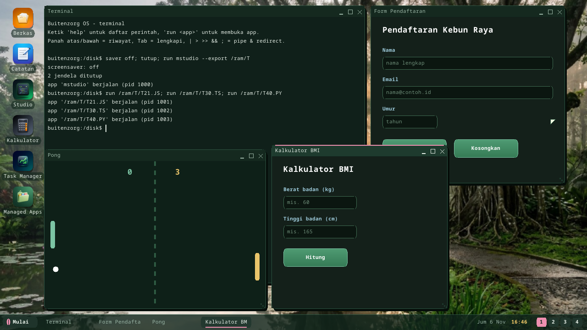
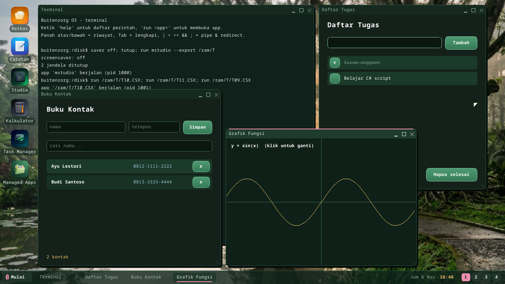
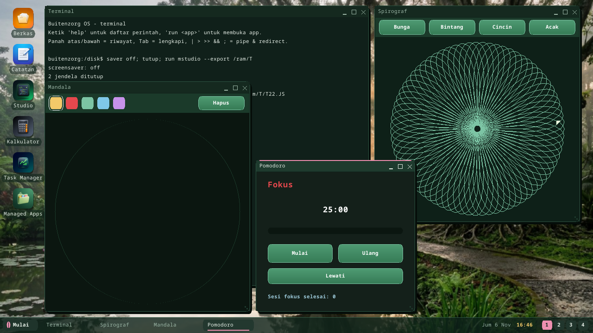
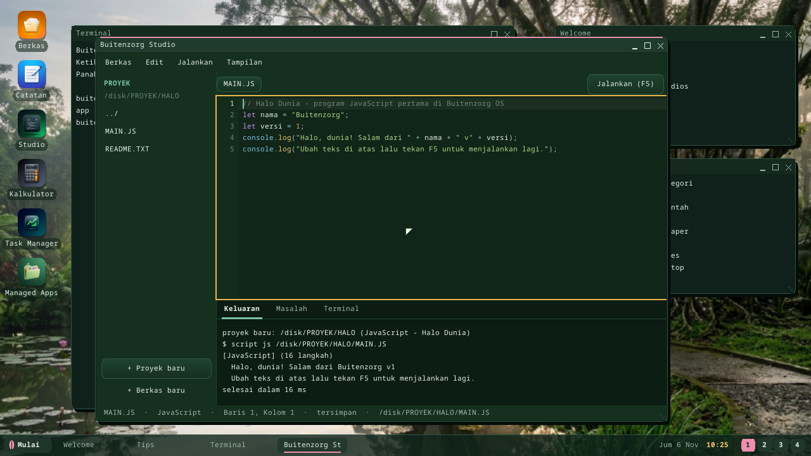

# Dokumentasi

Indeks dokumentasi lengkap **Buitenzorg OS**. Dokumen tersedia dalam **English**
dan **Bahasa Indonesia**; spec teknis dan tracker perencanaan di root repo dalam
**Bahasa Indonesia** (ditandai *ID* di bawah).

[English](README.md) · **Bahasa Indonesia** · ← Kembali ke [README proyek](../README.id.md).

## Mulai di sini

| Dokumen | Isi |
|---|---|
| [**Tutorial**](tutorial.id.md) | Panduan berurutan nol→app: build → keliling desktop → shell → bikin app → debug/profil → keluar QEMU. **Baca ini dulu.** |
| [Getting Started](getting-started.id.md) | Prasyarat, quickstart satu perintah, alur harian, dan troubleshooting. |
| [App Pertama](first-app.id.md) | Dua cara membuat app (SDK & native), katalog library bawaan, dan aturan zerolib yang wajib diketahui tiap penulis app. |

## Jalankan & pasang

| Dokumen | Isi |
|---|---|
| [Jalankan di VM](run-in-vm.id.md) | Konversi image lalu jalankan di VMware Player, VirtualBox, atau Hyper-V. |
| [Pasang di Hardware](install-hardware.id.md) | Tulis image ke stik USB dan boot mesin fisik (BIOS/UEFI), dengan tabel kompatibilitas yang jujur. |
| [Buitenzorg Studio](studio.id.md) | IDE di dalam OS: proyek dari 52 template, editor kode, Jalankan (F5), Keluaran, Masalah, Terminal. |
| [C# Script (`.csx`)](csharp-script.id.md) | C# tanpa build: engine bytecode untuk C# tingkat atas, konsol dan UI (`Ui.Window`), 16x lebih cepat dari interpreter pohon. |
| [Aplikasi UI JS/TS/Python](script-ui.id.md) | Aplikasi berjendela tanpa C#: `window`, `button`, `text`, ... gaya immediate mode, berjalan sebagai proses sendiri. |
| [Shell & Skrip](shell.id.md) | Edit baris, pipe/redirect, variabel, coreutils, alias, skrip `.SH` dengan if/for/while, profil saat mulai. |
| [bz-link: perangkat yang berjalan dari PC](bz-link.id.md) | `bz deploy` app atau skrip ke OS yang sedang berjalan (tanpa build ulang image), `bz run`/`shell`/`push`/`pull`/`logs` lewat jaringan. |
| [Paket (`.bzpkg`)](packages.id.md) | `bz pack` di host, `bz install/remove` di perangkat, format dan aturan keamanannya. |
| [Internet dan peramban web](internet.id.md) | Peramban (HTTP/HTTPS), `nslookup`, dan `Buitenzorg.Net` (DNS, TCP, TLS, HttpClient) untuk program. |
| [Suara dan media](media.id.md) | Musik dan Gambar, mixer kernel (stream per program, volume per aplikasi), WAV, MediaPlayer dan gambar PNG/JPEG/GIF untuk program. |
| [Game dan Buitenzorg.Game](games.id.md) | Ular, Ranjau, Bata, Balok, Kartu, dan framework game 2D (loop fixed-timestep, event tombol mentah, partikel, skor tertinggi). |
| [Debugging & Profiling](debugging.id.md) | Attach GDB ke kernel yang berjalan, dan profiler zona berbasis TSC. |

## Tangkapan layar: aplikasi skrip

| | |
|---|---|
|  |  |
| Form pendaftaran, Pong, kalkulator BMI ([Aplikasi UI JS/TS/Python](script-ui.id.md)) | Buku kontak, daftar tugas, grafik ([C# script](csharp-script.id.md)) |
|  |  |
| Spirograf, mandala, Pomodoro ([template Studio](studio.id.md)) | [Buitenzorg Studio](studio.id.md) |

## Referensi teknis

| Dokumen | Isi |
|---|---|
| [Syscall ABI](abi.id.md) | Tabel syscall v1, struct lintas-batas, model keamanan pointer, dan aturan evolusi. |
| [C# di Ring 3](csharp-userland.id.md) | Cara C# berjalan di user-space: pipeline bflat, ELF loader, dan shim `bzstart`. |
| [App Framework](app-framework.id.md) | Model aplikasi, manifest, SDK, dan window syscall. |
| [System Services](system-services.id.md) | VFS, service/init manager, async I/O, dan jaringan. |
| [Desktop Environment](desktop-environment.id.md) | Compositor, window manager, tema, workspace, dan shell. |
| [Graphics & Window System](window-system.id.md) | Stack rendering dan manajemen window. |
| [Subsistem AI & Power](ai-power.id.md) | Subsistem LLM / CV / GenAI lokal, Model Manager, dan power management. |

## Perencanaan & riwayat (root repo)

| Dokumen | Isi |
|---|---|
| [PLAN.md](../PLAN.md) *(ID)* | Roadmap produk, per-versi (v0.1 → v1.x). |
| [Progress.md](../Progress.md) *(ID)* | Tracker checklist per-fitur (selesai / sebagian / belum). |
| [CHANGELOG.md](../CHANGELOG.md) *(EN)* | Riwayat rilis per codename versi. |
| [requirements.md](../requirements.md) *(ID)* | Spec teknis penuh; §17 adalah checklist pengembangan. |
| [CONTRIBUTING.md](../CONTRIBUTING.md) *(EN)* | Standar koding dan alur kontribusi. |

---

*Buitenzorg OS dibuat oleh Gravicode Studios, dipimpin oleh Kang Fadhil.*
