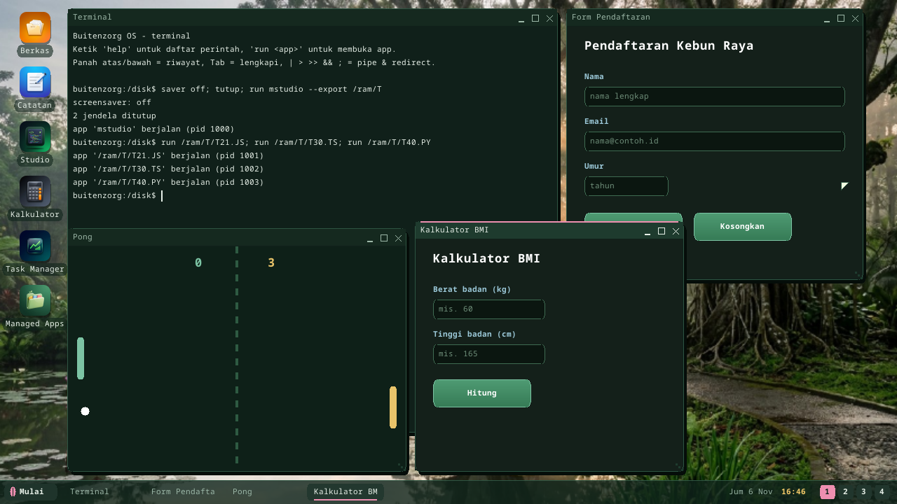
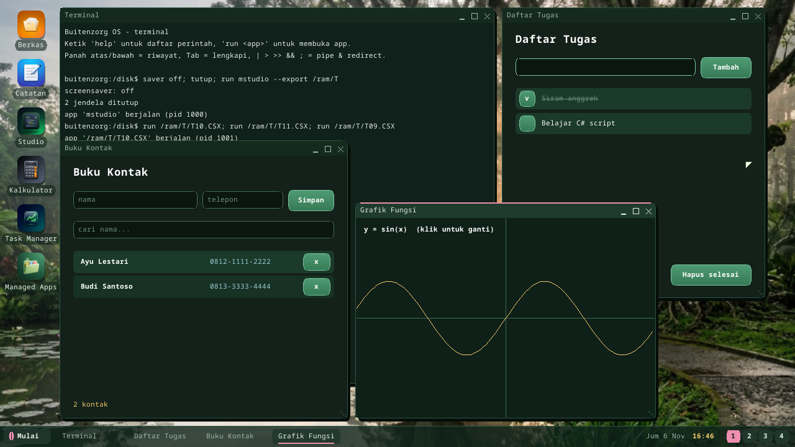
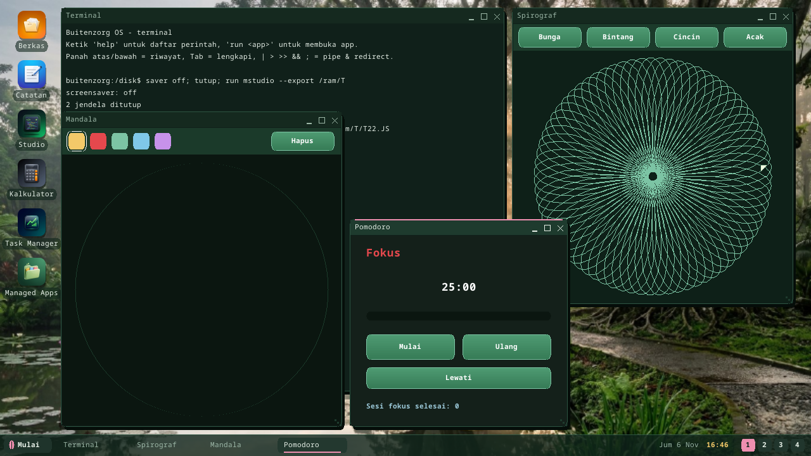
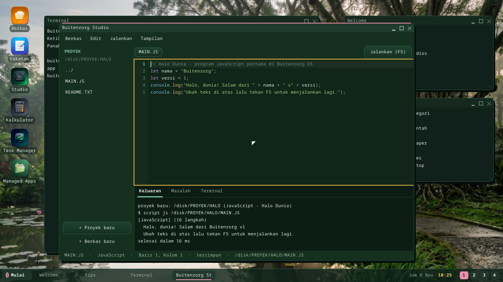

# Documentation

The complete documentation index for **Buitenzorg OS**. Docs are written in
**English**; the technical spec and planning trackers in the repo root are in
**Bahasa Indonesia** (marked *ID* below).

**English** · [Bahasa Indonesia](README.id.md) · ← Back to the [project README](../README.md).

## Start here

| Doc | What it covers |
|---|---|
| [**Tutorial**](tutorial.md) | A sequential zero-to-app walkthrough: build → explore the desktop → shell → write an app → debug/profile → leave QEMU. **Read this first.** |
| [Getting Started](getting-started.md) | Prerequisites, one-command quickstart, the daily workflow, and troubleshooting. |
| [Your First App](first-app.md) | Both ways to build an app (SDK and native), the built-in library catalog, and the zerolib rules every app author must know. |

## Run & install

| Doc | What it covers |
|---|---|
| [Run in a VM](run-in-vm.md) | Convert the image and run it in VMware Player, VirtualBox, or Hyper-V. |
| [Raspberry Pi 4](install-raspberry-pi.md) | The desktop on a Pi 4's HDMI screen, on all four cores: verified on a real 8 GB board and on QEMU. |
| [Install on Hardware](install-hardware.md) | Flash the image to a USB stick and boot a physical machine (BIOS/UEFI), with an honest capability matrix. |
| [Buitenzorg Studio](studio.md) | The IDE inside the OS: projects from 52 templates, a code editor, Run (F5), Output, Problems, Terminal. |
| [C# Script (`.csx`)](csharp-script.md) | C# without a build step: a bytecode engine for top-level C#, console and UI (`Ui.Window`), 16x faster than the tree interpreter. |
| [UI Apps in JS/TS/Python](script-ui.md) | Windowed apps without C#: `window`, `button`, `text`, ... in immediate mode, run as their own process. |
| [The Shell & Scripts](shell.md) | Line editing, pipes/redirection, variables, coreutils, aliases, `.SH` scripts with if/for/while, the startup profile. |
| [bz-link: a running device from your PC](bz-link.md) | `bz deploy` an app or script to a running OS (no image rebuild), `bz run`/`shell`/`push`/`pull`/`logs` over the network. |
| [Packages (`.bzpkg`)](packages.md) | `bz pack` on the host, `bz install/remove` on the device, the format and its safety rules. |
| [Games and Buitenzorg.Game](games.md) | Ular, Ranjau, Bata, Balok, Kartu, and the 2D game framework (fixed-timestep loop, raw key events, particles, high scores). |
| [Debugging & Profiling](debugging.md) | Attach GDB to the running kernel, and the instrumented TSC zone profiler. |

## Screenshots: script apps

| | |
|---|---|
|  |  |
| Sign-up form, Pong, BMI calculator ([UI apps in JS/TS/Python](script-ui.md)) | Address book, to-do list, plotter ([C# script](csharp-script.md)) |
|  |  |
| Spirograph, mandala, Pomodoro ([Studio templates](studio.md)) | [Buitenzorg Studio](studio.md) |

## Technical reference

| Doc | What it covers |
|---|---|
| [Managed Apps + Buitenzorg.UI](managed-apps.md) | The managed app folder, the Avalonia-style UI toolkit, how it draws, and how apps are tested. |
| [Syscall ABI](abi.md) | The v1 syscall table, cross-boundary structs, the pointer security model, and the evolution rules. |
| [C# in Ring 3](csharp-userland.md) | How C# runs in user-space: the bflat pipeline, the ELF loader, and the `bzstart` shim. |
| [App Framework](app-framework.md) | The app model, manifest, SDK, and window syscalls. |
| [System Services](system-services.md) | VFS, the service/init manager, async I/O, and networking. |
| [Desktop Environment](desktop-environment.md) | Compositor, window manager, themes, workspaces, and the shell. |
| [Graphics & Window System](window-system.md) | The rendering stack and window management. |
| [AI Subsystem & Power](ai-power.md) | The local LLM / CV / GenAI subsystem, the Model Manager, and power management. |

## Planning & history (repo root)

| Doc | What it covers |
|---|---|
| [PLAN.md](../PLAN.md) *(ID)* | Product roadmap, version by version (v0.1 → v1.x). |
| [Progress.md](../Progress.md) *(ID)* | Per-feature checklist tracker (done / partial / pending). |
| [CHANGELOG.md](../CHANGELOG.md) | Release history by version codename. |
| [requirements.md](../requirements.md) *(ID)* | The full technical spec; §17 is the development checklist. |
| [CONTRIBUTING.md](../CONTRIBUTING.md) | Coding standards and the contribution flow. |

---

*Buitenzorg OS is made by Gravicode Studios, led by Kang Fadhil.*
