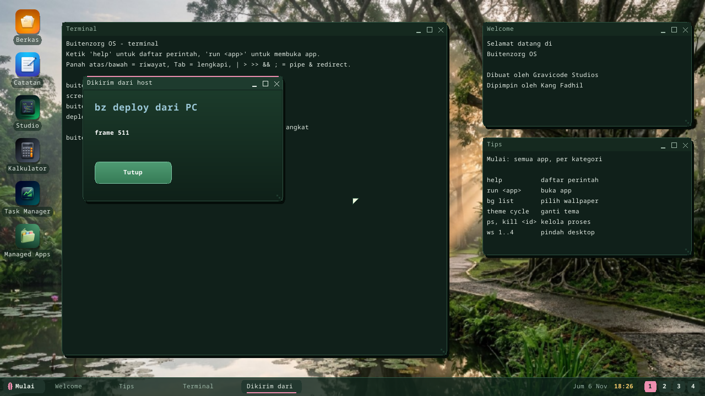

# bz-link: bekerja dengan perangkat yang sedang berjalan dari PC

CLI `bz` di PC berbicara dengan Buitenzorg OS yang sedang berjalan lewat
jaringan: menjalankan perintah shell, menyalin berkas dua arah, membaca log,
dan men-deploy app atau skrip agar langsung jalan — tanpa membangun ulang
image disk, tanpa restart.

```text
PC                                         Buitenzorg OS
bz deploy GAME.JS   ── BZDP lewat UDP ─▶   /disk/GAME.JS, lalu `run /disk/GAME.JS`
bz logs -f          ◀── log konsol ────    print(...), [app] ..., [deploy] ...
```

## 1. Nyalakan (di perangkat)

Di Terminal:

```text
deploy on 1234
```

Empat angka itu adalah kode pairing yang wajib dibawa setiap permintaan (tanpa
angka, OS memilihkan dan menampilkannya). Layanan lalu tetap aktif setelah
restart sampai `deploy off` (`/disk/DEPLOY.CFG`). `deploy` saja menampilkan
status, alamat dan kodenya.

Defaultnya mati: tidak ada yang mendengarkan sampai seseorang di perangkat
menyalakannya.

## 2. Hubungkan (di PC)

```powershell
dotnet run --project sdk\bz -- device connect 192.168.1.50 1234
```

`bz` mengingat perangkatnya di `~/.bz/device.json` (atau pakai variabel
lingkungan `BZ_DEVICE=host[:port]` dan `BZ_CODE=1234`). Di QEMU, teruskan port
lalu hubungkan ke mesin sendiri:

```powershell
qemu-system-x86_64 ... -netdev user,id=n0,hostfwd=udp::7070-:7070 -device e1000,netdev=n0
bz device connect 127.0.0.1 1234
```

## 3. Perintah

| Perintah | Fungsi |
|---|---|
| `bz device` | menyapa: arsitektur, alamat |
| `bz deploy BERKAS` | unggah ke `/disk` lalu jalankan: `.ELF` `.DLL` `.JS` `.TS` `.PY` `.CSX` → `run`, `.SH` → `sh`, `.bzpkg` → `bz install` lalu paketnya; kemudian menampilkan log perangkat selama 5 dtk (`--follow N`, `--no-run`, `--as NAMA.EXT`) |
| `bz deploy FOLDER` | folder proyek (`app.manifest` + `package/`) di-`bz pack` dulu, lalu di-deploy sebagai paket |
| `bz run BARIS` | menjalankan satu baris shell di perangkat dan mencetak output-nya; status keluar mengikuti perintahnya (`bz run "ls /disk"`) |
| `bz shell` | shell interaktif di perangkat (setiap baris seperti `bz run`; `exit` keluar) |
| `bz push LOKAL /disk/NAMA.EXT` | unggah berkas (`/disk/` memakai nama lokal) |
| `bz pull /disk/NAMA.EXT [LOKAL]` | unduh berkas |
| `bz ls [/disk]` | daftar isi folder |
| `bz logs [-f]` | log konsol perangkat (`-f` mengikutinya) |
| `bz kill PID` | hentikan proses (`bz run ps` mendaftarnya) |
| `bz dap` | server Debug Adapter Protocol untuk VS Code: breakpoint di skrip dan program native di perangkat ([Debugging](debugging.id.md#-vs-code-breakpoint-di-perangkat-yang-berjalan-bz-dap)) |

Nama berkas di perangkat berformat FAT 8.3 (`GAME.JS`, `HELLO.ELF`); `bz
deploy` memendekkan nama yang lebih panjang.

Satu putaran lengkap:

```powershell
bz deploy halo.js
# halo.js -> /disk/HALO.JS (377 bytes, 174 ms)
# app '/disk/HALO.JS' berjalan (pid 1000)
# -- device log for 5 s --
# halo.js: mulai di perangkat
```



## Protokolnya

BZDP v1 (`kernel/bzkernel/src/deploy.rs`): UDP port 7070, satu datagram per
permintaan, stop-and-wait dengan pengulangan, little-endian; balasan membawa
nomor urut permintaan, dan permintaan yang diulang mendapat balasan tersimpan
(balasan yang hilang tidak pernah menjalankan perintah dua kali). Operasi:
HELLO, BEGIN/DATA/END (unggah per 1 KiB, dicek CRC-32 sebelum berkas ditulis),
RUN, EXEC + OUTPUT (output perintah), LOG, KILL, LIST, READ. Kliennya dipakai
bersama oleh `bz` dan Magic App Generator
(`tools/MagicAppGen/Services/BzdpClient.cs`; `MagicAppGen --bzdp-selftest`
mengujinya terhadap perangkat palsu).

## Batasan

- **Kecepatan:** sekitar 20 KB/dtk di QEMU — perangkat menjawab satu
  permintaan per putaran loop desktop. Cukup untuk app dan skrip; lambat untuk
  aset besar.
- **Keamanan:** kode pairing adalah satu-satunya pemeriksaan, dan lalu
  lintasnya tidak dienkripsi. Pakai di jaringan yang dipercaya, lalu matikan
  setelahnya. Untuk shell terenkripsi pakai `ssh on` (lihat panduan shell).
- Hanya UDP (stack TCP sudah ada; BZDP belum memakainya); belum ada
  breakpoint (debugger adalah langkah berikutnya Developer Workstation).
