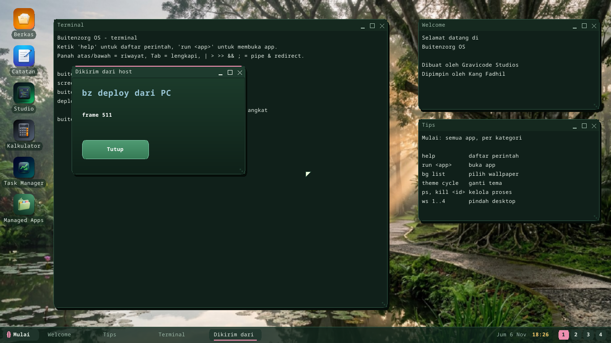

# bz-link: working with a running device from your PC

The `bz` CLI on your PC talks to a running Buitenzorg OS over the network:
run shell commands on it, copy files both ways, read its log, and deploy an
app or script so it starts at once — no rebuilding the disk image, no reboot.

```text
PC                                         Buitenzorg OS
bz deploy GAME.JS   ── BZDP over UDP ──▶   /disk/GAME.JS, then `run /disk/GAME.JS`
bz logs -f          ◀── console log ───    print(...), [app] ..., [deploy] ...
```

## 1. Switch it on (on the device)

In the Terminal:

```text
deploy on 1234
```

The four digits are the pairing code every request must carry (without a
number the OS picks one and shows it). The service then stays on across
reboots until `deploy off` (`/disk/DEPLOY.CFG`). `deploy` alone shows its
state, address and code.

It is off by default: nothing listens until someone at the device switches
it on.

## 2. Connect (on the PC)

```powershell
dotnet run --project sdk\bz -- device connect 192.168.1.50 1234
```

`bz` remembers the device in `~/.bz/device.json` (or use the environment
variables `BZ_DEVICE=host[:port]` and `BZ_CODE=1234`). Under QEMU, forward the
port and connect to your own machine:

```powershell
qemu-system-x86_64 ... -netdev user,id=n0,hostfwd=udp::7070-:7070 -device e1000,netdev=n0
bz device connect 127.0.0.1 1234
```

## 3. Commands

| Command | Does |
|---|---|
| `bz device` | says hello: architecture, address |
| `bz deploy FILE` | uploads to `/disk` and starts it: `.ELF` `.DLL` `.JS` `.TS` `.PY` `.CSX` → `run`, `.SH` → `sh`, `.bzpkg` → `bz install` then the package; then shows the device log for 5 s (`--follow N`, `--no-run`, `--as NAME.EXT`) |
| `bz deploy DIR` | a project folder (`app.manifest` + `package/`) is packed with `bz pack` first, then deployed as a package |
| `bz run LINE` | runs one shell line on the device and prints its output; the exit status follows the command (`bz run "ls /disk"`) |
| `bz shell` | an interactive shell on the device (each line like `bz run`; `exit` leaves) |
| `bz push LOCAL /disk/NAME.EXT` | uploads a file (`/disk/` keeps the local name) |
| `bz pull /disk/NAME.EXT [LOCAL]` | downloads a file |
| `bz ls [/disk]` | lists a folder |
| `bz logs [-f]` | the device's console log (`-f` follows it) |
| `bz kill PID` | stops a process (`bz run ps` lists them) |
| `bz prof APP [args] [--seconds N]` | profiles a program on the device, prints the hottest functions ([Debugging](debugging.md#%EF%B8%8F-profiler-for-apps-prof-app-bz-prof)) |
| `bz dap` | Debug Adapter Protocol server for VS Code: breakpoints in scripts and native programs on the device ([Debugging](debugging.md#-vs-code-breakpoints-on-a-running-device-bz-dap)) |

File names on the device are FAT 8.3 (`GAME.JS`, `HELLO.ELF`); `bz deploy`
shortens a longer name for you.

A full round trip:

```powershell
bz deploy halo.js
# halo.js -> /disk/HALO.JS (377 bytes, 174 ms)
# app '/disk/HALO.JS' berjalan (pid 1000)
# -- device log for 5 s --
# halo.js: mulai di perangkat
```



## The protocol

BZDP v1 (`kernel/bzkernel/src/deploy.rs`): UDP port 7070, one datagram per
request, stop-and-wait with retries, little-endian; replies carry the
request's sequence number, and a repeated request gets the saved reply (a
lost reply never runs a command twice). Operations: HELLO, BEGIN/DATA/END
(upload in 1 KiB chunks, CRC-32 checked before the file is written), RUN,
EXEC + OUTPUT (a command's output), LOG, KILL, LIST, READ. The client is
shared by `bz` and the Magic App Generator
(`tools/MagicAppGen/Services/BzdpClient.cs`; `MagicAppGen --bzdp-selftest`
tests it against a fake device).

## Limits

- **Speed:** about 20 KB/s under QEMU — the device answers one request per
  desktop-loop turn. Fine for apps and scripts; slow for large assets.
- **Security:** the pairing code is the only check, and traffic is not
  encrypted. Use it on a network you trust, and switch it off afterwards.
  For an encrypted shell use `ssh on` (see the shell guide).
- UDP only (the TCP stack exists; BZDP does not use it yet); no breakpoints
  yet (the debugger is the next step of the Developer Workstation).
