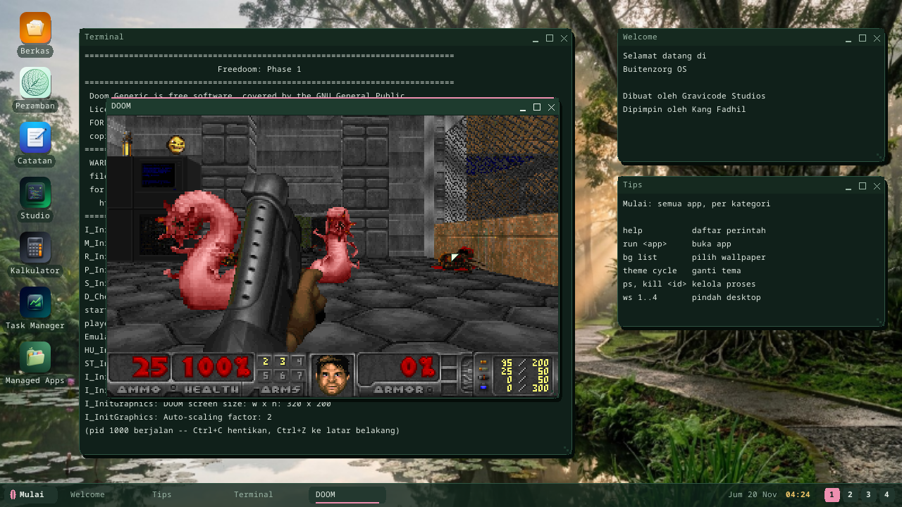

# Program C, SDL2 dan DOOM

Buitenzorg menjalankan program C sebagai proses ring-3 biasa, di ketiga
arsitektur (x86-64, ARM64, RISC-V). `userland/c` adalah runtime C kecil untuk
mem-port kode yang sudah ada:

| Bagian | Isinya |
|---|---|
| `include/` | header libc yang dipakai program port (`stdio.h`, `stdlib.h`, `string.h`, `ctype.h`, `math.h`, `unistd.h`, `sys/stat.h`, `time.h`, ...) dan `SDL.h` |
| `src/crt0.c` | `_start`: stack 1 MiB, `argv` dari string argumen program (`PROC_ARGS`; tanda kutip ganda mengelompokkan kata), `main`, `exit` |
| `src/libc.c` | string, ctype, `malloc` (potongan 4 MiB dari `MMAP`, daftar bebas per kelas ukuran), berkas (`fopen` membaca berkas ke memori -- berkas besar per 1 MiB lewat `FS_READ_AT`; berkas yang ditulis disimpan dengan `FS_WRITE` saat `fflush` / `fclose`; path relatif ada di `/disk`), keluarga `printf` / `scanf`, `strto*`, `qsort`, waktu (`CLOCK_NANOS`, `CLOCK_RTC`), `math.h` dasar |
| `src/sdl.c` | subset SDL2: satu jendela, tekstur streaming yang ditampilkan dengan satu draw op `BLIT`, event keyboard (dan tombol gamepad USB, dipetakan ke tombol), `SDL_GetTicks`, `SDL_Delay` |
| `user.ld` | tata letak program (image di 0x400000) yang diharapkan loader ELF kernel |

Program dikompilasi dengan **zig 0.13** (`zig cc`, target freestanding per
arsitektur). Hanya C standar yang diasumsikan; belum ada `fork`, signal,
socket atau thread POSIX di runtime ini.

## DOOM

Engine id Software (lewat [doomgeneric](https://github.com/ozkl/doomgeneric),
GPL-2.0) berjalan tanpa diubah -- backend SDL2-nya sendiri dikompilasi terhadap
subset di atas -- dengan IWAD [Freedoom](https://freedoom.github.io) (lisensi
BSD). Keduanya tidak ada di repositori ini: sebuah skrip mengunduhnya, tiap
unduhan dicek terhadap SHA-256 yang dipatok.

```
scripts/fetch-doom.sh        # zig, doomgeneric pada commit tetap, Freedoom 0.13.0 (Windows: .\scripts\fetch-doom.ps1)
scripts/build-doom.sh        # kernel/target/doom/<arch>/DOOM.ELF untuk x86_64, aarch64, riscv64
cd kernel && cargo run --release -p bzimage -- --out ../dist   # DOOM.ELF + DOOM.WAD di /disk
```

Di desktop, ketik `doom` (atau `run doom`) di Terminal. Tombol: panah untuk
bergerak, Ctrl menembak, Spasi membuka pintu, Shift berlari, Esc menu, 1-7
senjata. Gamepad USB juga bisa: d-pad bergerak, A menembak, B membuka pintu,
X / Y bergeser ke samping, Start = Enter, Select = Esc. Belum ada suara
(modul SDL mixer DOOM tidak ikut).

Boot self-test memainkan demo pertama IWAD selama 40 frame dan memeriksa
gambarnya (`MILESTONE: DOOM OK`, diwajibkan smoke test bila DOOM di-build).



Lisensi: DOOM.ELF berlisensi GPL-2.0 (source doomgeneric pada commit yang
dipatok adalah source-nya); runtime C dan subset SDL adalah bagian Buitenzorg
(MIT); Freedoom berlisensi BSD (`kernel/target/doom/FREEDOOM-COPYING.txt`).

---

← [Indeks dokumentasi](README.id.md) · *Buitenzorg OS — dibuat oleh Gravicode Studios, dipimpin oleh Kang Fadhil.*
