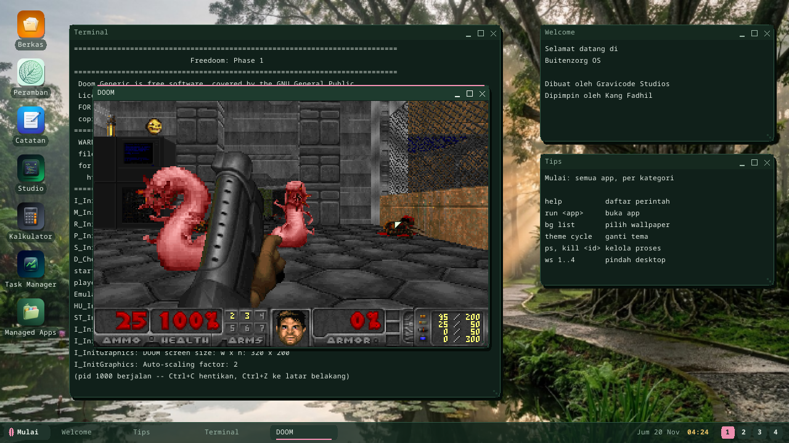

# C programs, SDL2 and DOOM

Buitenzorg runs C programs as ordinary ring-3 processes, on all three
architectures (x86-64, ARM64, RISC-V). `userland/c` is a small C runtime made
for porting existing code:

| Part | What it provides |
|---|---|
| `include/` | the libc headers ported programs include (`stdio.h`, `stdlib.h`, `string.h`, `ctype.h`, `math.h`, `unistd.h`, `sys/stat.h`, `time.h`, ...) and `SDL.h` |
| `src/crt0.c` | `_start`: a 1 MiB stack, `argv` from the program's argument string (`PROC_ARGS`; double quotes group words), `main`, `exit` |
| `src/libc.c` | strings, ctype, `malloc` (4 MiB chunks from `MMAP`, size-class free lists), files (`fopen` reads the file into memory -- large files in 1 MiB pieces with `FS_READ_AT`; files written are saved with `FS_WRITE` on `fflush` / `fclose`; relative paths are on `/disk`), the `printf` / `scanf` families, `strto*`, `qsort`, time (`CLOCK_NANOS`, `CLOCK_RTC`), basic `math.h` |
| `src/sdl.c` | an SDL2 subset: one window, a streaming texture shown with one `BLIT` draw op, keyboard events (and the USB gamepad's buttons, mapped to keys), `SDL_GetTicks`, `SDL_Delay` |
| `user.ld` | the program layout (image at 0x400000) the kernel's ELF loader expects |

Programs are compiled with **zig 0.13** (`zig cc`, a freestanding target per
architecture). Only standard C is assumed; there is no POSIX `fork`, signals,
sockets or threads in this runtime yet.

## DOOM

The id Software engine (through [doomgeneric](https://github.com/ozkl/doomgeneric),
GPL-2.0) runs unmodified -- its own SDL2 backend is compiled against the subset
above -- with the [Freedoom](https://freedoom.github.io) IWAD (BSD licence).
Neither is part of this repository: a script fetches them, each download
checked against a pinned SHA-256.

```
scripts/fetch-doom.sh        # zig, doomgeneric at a fixed commit, Freedoom 0.13.0 (Windows: .\scripts\fetch-doom.ps1)
scripts/build-doom.sh        # kernel/target/doom/<arch>/DOOM.ELF for x86_64, aarch64, riscv64
cd kernel && cargo run --release -p bzimage -- --out ../dist   # DOOM.ELF + DOOM.WAD on /disk
```

On the desktop, type `doom` (or `run doom`) in the Terminal. Keys: arrows to
move, Ctrl to fire, Space to open doors, Shift to run, Esc for the menu, 1-7
for weapons. A USB gamepad works too: the d-pad moves, A fires, B opens doors,
X / Y strafe, Start is Enter, Select is Esc. There is no sound yet (DOOM's SDL
mixer module is left out).

The self-test boot plays the IWAD's first demo for 40 frames and checks the
picture (`MILESTONE: DOOM OK`, required by the smoke test when DOOM was built).



Licences: DOOM.ELF is GPL-2.0 (the doomgeneric source at the pinned commit is
its corresponding source); the C runtime and SDL subset are part of Buitenzorg
(MIT); Freedoom is BSD-licensed (`kernel/target/doom/FREEDOOM-COPYING.txt`).

---

← [Documentation index](README.md) · *Buitenzorg OS — made by Gravicode Studios, led by Kang Fadhil.*
