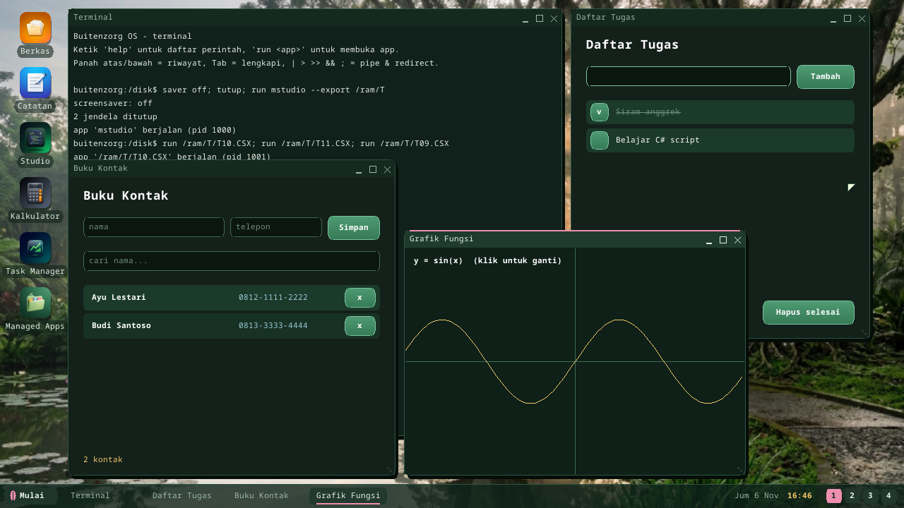

# C# script (`.csx`)

Buitenzorg menjalankan **C# script** langsung, tanpa PC dan tanpa proses
build: tulis berkas `.csx` di [Studio](studio.id.md) lalu tekan F5, atau ketik
`csx FILE.CSX` di Terminal. Skrip yang membuka jendela (`Ui.Window(...)`)
berjalan sebagai aplikasi sendiri.

```csharp
// MAIN.CSX -- tanpa class, tanpa Main: pernyataan dijalankan dari atas ke bawah
int Fib(int n) => n < 2 ? n : Fib(n - 1) + Fib(n - 2);

var prima = new List<int>();
for (int i = 2; prima.Count < 10; i++)
{
    bool ok = true;
    for (int d = 2; d * d <= i; d++) if (i % d == 0) { ok = false; break; }
    if (ok) prima.Add(i);
}
Console.WriteLine($"Fib(20) = {Fib(20)}");
Console.WriteLine($"prima: {string.Join(", ", prima)}");
Console.WriteLine($"akar 2 = {Math.Sqrt(2):F6}");
```

## Performa

Skrip **dikompilasi ke bytecode** dan dijalankan VM berbasis stack
(`kernel/bzkernel/src/csx.rs`, Rust): setiap variabel lokal menjadi slot frame,
setiap nama global, method dan member diselesaikan sekali saat kompilasi,
sehingga tidak ada pencarian nama saat skrip berjalan. `Fib(25)` (2,5 juta
instruksi) selesai dalam 34 ms di host PC, **16x lebih cepat** daripada
program yang sama di interpreter JavaScript berbasis pohon; satu juta
penjumlahan double sekitar 0,2 detik. Di emulasi QEMU semuanya beberapa kali
lebih lambat.

## Bahasa

| Bagian | Didukung |
|---|---|
| Tipe | `int long short byte double float decimal bool char string var object`, array `T[]` (`new int[n]`, `new[] {..}`, `{..}`), `List<T>`, `Dictionary<K,V>`, `StringBuilder`, `Random` |
| Method | method tingkat atas dengan parameter bertipe, badan `=>`, rekursi, boleh didefinisikan sebelum atau sesudah dipakai; variabel tingkat atas terlihat dari method |
| Pernyataan | `if/else`, `while`, `do/while`, `for`, `foreach` (array, list, string, dictionary -> `kv.Key`/`kv.Value`), `switch` (case int / string / char), `break`, `continue`, `return`, `try/catch/finally`, `throw new Exception(..)` |
| Operator | `+ - * / %` (pembagian dan sisa bilangan bulat ala C#), `== != < <= > >=`, `&& \|\| !`, `& \| ^ ~ << >>`, `?:`, `??`, `= += -= *= /= %= &= \|= ^= <<=`, `++ --`, cast `(int)` `(double)` `(char)` |
| String | interpolasi `$"{x}"` dengan alignment dan format `{x,8}` `{x:F2}` `{x:N0}` `{x:D3}` `{x:X}` `{x:P1}`, verbatim `@"..."`, escape; `Length`, `Substring`, `IndexOf`, `Contains`, `StartsWith`, `EndsWith`, `Replace`, `Split`, `Trim`, `ToUpper/ToLower`, `PadLeft/PadRight`, `ToCharArray`, `s[i]` |
| List | `Add`, `AddRange`, `Insert`, `Remove`, `RemoveAt`, `Clear`, `Contains`, `IndexOf`, `Sort`, `Reverse`, `ToArray`, `Count`, `Sum`, `Min`, `Max`, `Average` |
| Dictionary | `d[k]`, `Add`, `ContainsKey`, `ContainsValue`, `Remove`, `Count`, `Keys`, `Values`, `GetValueOrDefault`, inisialisasi `{ {k, v}, .. }` dan `{ [k] = v }` |
| Library | `Console.WriteLine/Write` (juga placeholder `"{0}"`), `Math.*` (Sqrt, Pow, Abs, Min, Max, Clamp, Sign, Floor, Ceiling, Round (banker's), Truncate, Sin, Cos, Tan, Atan, Atan2, Exp, Log, Log10, PI, E), `int/long/double.Parse`, `Convert.ToInt32/ToDouble/ToString`, `string.Join/Format/IsNullOrEmpty`, `char.IsDigit/IsLetter/IsUpper/ToUpper/...`, `int.MaxValue`, `Environment.NewLine`, `Args` |
| Error | error runtime adalah exception: `DivideByZeroException`, `IndexOutOfRangeException`, `KeyNotFoundException`, `FormatException`, `NullReferenceException`, ... -- `catch (Exception e)` mendapat `e.Message`; bila tidak ditangkap, error dilaporkan beserta barisnya |

**Belum didukung:** class, struct, record, enum dan interface buatan sendiri;
lambda dan LINQ (`Where`, `Select`, ...); `out`/`ref`; property; generic
buatan sendiri; overload method; array multidimensi (`int[,]`; pakai array di
dalam array); `async`. Pesan error engine menyebutkannya.

## Aplikasi UI

API immediate-mode yang sama dengan [aplikasi UI JS/TS/Python](script-ui.id.md),
sebagai kelas statis `Ui`:

```csharp
Ui.Window("Penghitung C#", 320, 220);
int n = 0;
while (Ui.Running())
{
    Ui.Clear(0x14201A);
    Ui.Text(24, 64, $"{n}", 0xFFFFFF, 2);
    if (Ui.Button(24, 140, 124, 40, "Tambah")) n++;
    Ui.Present();
}
```

`Ui.Window, Width, Height, Clear, Rect, Frame, Gradient, Line, Circle, Ring,
Text, TextWidth, LineHeight, Button, Input, SetInput, Focus, Present, Running,
Quit, MouseX, MouseY, MouseDown, Clicked, ClickX, ClickY, Key, Ticks, Wait,
Random, Rgb`. `Ui.Input(x, y, w, id [, placeholder])` adalah kolom teks yang
mengembalikan teksnya (klik untuk mengetik; Enter / Tab / Esc keluar). Tombol:
`27` Esc, `' '` spasi, `63232..63235` atas/bawah/kiri/kanan.

## Menjalankan

| Di mana | Caranya |
|---|---|
| Studio | F5 (skrip konsol mencetak ke **Keluaran**; error bernomor baris masuk **Masalah**) |
| Terminal | `csx FILE.CSX [arg]` (juga `script cs FILE`); `csx` saja menjalankan demo |
| Skrip UI | `run FILE.CSX` (atau F5): proses dan jendela sendiri |
| Paket | `.bzpkg` dengan entry `.CSX` |

Skrip konsol berjalan di kernel dengan batas 50 juta instruksi (loop yang
lepas kendali berhenti dengan pesan, bukan membekukan desktop); skrip UI
berjalan di proses ring-3 sendiri (`CLRHOST.ELF`) tanpa batas.

## Template

**Proyek baru** di Studio punya sebelas template C# script: halo, List &
Dictionary, analisis teks, algoritma pengurutan, exception, statistik &
matematika; dan, dengan UI, penghitung, game Ular, grafik fungsi, buku kontak
(kolom isian + pencarian) dan daftar tugas.



## C# di Buitenzorg: tiga cara

| | C# script (`.csx`) | C# managed (RustCLR) | C# native (bflat) |
|---|---|---|---|
| Build | tidak perlu, di perangkat | `dotnet build` di PC | bflat di PC |
| Bahasa | subset C# (tanpa class) | C# penuh, .NET BCL, LINQ | C# tanpa exception / GC |
| Kecepatan | VM bytecode | interpreter IL | kode mesin |
| Cocok untuk | alat cepat, belajar, game kecil | aplikasi sungguhan (Buitenzorg.UI) | program sistem yang cepat |

---

← [Indeks dokumentasi](README.id.md) · *Buitenzorg OS — dibuat oleh Gravicode Studios, dipimpin Kang Fadhil.*
