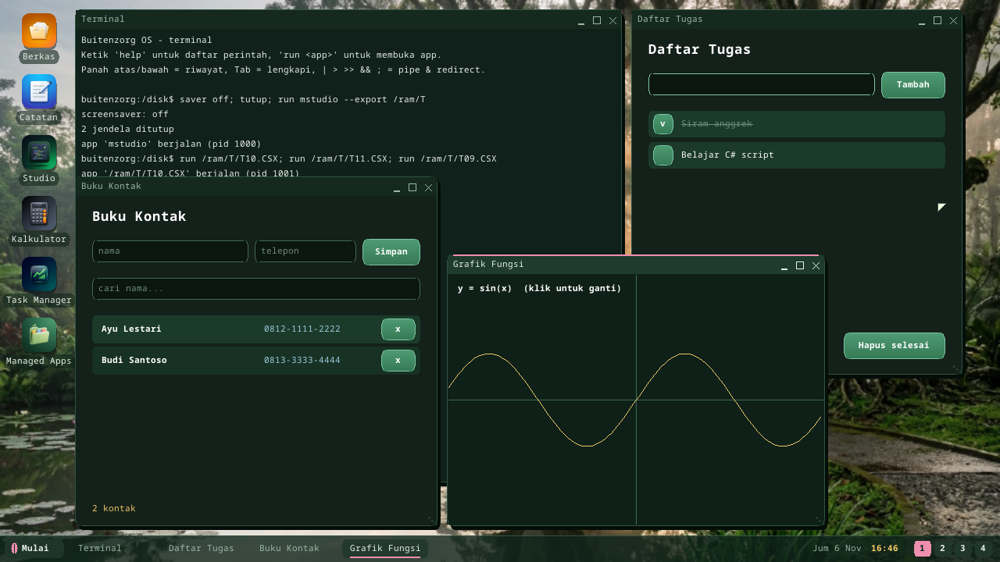

# C# script (`.csx`)

Buitenzorg runs **C# scripts** directly, without a PC and without a build
step: write a `.csx` file in [Studio](studio.md) and press F5, or type
`csx FILE.CSX` in the Terminal. A script that opens a window
(`Ui.Window(...)`) runs as its own app.

```csharp
// MAIN.CSX -- no class, no Main: statements run top to bottom
int Fib(int n) => n < 2 ? n : Fib(n - 1) + Fib(n - 2);

var primes = new List<int>();
for (int i = 2; primes.Count < 10; i++)
{
    bool prime = true;
    for (int d = 2; d * d <= i; d++) if (i % d == 0) { prime = false; break; }
    if (prime) primes.Add(i);
}
Console.WriteLine($"Fib(20) = {Fib(20)}");
Console.WriteLine($"primes: {string.Join(", ", primes)}");
Console.WriteLine($"sqrt 2 = {Math.Sqrt(2):F6}");
```

## Performance

Scripts are **compiled to bytecode** and run by a stack VM
(`kernel/bzkernel/src/csx.rs`, Rust): every local variable becomes a frame
slot, every global, method and member name is resolved once at compile time,
so nothing is looked up by name while the script runs. `Fib(25)` (2.5 million
instructions) takes 34 ms on a PC host, **16x faster** than the same program in
the tree-walking JavaScript interpreter; a loop of a million double additions
~0.2 s. Under QEMU's emulation everything is several times slower.

## Language

| Area | Supported |
|---|---|
| Types | `int long short byte double float decimal bool char string var object`, arrays `T[]` (`new int[n]`, `new[] {..}`, `{..}`), `List<T>`, `Dictionary<K,V>`, `StringBuilder`, `Random` |
| Methods | top-level methods with typed parameters, `=>` bodies, recursion, defined before or after use; top-level variables are visible in methods |
| Statements | `if/else`, `while`, `do/while`, `for`, `foreach` (arrays, lists, strings, dictionaries -> `kv.Key`/`kv.Value`), `switch` (int / string / char cases), `break`, `continue`, `return`, `try/catch/finally`, `throw new Exception(..)` |
| Operators | `+ - * / %` (C# integer division and remainder), `== != < <= > >=`, `&& \|\| !`, `& \| ^ ~ << >>`, `?:`, `??`, `= += -= *= /= %= &= \|= ^= <<=`, `++ --`, casts `(int)` `(double)` `(char)` |
| Strings | interpolation `$"{x}"` with alignment and formats `{x,8}` `{x:F2}` `{x:N0}` `{x:D3}` `{x:X}` `{x:P1}`, verbatim `@"..."`, escapes; `Length`, `Substring`, `IndexOf`, `Contains`, `StartsWith`, `EndsWith`, `Replace`, `Split`, `Trim`, `ToUpper/ToLower`, `PadLeft/PadRight`, `ToCharArray`, `s[i]` |
| Lists | `Add`, `AddRange`, `Insert`, `Remove`, `RemoveAt`, `Clear`, `Contains`, `IndexOf`, `Sort`, `Reverse`, `ToArray`, `Count`, `Sum`, `Min`, `Max`, `Average` |
| Dictionaries | `d[k]`, `Add`, `ContainsKey`, `ContainsValue`, `Remove`, `Count`, `Keys`, `Values`, `GetValueOrDefault`, `{ {k, v}, .. }` and `{ [k] = v }` initializers |
| Library | `Console.WriteLine/Write` (also `"{0}"` placeholders), `Math.*` (Sqrt, Pow, Abs, Min, Max, Clamp, Sign, Floor, Ceiling, Round (banker's), Truncate, Sin, Cos, Tan, Atan, Atan2, Exp, Log, Log10, PI, E), `int/long/double.Parse`, `Convert.ToInt32/ToDouble/ToString`, `string.Join/Format/IsNullOrEmpty`, `char.IsDigit/IsLetter/IsUpper/ToUpper/...`, `int.MaxValue`, `Environment.NewLine`, `Args` |
| Errors | runtime errors are exceptions: `DivideByZeroException`, `IndexOutOfRangeException`, `KeyNotFoundException`, `FormatException`, `NullReferenceException`, ... -- `catch (Exception e)` gets `e.Message`; uncaught, the error is reported with its line |

**Not (yet) supported:** your own classes, structs, records, enums and
interfaces; lambdas and LINQ (`Where`, `Select`, ...); `out`/`ref`; properties;
generics of your own; method overloads; multi-dimensional arrays (`int[,]`;
use arrays of arrays); `async`. The engine says so in the error message.

## UI apps

The same immediate-mode API as [UI apps in JS/TS/Python](script-ui.md), as a
static class `Ui`:

```csharp
Ui.Window("Penghitung C#", 320, 220);
int n = 0;
while (Ui.Running())
{
    Ui.Clear(0x14201A);
    Ui.Text(24, 64, $"{n}", 0xFFFFFF, 2);
    if (Ui.Button(24, 140, 124, 40, "Tambah")) n++;
    Ui.Present();
}
```

`Ui.Window, Width, Height, Clear, Rect, Frame, Gradient, Line, Circle, Ring,
Text, TextWidth, LineHeight, Button, Input, SetInput, Focus, Present, Running,
Quit, MouseX, MouseY, MouseDown, Clicked, ClickX, ClickY, Key, Ticks, Wait,
Random, Rgb`. `Ui.Input(x, y, w, id [, placeholder])` is a text field that
returns its text (click to type; Enter / Tab / Esc leave it). Keys: `27`
Esc, `' '` space, `63232..63235` up/down/left/right.

## Running

| Where | How |
|---|---|
| Studio | F5 (console scripts print to **Keluaran**; errors with a line go to **Masalah**) |
| Terminal | `csx FILE.CSX [args]` (also `script cs FILE`); `csx` alone runs a demo |
| UI script | `run FILE.CSX` (or F5): its own process and window |
| Package | a `.bzpkg` whose entry is a `.CSX` |

Console scripts run in the kernel with a budget of 50 million instructions
(a runaway loop stops with a message instead of freezing the desktop); UI
scripts run in their own ring-3 process (`CLRHOST.ELF`) without a budget.

## Templates

Studio's **Proyek baru** has eleven C# script templates: hello, List &
Dictionary, text analysis, sorting algorithms, exceptions, statistics & math;
and, with a UI, a counter, a Snake game, a function plotter, an address book
(fields + search) and a to-do list.



## C# on Buitenzorg: three ways

| | C# script (`.csx`) | Managed C# (RustCLR) | Native C# (bflat) |
|---|---|---|---|
| Build | none, on the device | `dotnet build` on a PC | bflat on a PC |
| Language | a C# subset (no classes) | full C#, .NET BCL, LINQ | C# without exceptions / GC |
| Speed | bytecode VM | IL interpreter | machine code |
| Best for | quick tools, learning, small games | real apps (Buitenzorg.UI) | fast system programs |

---

← [Documentation index](README.md) · *Buitenzorg OS — made by Gravicode Studios, led by Kang Fadhil.*
