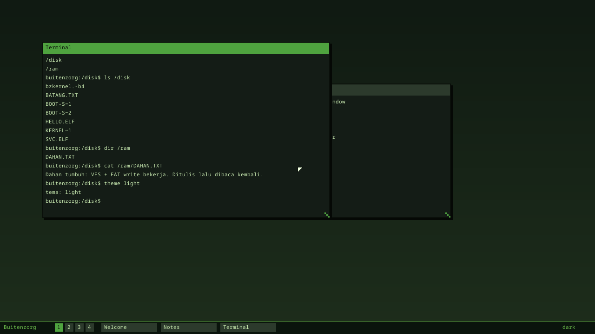
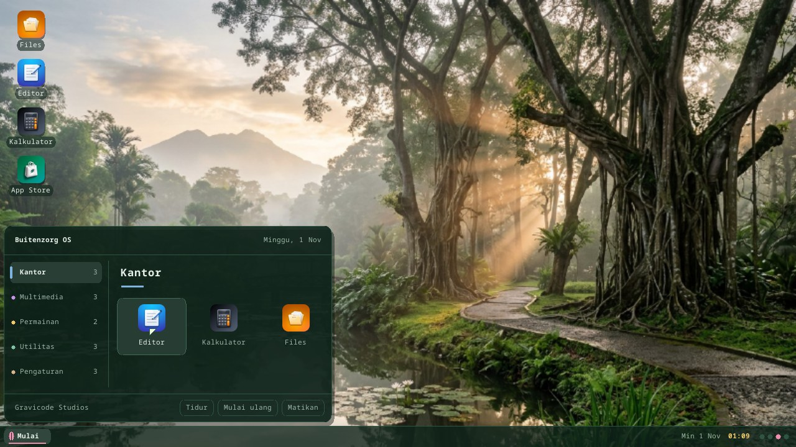
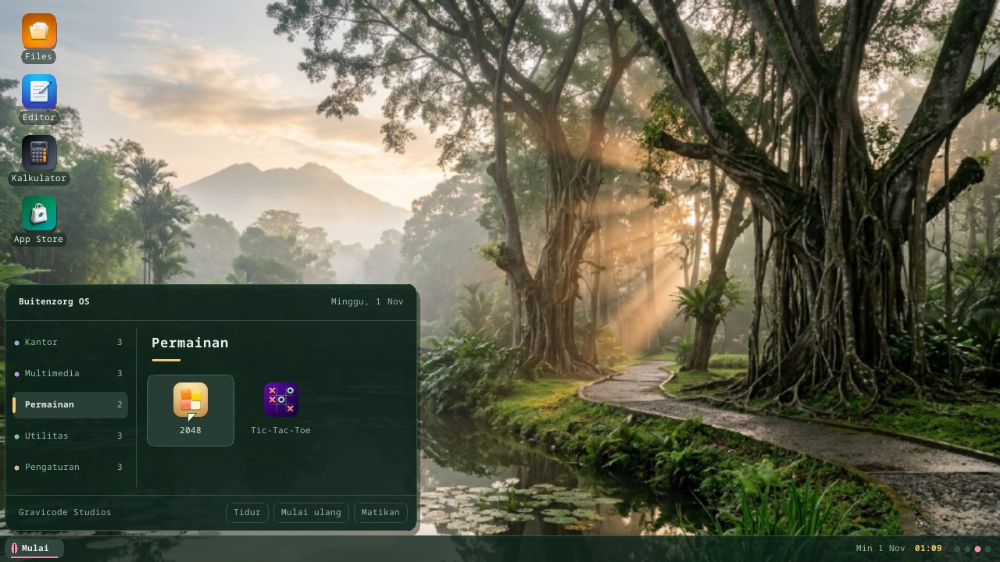
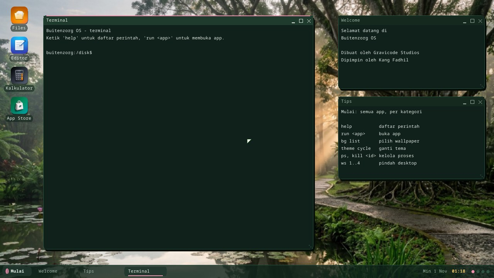

# Desktop Environment (v0.7 "Kanopi")

The v0.7 milestone: **"switch between virtual desktops, toggle dark/light, run
ls/dir in the terminal"**. Built on the v0.6 window manager.

**English** · [Bahasa Indonesia](desktop-environment.id.md) · ← [Documentation index](README.md)

## System theme (`theme.rs`)

Color design tokens with two variants: **dark** (default, deep leaf-green) and
**light**. The compositor and window manager read colors from `theme::current()`
rather than hardcoding them. Toggle via `theme::toggle()` or the `theme
dark|light|toggle` command. This is the foundation of the full theme engine
(§15) that arrives in v0.10.

## Virtual desktops / workspaces (`wm.rs`)

4 workspaces. Each window has a `workspace` field; the compositor only draws the
windows on the active workspace. `switch_workspace(n)` moves between desktops.
The wallpaper shifts slightly per desktop (the `shift` function). The taskbar
shows a `[1][2][3][4]` indicator with the active one highlighted, plus that
workspace's window buttons.

## Terminal + shell

| Module | Role |
|---|---|
| `terminal.rs` | A terminal bound to a window: scrollback + input line, line editing, Enter runs the shell, the window body = scrollback tail + prompt. |
| `shell.rs` | A command interpreter over the VFS/theme/wm. `run(line) -> (output, Effect)`. |
| `keyboard.rs` | An input queue; the keyboard IRQ pushes chars, the desktop loop drains them → terminal. |

**Commands**: `help`, `ls`/`dir`, `cat`/`type`, `cd`, `pwd`, `echo`, `mounts`,
`clear`/`cls`, `ver`/`uname`, `theme [dark|light|toggle]`, `ws [1-4]`,
`bz `, and more. Windows aliases (`dir`, `type`, `cls`) map to the
equivalent behavior (§14.2). Relative paths resolve against the cwd (default
`/disk`).

## Input routing

`desktop_loop` (the final loop after boot):
1. Drain `keyboard::pop()` → `terminal::feed_char` (line editing + shell).
2. Poll `mouse::state()` → `wm::handle_mouse` (move/resize a window).
3. Recompose the desktop when anything changes.

## Verification

`kanopi_demo` scripts it: it runs `ver`/`mounts`/`ls`/`dir`/`cat` in the terminal
(asserting the listing contains DAHAN.TXT → `TERMINAL OK`), toggles the theme
dark→light (`THEME OK`), and switches from workspace 1→2 (`WORKSPACE OK`). The
smoke test requires those markers; visual verification in
`docs/img/desktop-kanopi.png`.

## The v0.16 desktop shell

The v0.7 environment grew into a full desktop shell in v0.16 — a Start button
and menu, desktop icons, and a taskbar tray with a live RTC clock:

**The "kebun" look (default theme).** Taken from the default wallpaper —
the Bogor Botanical Gardens' lotus pond: deep-moss glass panels blended over
the wallpaper (`Theme.glass`), mist text, lichen for secondary text, pollen
gold for the time, and lotus pink as the single accent (the Start leaf, the
selected category, the focused window's top hairline and its taskbar
underline). Classic themes keep their solid panels (`glass = 0`).

**Start menu — organised by category.** A category rail on the left
(*Kantor*, *Multimedia*, *Permainan*, *Utilitas*, *Pengaturan*), each with its
own leaf color and its app count; resting on a category shows its apps as icon
cards with the category name as a heading ruled in that color. The header
shows today's date; the footer has *Tidur* (sleep), *Mulai ulang* (restart)
and *Matikan* (shut down). *Wallpaper* and *Tema* under Pengaturan are system
actions (next official wallpaper / next theme), not apps.

**A tidy first view.** When the session starts, windows left behind by the
boot demos (their programs have exited, so they only show frozen frames) are
closed; the terminal opens fresh on the left with a greeting, and a *Tips*
card lists the commands to start with.

**App icons.** Every launcher entry has its own icon — AI-generated artwork in
one consistent style (`assets/icons/*.jpg`). `bzimage/build.rs` downsamples
each to 44 px (desktop) and 18 px (start menu), cuts the same anti-aliased
rounded-square silhouette into the alpha channel and packs them into
`/disk/ICONS.BIN`; `icons.rs` loads the pack and `wm.rs` alpha-blends the
icons over the wallpaper (`MILESTONE: ICONS OK`). On boot media without a
`/disk` driver each app falls back to its own colored tile with an initial,
so no two launchers look the same.

## Scheduler note

Timer preemption is **off** except for `scheduler_demo` (v0.2). Everything else
is cooperative (`yield_now`). Enabling global preemption while the boot task does
heavy rendering/heap work triggers a memory-corruption race — see CLAUDE.md.

---

← [Documentation index](README.md) · *Buitenzorg OS — made by Gravicode Studios, led by Kang Fadhil.*
