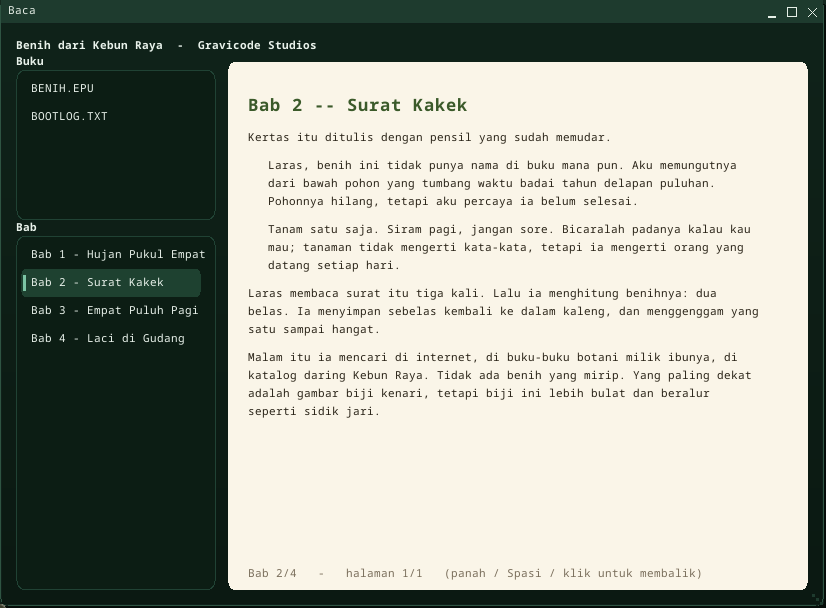
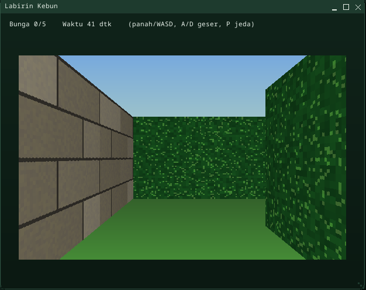
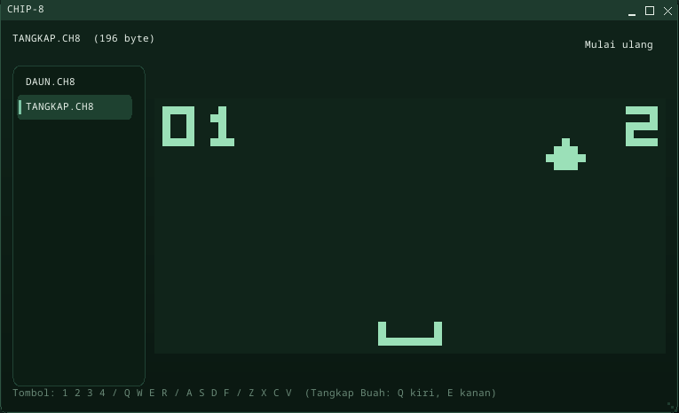

# Membaca, labirin 3D, CHIP-8 dan mode game

## Baca, pembaca e-book

`run mbaca`, atau **Mulai > Hiburan > Baca**. Perpustakaannya berisi buku EPUB
(`.EPU` -- disk FAT menyimpan nama 8.3, jadi `buku.epub` yang disalin dengan
`bz push` tiba sebagai `BUKU.EPU`) dan berkas teks di atas 1 KB di `/disk`
dan folder scratch. Setiap bab ditata sesuai jendela lalu dipecah menjadi
halaman di batas baris; balik halaman dengan panah, Spasi, PageUp /
PageDown, roda tetikus, atau klik (sepertiga kiri = mundur). Daftar bab
melompat antarbab. Setiap buku dibuka lagi di posisi terakhir
(`/disk/BACA.CFG`).

Setiap image membawa satu cerita pendek orisinal, *Benih dari Kebun Raya*
(`/disk/BENIH.EPU`, empat bab; sumbernya di `assets/books/benih`, di-zip
dengan deflate saat image dibangun).

Cara kerja: host membuka arsipnya (`userland/clrhost/src/zipapi.rs`, native
`ZipList` / `ZipText`, entri stored dan deflate lewat `miniz_oxide`),
aplikasi membaca `META-INF/container.xml`, judul, penulis, manifest dan spine
dari OPF, lalu menata setiap bab dengan mesin halaman Peramban. Berkas teks
menjadi paragraf di baris kosongnya.

**Komik:** berkas `.CBZ` (ZIP berisi gambar -- PNG, JPEG, GIF, BMP) di `/disk`
dibuka sebagai komik: satu gambar per halaman, disesuaikan dengan jendela,
urut nama alami (`hal2` sebelum `hal10`); daftar halaman menggantikan daftar
bab dan posisinya diingat seperti buku.

Batasan: tanpa CSS, gambar di buku tampil sebagai kotak abu-abu, tanpa buku
ber-DRM, tanpa berkas daftar isi (judul bab diambil dari `<title>` tiap bab).

## Labirin Kebun

`run mlabirin`, atau **Mulai > Hiburan > Labirin Kebun**: labirin sudut
pandang orang pertama di antara pagar tanaman. Temukan lima bunga emas; lalu
gerbang di tembok batu tua (sisi timur) terbuka -- keluarlah lewat situ.
Atas / Bawah (atau W / S) berjalan, Kiri / Kanan berbelok, A / D bergeser, P
jeda, Enter labirin baru setelah menang. Setiap labirin dibangkitkan (DFS,
8x8 sel) dan diperiksa bahwa semua bunga dan gerbang bisa dicapai.

Gambarnya di-ray-cast di host: satu panggilan native (`RayRender`,
`clrhost/src/raycast.rs`) menggambar seluruh frame -- dinding pagar, batu dan
gerbang bertekstur dengan bayangan jarak, gradasi langit dan rumput, bunga
sebagai sprite billboard dengan depth buffer -- ke `int[]` yang di-blit oleh
game. Interpreter hanya menjalankan aturannya.

## CHIP-8

`run mchip8`, atau **Mulai > Hiburan > CHIP-8**: emulator mesin virtual
CHIP-8 (1977) -- memori 4 KiB, 16 register, layar 64x32, timer delay dan
suara, 600 instruksi per detik. Dua program orisinal ikut di setiap image:
**TANGKAP.CH8** (*Tangkap Buah*: tangkap buah yang jatuh dengan keranjang, Q
kiri, E kanan; tiga kali luput berakhir, tombol apa pun mulai lagi) dan
**DAUN.CH8** (*Daun*: daun melayang dan memantul di tepi layar). Berkas
`.CH8` lain di `/disk` ikut tampil di daftar. Keypad
`1 2 3 C / 4 5 6 D / 7 8 9 E / A 0 B F` ada di tombol
`1 2 3 4 / Q W E R / A S D F / Z X C V`; P untuk jeda. Sumbernya di
`assets/chip8/*.asm`, dirakit oleh `scripts/chip8asm.py`.

## Mode game

Game atau lagu yang sedang diputar menjaga desktop tetap terjaga: syscall
**`IDLE_INHIBIT` (66)** menahan screensaver selama program pemanggil berjalan
(dilepas saat program berakhir). `GameView` menyalakannya selama loop game
berjalan, `MediaPlayer` selama memutar; program lain memanggil
`Buitenzorg.App.Session.KeepAwake(true / false)`.

---

← [Indeks dokumentasi](README.id.md) · *Buitenzorg OS — dibuat oleh Gravicode Studios, dipimpin oleh Kang Fadhil.*
