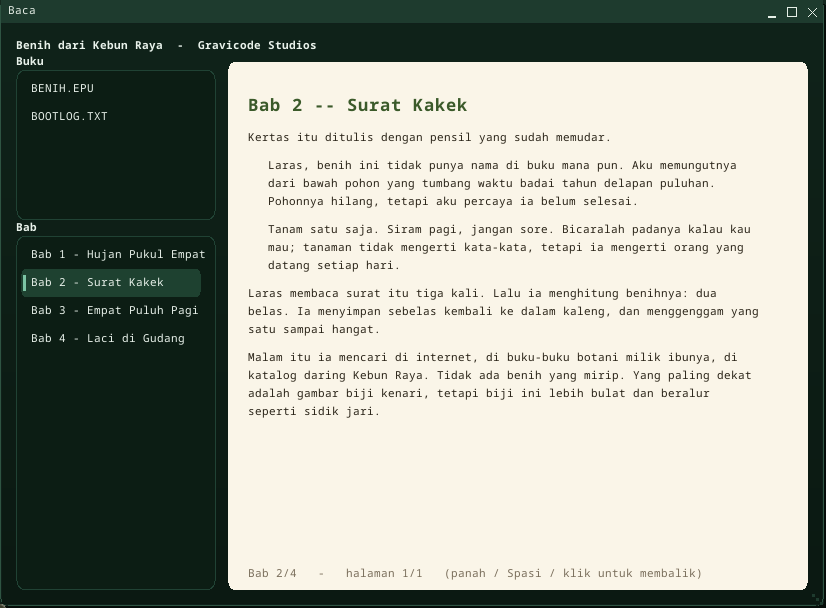
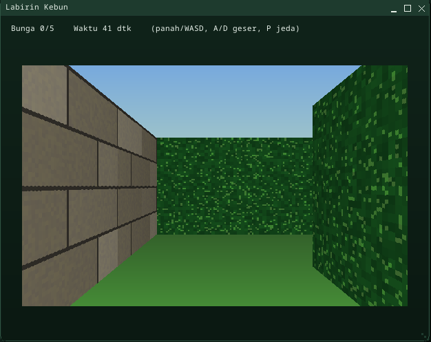
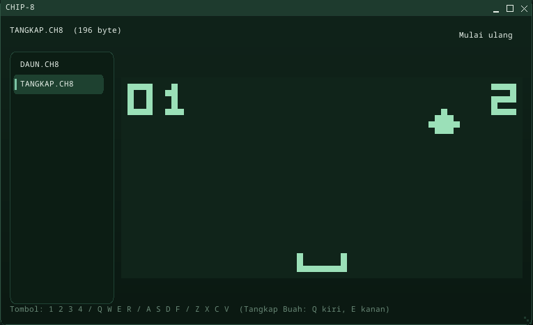

# Reading, a 3D maze, CHIP-8 and game mode

## Baca, the e-book reader



`run mbaca`, or **Start > Hiburan > Baca**. The library lists the EPUB books
(`.EPU` -- the FAT disk keeps 8.3 names, so `book.epub` copied with
`bz push` arrives as `BOOK.EPU`) and text files larger than 1 KB on `/disk`
and the scratch folder. A chapter is laid out to the window and split into
pages at line boundaries; turn pages with the arrow keys, Space, PageUp /
PageDown, the wheel, or a click (left third = back). The chapter list jumps
between chapters. Each book reopens where it was left (`/disk/BACA.CFG`).

Every image carries one original short story, *Benih dari Kebun Raya*
(`/disk/BENIH.EPU`, four chapters; sources in `assets/books/benih`, zipped
with deflate when the image is built).

How it works: the host opens the archive (`userland/clrhost/src/zipapi.rs`,
natives `ZipList` / `ZipText`, stored and deflated entries through
`miniz_oxide`), the app reads `META-INF/container.xml`, the OPF's title,
author, manifest and spine, and lays every chapter out with Peramban's page
engine. A text file becomes paragraphs at its blank lines.

**Comics:** a `.CBZ` (a ZIP of pictures -- PNG, JPEG, GIF, BMP) on `/disk`
opens as a comic: one picture per page, fitted to the window, in natural name
order (`page2` before `page10`); the page list replaces the chapters and the
position is remembered like a book's.

Limits: no CSS (so no fonts or layouts of the book's own), images in books
show as gray boxes, no DRM-protected books, no table-of-contents file (the
chapter titles come from each chapter's `<title>`).

## Labirin Kebun



`run mlabirin`, or **Start > Hiburan > Labirin Kebun**: a first-person maze
between clipped hedges. Find the five golden flowers; then the gate in the
old stone wall (east side) opens -- walk out through it. Up / Down (or W / S)
walk, Left / Right turn, A / D step sideways, P pauses, Enter starts a new
maze after a win. Every maze is generated (depth-first carving, 8x8 cells)
and checked to have every flower and the gate reachable.

The picture is ray-cast in the host: one native call (`RayRender`,
`userland/clrhost/src/raycast.rs`) draws the whole frame -- textured hedge,
stone and gate walls with distance shading, sky and lawn gradients, the
flowers as billboard sprites behind a depth buffer -- into an `int[]` the
game blits. The interpreter only runs the rules. Off the device (`dotnet`)
a flat-colored managed renderer stands in.

## CHIP-8



`run mchip8`, or **Start > Hiburan > CHIP-8**: an emulator of the 1977
CHIP-8 virtual machine -- 4 KiB of memory, 16 registers, a 64x32 screen,
delay and sound timers, 600 instructions per second. Two original programs
come with every image:

| | |
|---|---|
| **TANGKAP.CH8** -- *Tangkap Buah* | catch the falling fruit with the basket: Q = left, E = right; three misses end it, any key starts again |
| **DAUN.CH8** -- *Daun* | a leaf drifts and bounces off the edges |

Any other `.CH8` file on `/disk` appears in the list. The keypad
`1 2 3 C / 4 5 6 D / 7 8 9 E / A 0 B F` is on the keys
`1 2 3 4 / Q W E R / A S D F / Z X C V`; P pauses. The sources are in
`assets/chip8/*.asm`, assembled by `scripts/chip8asm.py` (a small assembler
for the usual mnemonics: `ld`, `add`, `drw`, `skp`, `db`, labels, constants):

```
python scripts/chip8asm.py assets/chip8/tangkap.asm assets/chip8/TANGKAP.CH8
```

The emulator follows the CHIP-48 conventions for the two ambiguous groups
(`8xy6`/`8xyE` shift VX in place; `Fx55`/`Fx65` leave I unchanged).

## Game mode

A game or a playing song keeps the desktop awake: syscall **`IDLE_INHIBIT`
(66)** holds off the screensaver while the calling program runs (released
when it ends). `Buitenzorg.Game.GameView` turns it on while its loop runs,
`Buitenzorg.Media.MediaPlayer` while it plays; other programs call
`Buitenzorg.App.Session.KeepAwake(true / false)`.

---

← [Documentation index](README.md) · *Buitenzorg OS — made by Gravicode Studios, led by Kang Fadhil.*
