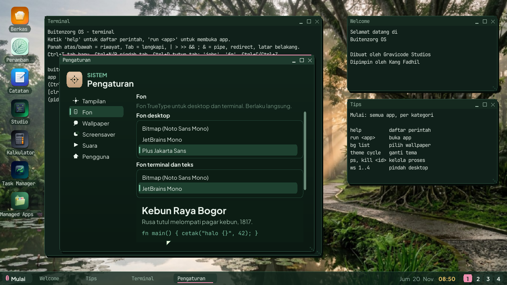

# Fon

Buitenzorg menggambar teks dengan fon TrueType / OpenType sungguhan: outline
anti-alias, kerning, ketebalan bold dan ukuran bebas. Mesin fon kernel
(`kernel/bzkernel/src/font.rs`) melayani desktop, terminal, setiap app managed
dan app UI skrip.



## Yang disertakan

| Fon | Dipakai untuk | Lisensi |
|---|---|---|
| **Plus Jakarta Sans** Regular + Bold (Tokotype, Jakarta) | desktop: judul jendela, menu Mulai, taskbar, app managed | SIL OFL 1.1 |
| **JetBrains Mono** Regular + Bold | terminal, jendela teks, editor kode, Konsol | SIL OFL 1.1 |

Fon ada di `/disk/FONTS` bersama lisensinya (`PJSANS.TXT`, `JBMONO.TXT`) dan
katalog fon yang bisa dipasang (`CATALOG.TXT`). Tanpa berkas fon, fon bitmap
8 x 16 bawaan dipakai, persis seperti sebelumnya.

## Memilih fon

* **Pengaturan > Fon**: fon desktop, fon terminal, pratinjau, dan katalog
  (pasang / hapus).
* **Terminal**:

```
font                          fon terpasang, pilihan sekarang, cache glyph
font ui Plus Jakarta Sans     fon desktop  (font ui bitmap = tampilan lama)
font mono JetBrains Mono      fon terminal
font catalog [teks]           fon yang bisa dipasang
font info inter               satu entri katalog: berkas, ukuran, SHA-256, URL
font install inter            unduh lewat HTTPS, cek SHA-256, pasang
font remove inter             hapus
```

Pilihan disimpan di `/disk/FONTS.CFG`. Fon terminal selalu mengisi kisi sel
8 x 16, jadi menggantinya tidak pernah menggeser teks.

## Memasang fon lain

Katalog (`assets/fonts/catalog.txt`, seperti formula
[fontist](https://www.fontist.org/)) memuat 13 keluarga: Inter, Noto Sans,
Lora, Nunito, Poppins, Atkinson Hyperlegible, Pacifico, Fira Code, Source Code
Pro, IBM Plex Mono, Ubuntu dan dua yang disertakan. Setiap baris mematok satu
berkas ke commit tetap repositorinya, dengan ukuran dan SHA-256.

* **Di perangkat:** `font install NAMA` menjalankan pengunduh (app Pengaturan
  tanpa jendela: HTTPS ada di runtime managed). Kernel memeriksa SHA-256 dan
  bahwa berkasnya memang fon sebelum mendaftarkannya.
* **Dari PC:** `bz font search|info|install NAMA` mengunduh ke `~/.bz/fonts`
  (SHA-256 dicek); `bz font install NAMA --device` sekaligus mengirim berkasnya
  ke perangkat yang terhubung (`bz device connect`), lalu `font add` di sana
  memasangnya.
* Fon berlisensi SIL OFL, Apache 2.0 atau MIT langsung dipasang. Lisensi lain
  (UFL milik Ubuntu di katalog) perlu `--accept-license` setelah membaca
  syaratnya.

Fon variabel dengan sumbu ketebalan (Inter, Noto Sans, Lora, ...) memberi
Regular dan Bold (ketebalan 700) dari satu berkas.

## Di app

**Buitenzorg.UI** (C# managed): teks dalam gaya toolkit otomatis memakai fon
desktop dan diukur dengannya (`Fonts.Measure`, `Fonts.Fit`, `Fonts.IndexAt`;
pembungkusan baris, pemotongan, caret dan seleksi kotak teks mengikutinya).
`DrawingContext.MonoText` mempertahankan kisi monospace (kode, terminal), dan
`DrawingContext.TextIn(x, y, teks, warna, Fonts.Find("Lora"), 28)` menggambar
dengan fon terpasang mana pun di ukuran berapa pun. `Fonts.Installed()`
mendaftar fon yang ada.

**App UI skrip** (JS / TS / Python / C# script):

```js
let judul = font("Plus Jakarta Sans", true);     // 0 bila belum terpasang
textfont(24, 16, "Kebun Raya Bogor", 0xFFFFFF, judul, 30);
let w = measure("Kebun Raya Bogor", judul, 30);  // piksel
```

`textwidth(s, gaya)` kini juga mengukur dengan fon desktop. Studio punya
templat *Pameran Fon*.

**Syscall:** `FONT_OP` (71) mendaftar, mencari, mengukur, memasang dan
menghapus fon; draw op 14 `DRAW_TEXT_FONT` menggambar dengan satu fon (lihat
[abi.id.md](abi.id.md)).

## Cara kerjanya

* `ttf-parser` membaca outline, metrik, sumbu fon variabel dan kerning (tabel
  `kern`, atau pair adjustment fitur `kern` di GPOS); `ab_glyph_rasterizer`
  mengubah outline menjadi coverage. Tanpa hinting: glyph ditempatkan di posisi
  seperempat piksel seperti FreeType, jadi jaraknya sama.
* Glyph di-cache per (fon, ukuran, karakter, offset seperempat piksel), maks
  3 MiB; karakter yang tidak ada di satu fon diambil dari fon terpasang lain,
  atau dari fon bitmap.
* Splash boot tetap memakai fon bitmap: ia menggambar dari dalam jalur print
  kernel, tempat tidak boleh ada alokasi.
* Boot self-test memeriksa advance proporsional dan monospace, bold, kerning,
  coverage anti-alias, fallback dan penggantian fon desktop
  (`MILESTONE: FONTS OK`, diwajibkan smoke test di semua arsitektur);
  self-test Pengaturan memasang fon dari server lokal, menolak SHA-256 yang
  salah dan lisensi lain tanpa persetujuan, lalu menghapusnya lagi.

Belum: hinting TrueType, skrip kanan-ke-kiri dan kompleks (belum ada
shaping), emoji berwarna, dan teks TrueType di program C# native (bflat) dan
C -- mereka masih menggambar teks bitmap sendiri atau memakai draw op 14
langsung.

---

← [Indeks dokumentasi](README.id.md) · *Buitenzorg OS — dibuat oleh Gravicode Studios, dipimpin oleh Kang Fadhil.*
