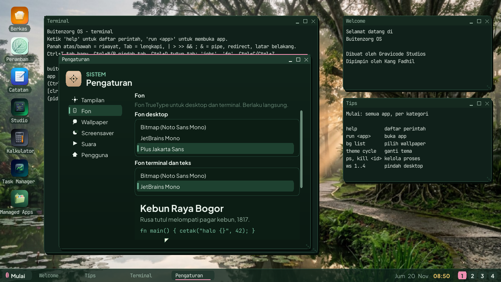

# Fonts

Buitenzorg draws text with real TrueType / OpenType fonts: anti-aliased
outlines, kerning, bold weights and any size. The kernel's font engine
(`kernel/bzkernel/src/font.rs`) serves the desktop, the terminal, every
managed app and script UI apps alike.



## What ships

| Font | Used for | Licence |
|---|---|---|
| **Plus Jakarta Sans** Regular + Bold (Tokotype, Jakarta) | the desktop: window titles, Start menu, taskbar, managed apps | SIL OFL 1.1 |
| **JetBrains Mono** Regular + Bold | the terminal, text windows, code editor, Konsol | SIL OFL 1.1 |

They live in `/disk/FONTS` with their licences (`PJSANS.TXT`, `JBMONO.TXT`)
and the catalog of installable fonts (`CATALOG.TXT`). Without font files the
built-in 8 x 16 bitmap font is used, exactly as before.

## Choosing fonts

* **Pengaturan > Fon**: the desktop font, the terminal font, a preview, and
  the catalog (install / remove).
* **Terminal**:

```
font                          installed faces, the current choice, glyph cache
font ui Plus Jakarta Sans     the desktop's font  (font ui bitmap = the old look)
font mono JetBrains Mono      the terminal's font
font catalog [text]           fonts that can be installed
font info inter               one catalog entry: files, sizes, SHA-256, URLs
font install inter            download over HTTPS, check SHA-256, install
font remove inter             uninstall
```

The choice is kept in `/disk/FONTS.CFG`. The terminal font always fills the
8 x 16 cell grid, so changing it never moves text around.

## Installing more fonts

The catalog (`assets/fonts/catalog.txt`, like
[fontist](https://www.fontist.org/)'s formulas) lists 13 families: Inter,
Noto Sans, Lora, Nunito, Poppins, Atkinson Hyperlegible, Pacifico, Fira Code,
Source Code Pro, IBM Plex Mono, Ubuntu and the two shipped ones. Every line
pins one file to a fixed commit of its repository with its size and SHA-256.

* **On the device:** `font install NAME` starts the downloader (the Settings
  app without a window: HTTPS lives in the managed runtime). The kernel checks
  the SHA-256 and that the file is a font before it registers it.
* **From a PC:** `bz font search|info|install NAME` downloads into
  `~/.bz/fonts` (SHA-256 checked); `bz font install NAME --device` also pushes
  the files to a connected device (`bz device connect`), where `font add`
  installs them.
* Fonts under the SIL OFL, Apache 2.0 or MIT licence install directly. Any
  other licence (Ubuntu's UFL in the catalog) needs `--accept-license` after
  reading its terms.

A variable font with a weight axis (Inter, Noto Sans, Lora, ...) gives both
Regular and Bold (weight 700) from one file.

## In apps

**Buitenzorg.UI** (managed C#): text in the toolkit's styles uses the desktop
font automatically and is measured with it (`Fonts.Measure`, `Fonts.Fit`,
`Fonts.IndexAt`; wrapping, trimming, text-box carets and selections follow).
`DrawingContext.MonoText` keeps the monospace grid (code, terminals), and
`DrawingContext.TextIn(x, y, text, color, Fonts.Find("Lora"), 28)` draws in any
installed face at any size. `Fonts.Installed()` lists the faces.

**Script UI apps** (JS / TS / Python / C# script):

```js
let judul = font("Plus Jakarta Sans", true);     // 0 when it is not installed
textfont(24, 16, "Kebun Raya Bogor", 0xFFFFFF, judul, 30);
let w = measure("Kebun Raya Bogor", judul, 30);  // pixels
```

`textwidth(s, style)` now measures in the desktop font too. Studio has a
template, *Pameran Fon*.

**Syscalls:** `FONT_OP` (71) lists, finds, measures, installs and removes
faces; draw op 14 `DRAW_TEXT_FONT` draws in a face (see [abi.md](abi.md)).

## How it works

* `ttf-parser` reads outlines, metrics, variable-font axes and kerning (the
  `kern` table, else the GPOS `kern` feature's pair adjustments);
  `ab_glyph_rasterizer` turns outlines into coverage. No hinting: glyphs are
  placed at quarter-pixel positions like FreeType's, so spacing matches it.
* Glyphs are cached per (face, size, character, quarter-pixel offset), 3 MiB
  at most; a character a face lacks comes from another installed face, else
  from the bitmap font.
* The boot splash keeps the bitmap font: it draws from inside the kernel's
  print path, where nothing may allocate.
* The self-test boot checks proportional and monospace advances, bold,
  kerning, anti-aliased coverage, fallback and switching the desktop font
  (`MILESTONE: FONTS OK`, required by the smoke test on every architecture);
  Pengaturan's self-test installs a font from a local server, refuses a wrong
  SHA-256 and another licence without consent, and removes it again.

Not done yet: TrueType hinting, right-to-left and complex scripts (no
shaping), colour emoji, and TrueType text in native (bflat) C# and C
programs -- they still draw their own bitmap text or use draw op 14 directly.

---

← [Documentation index](README.md) · *Buitenzorg OS — made by Gravicode Studios, led by Kang Fadhil.*
