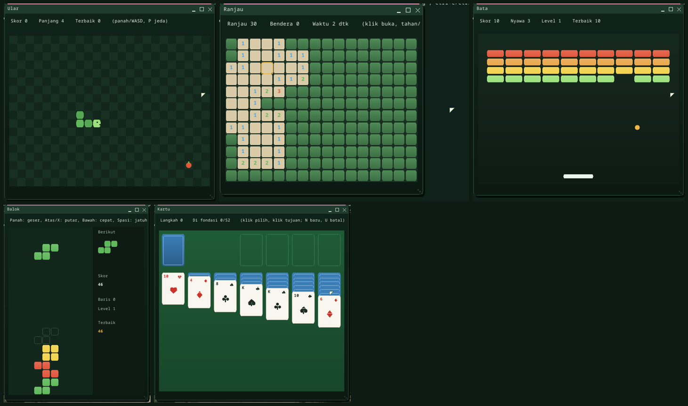

# Game dan `Buitenzorg.Game`

Buitenzorg membawa lima game 2D buatannya sendiri, dibangun di atas framework
game kecil yang bisa dipakai aplikasi C# managed mana pun. Mulai dari **Mulai >
Permainan**, folder *Managed Apps*, atau Terminal (`run mular`).

| Game | Jalankan | Cara main |
|---|---|---|
| **Ular** -- ular di kebun: makan buah, tumbuh, jangan menabrak pagar atau diri sendiri | `mular` | panah / WASD; menunggu tombol pertama; P jeda, Enter main lagi |
| **Ranjau** -- buka petak tanpa menggali ranjau; angka = jumlah ranjau di sekitar | `mranjau` | klik / Spasi buka, tahan / F bendera, panah geser; petak pertama selalu aman |
| **Bata** -- runtuhkan tembok bata dengan biji yang memantul; tiap tembok habis kembali lebih tinggi dan cepat | `mbata` | panah / A-D atau pointer menggeser papan, Spasi meluncurkan; 3 nyawa |
| **Balok** -- susun peti yang jatuh, baris penuh dipanen; makin cepat tiap 10 baris | `mbalok` | Kiri/Kanan geser, Atas/X putar, Bawah cepat, Spasi jatuhkan, P jeda |
| **Kartu** -- solitaire (aturan Klondike): pulangkan semua kartu, As sampai Raja per jenis | `mkartu` | klik kartu, klik tujuannya; klik kedua mengirim ke fondasi; N kartu baru, U batal |

Masing-masing menyimpan lima skor terbaik (`/disk/<GAME>.HI`, atau `/ram` bila ada).

## Membuat game

`Buitenzorg.Game` (`userland/clr-apps/Buitenzorg.Game`, `/disk/BZGAME.DLL`) di atas
Buitenzorg.UI: turunkan `GameView`, isi `Update()` (logika, `Dt` = 1/`Rate` detik,
selalu tetap) dan `Draw(dc, field)` (gambar dalam satuan game; `SRect`/`Sx`/`Sy`
mengubahnya ke piksel), lalu `GameHost.Build(judul, view, w, h)` + `view.Start()`.
Contoh lengkap ada di [versi bahasa Inggris](games.md#writing-a-game).

- **Loop** fixed-timestep (paling banyak 5 update susulan per tick: mesin lambat
  memperlambat game, bukan membekukannya). `P` = jeda.
- **Input** berupa tekan/lepas tombol mentah: jendela memakai `RawKeys` dan
  syscall **`KEY_EVENT`**. `Input.IsDown`, `WasPressed`/`WasReleased`,
  `Axis(neg, pos)`; `RawKey` = kode scancode set 1 (`| 0x100` untuk panah).
- **Menggambar** lewat `DrawingContext` toolkit (draw op kernel, tidak pernah
  loop per piksel di interpreter).
- **Pembantu:** `Rng` (xorshift ber-seed: replay dan tes tepat sama), `Vec2`,
  `Collide`, `Particles`, `Sfx` (nada di speaker), `HighScores`, `Banner`.
- **Tes** tanpa jam: `view.Step(n)`, `window.DispatchKeyEvent(kode, tekan)`.
  Setiap game punya `SelfTest()`; semuanya di `Managed --selftest all` (job .NET
  CI), Ular juga di suite managed saat boot di setiap arsitektur.

## Syscall

`KEY_EVENT` (59) = tekan/lepas berikutnya milik program yang fokus; `KEY_STATE`
(60) = apakah tombol sedang ditahan; `SLEEP_UNTIL` (61) = tidur sampai tenggat
`CLOCK_NANOS` dengan presisi ~1 ms. Status tombol diambil dari scancode mentah
semua keyboard (PS/2, USB HID, virtio-input); repeat tombol yang ditahan bukan
event baru. Cek boot: `MILESTONE: KEY EVENTS OK`.

## Batasan

Game berjalan di interpreter RustCLR: di emulasi software QEMU sekitar 15-30
frame per detik (kecepatan game tetap benar); di hardware nyata lancar. Belum
ada gamepad (HID boot protocol hanya keyboard dan mouse), belum ada musik, dan
screensaver masih bisa muncul saat lama berpikir di Kartu -- "mode game" masuk
langkah berikutnya.

---

← [Indeks dokumentasi](README.id.md) · *Buitenzorg OS — dibuat oleh Gravicode Studios, dipimpin oleh Kang Fadhil.*
