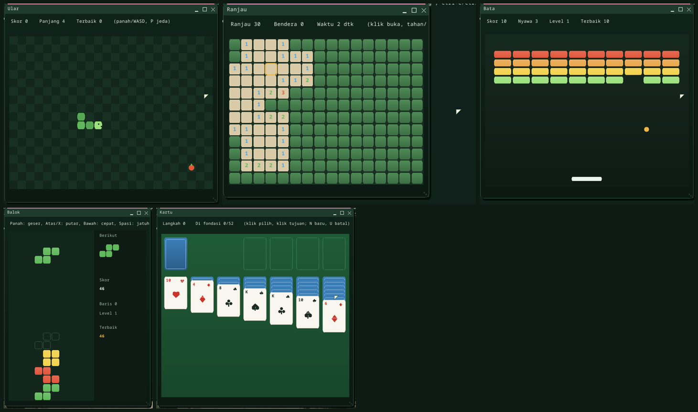

# Games and `Buitenzorg.Game`

Buitenzorg ships five 2D games of its own, built on a small game framework
that any managed C# app can use. Start them from **Start > Permainan**, the
*Managed Apps* folder, or the Terminal (`run mular`).



| Game | Launch | Play |
|---|---|---|
| **Ular** -- a snake in the garden: eat the fruit, grow, do not hit the hedge or yourself | `mular` | arrows / WASD; it waits for the first key; P pause, Enter again |
| **Ranjau** -- clear the plot without digging up a mine; numbers count the mines around | `mranjau` | click / Space opens, long press / F flags, arrows move; the first square is always safe |
| **Bata** -- knock the bricks out with a bouncing seed; every cleared wall returns taller and faster | `mbata` | arrows / A-D or the pointer move the paddle, Space launches; 3 lives |
| **Balok** -- stack the falling crates, a full row is harvested; the pace rises every 10 rows | `mbalok` | Left/Right move, Up/X rotate, Down faster, Space drop, P pause |
| **Kartu** -- patience (Klondike rules): send all cards home, Ace to King by suit | `mkartu` | click a card, click where it goes; a second click sends it to a foundation; N new deal, U undo |

Each keeps its five best scores (`/disk/<GAME>.HI`, or `/ram` where there is one).

## Writing a game

`Buitenzorg.Game` (`userland/clr-apps/Buitenzorg.Game`, `/disk/BZGAME.DLL`) sits
on Buitenzorg.UI:

```csharp
using Buitenzorg.Game;
using Buitenzorg.UI;

public sealed class MyGame : GameView
{
    double _x = 100;
    public MyGame() : base(400, 300, rate: 60) { }   // playfield in game units, updates per second

    protected override void Update()                 // Dt = 1/60 s, always
    {
        _x += Input.Axis(RawKey.Left, RawKey.Right) * 200 * Dt;
        if (Input.WasPressed(RawKey.Space)) Sfx.Blip();
    }

    protected override void Draw(DrawingContext dc, Rect field)
    {
        dc.FillRect(field, 0x13261B);
        dc.Ellipse(SRect(_x - 10, 140, 20, 20), 0xF2B544, true);   // game units -> pixels
    }
}

// in Main:  var w = GameHost.Build("My game", new MyGame(), 440, 360);  view.Start();  app.Run(w);
```

- **The loop** is fixed-timestep: `Update` runs `Rate` times per second of real
  time (at most five catch-up updates per tick: a slow machine slows the game
  instead of freezing it); `Draw` runs when the window renders. `P` pauses.
- **Input** comes as raw key presses and releases: the window has `RawKeys` on
  and reads the **`KEY_EVENT`** syscall instead of characters. `Input.IsDown`,
  `WasPressed` / `WasReleased` (edges of this update), `Axis(neg, pos)`.
  `RawKey` names the codes (PC scancode set 1, `| 0x100` for the arrows and
  the other 0xE0 keys).
- **Drawing** goes through the toolkit's `DrawingContext` -- kernel draw ops,
  never pixel loops in the interpreter. `SRect` / `Sx` / `Sy` / `Sl` scale game
  units to the control, keeping the playfield's aspect ratio.
- **Helpers:** `Rng` (seeded xorshift: replays and tests are exact), `Vec2`,
  `Collide.Rects/Circles/CircleRect` (CircleRect says which face was hit, for
  bouncing), `Particles` (bursts with gravity), `Sfx` (tones on the speaker;
  silent off the device), `HighScores`, `GameView.Banner` (pause / game-over
  band), `GameEnv.Interactive`.
- **Tests** run without a clock: `view.Step(n)` runs `n` updates,
  `window.DispatchKeyEvent(code, pressed)` / `SimulateKeyEvents("a d")` press
  keys. Every game has a `SelfTest()` (`dotnet MUlar.dll --selftest` on a PC;
  all of them in `Managed --selftest all`, CI's .NET job; Ular also in the
  boot's managed suite on every architecture).

## The syscalls

| # | Name | |
|---|---|---|
| 59 | `KEY_EVENT` | the next press / release of the focused program: `code \| pressed << 16 \| 1 << 17`, or 0. Reading events discards its pending characters |
| 60 | `KEY_STATE` | whether a key is held now |
| 61 | `SLEEP_UNTIL` | sleep until a `CLOCK_NANOS` deadline with about 1 ms precision (blocks until shortly before, then yields) |

The kernel keeps the key state from the raw scancodes of every keyboard (PS/2,
USB HID, virtio-input) below the character decoder; a held key's typematic
repeats are not new events. Boot check: `MILESTONE: KEY EVENTS OK`.

## Limits

The games run in the RustCLR interpreter: under QEMU's software emulation
they reach roughly 15-30 frames per second (the loop keeps the game speed
right regardless); on real hardware they are smooth. There is no gamepad yet
(USB HID boot protocol covers keyboards and mice only), no music, and the
screensaver can still start during a long think in Kartu -- the "game mode"
is part of the next steps (`PLAN.md`, Multimedia/Games).

---

← [Documentation index](README.md) · *Buitenzorg OS — made by Gravicode Studios, led by Kang Fadhil.*
