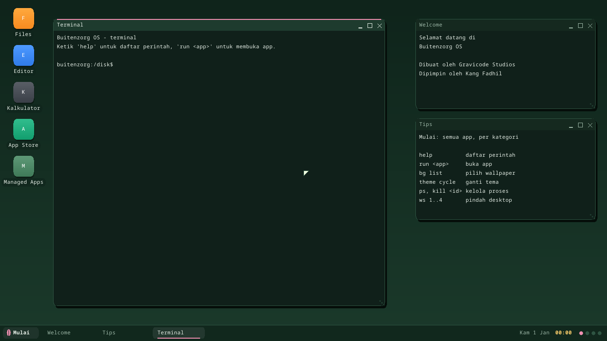

# Raspberry Pi 4

> **Verified on one physical board:** a Raspberry Pi 4 Model B (8 GB) booted
> `dist/buitenzorg-rpi4.img` to `RPI4 BOOT OK` on 2026-11-02 (the
> [serial log](logs/rpi4-first-boot.txt)). Other revisions and RAM sizes are
> untested. If yours stops early, the
> [stage letters](#reading-the-serial-output) tell you how far it got.

## What works today

Milestones R1 and R2: the kernel boots, shows the desktop on HDMI and runs on
all four cores.



| | Status |
|---|---|
| Boot on the Pi firmware | Yes: a real Pi 4 and QEMU `raspi4b`, direct `kernel8.img` |
| Serial console | PL011 on the GPIO header |
| Interrupts and timer | GIC-400 + the ARM generic timer |
| Memory, address spaces, built-in user-mode test programs | Yes |
| Screen | Yes: the desktop on HDMI, 1280x720 (the display scales it) |
| CPU cores | All four, started through the spin tables |
| SD card as `/disk`, apps | No (R3): the kernel can't read the card yet |
| Typing from a PC over the serial cable | Yes: into the desktop terminal or the focused app |
| USB keyboard and mouse, Ethernet | No (R4) |

So today the Pi shows the desktop and you can type into it from a PC through
the serial cable, but there's no USB keyboard or mouse yet, and without input
the screensaver starts after about 12 seconds. There is no wallpaper or app
icons yet either: those come from the SD card. The serial port (a
**USB-to-serial 3.3 V adapter**) shows the full boot log and takes your typing.

## Try it under QEMU

No board needed. This needs QEMU 9.0 or newer:

```powershell
.\scripts\build.ps1
qemu-system-aarch64 -M raspi4b -m 2G -kernel dist\kernel8.img `
    -dtb kernel\bzkernel\testdata\bcm2711-rpi-4-b.dtb -display none -serial stdio -serial null
```

`scripts/smoke-test.ps1` runs the same boot and checks it.

## Put it on an SD card

`scripts/build.ps1` fetches the Pi firmware and writes the card image,
`dist/buitenzorg-rpi4.img`. **Writing it erases the card.**

```powershell
.\scripts\flash-usb.ps1 -List
.\scripts\flash-usb.ps1 -Image dist\buitenzorg-rpi4.img
```

```bash
sudo ./scripts/flash-usb.sh --list
sudo ./scripts/flash-usb.sh /dev/sdX --image dist/buitenzorg-rpi4.img
```

## Connect the serial port

| Pi header pin | Signal | Adapter |
|---|---|---|
| 6 | GND | GND |
| 8 | GPIO 14 (TX) | RX |
| 10 | GPIO 15 (RX) | TX |

Use 3.3 V logic: **a 5 V adapter can damage the Pi.** Don't connect the adapter's
power pin. Open the port at **115200 8N1**, then power the Pi on.

## Typing from the PC

Open the adapter's port in a terminal program (PuTTY, Tera Term, `screen`) at
**115200 8N1** and type: the characters go to the desktop's Terminal window, or
to the app whose window has focus. Enter, Backspace, the arrow keys, Home, End,
Delete and Page Up / Down work. The first key while the screensaver is showing
only wakes it.

Only one program can hold the port: close the terminal program before
capturing the boot log with another one.

## Reading the serial output

The first letters come from the boot code, before the kernel's normal log starts.
A board has no debugger attached, so these are your first clue.

| You see | Meaning | Look at |
|---|---|---|
| Nothing | The kernel never ran, or the wiring is wrong | TX and RX swapped? Green LED blinking an error code? Are `start4.elf` and `config.txt` on the card? |
| `B` only, then silence | Stopped between entry and the move to 2 MiB | Report it: this shouldn't happen |
| `BD` | No Device Tree from the firmware | `bcm2711-rpi-4-b.dtb` on the card? |
| `BR3` | Entered at EL3, which isn't expected | Remove any `armstub` line you added |
| `BREM`, then silence | Stopped as the MMU came on | Report it, with the board's RAM size |
| `BREM`, then the logo | The kernel is running | Look for `MILESTONE:` lines |

A good boot ends with:

```text
[kernel] MILESTONE: RPI4 BOOT OK (raspberrypi,4-model-b via rpi-direct -> EL1 kernel; ...)
[kernel] BUITENZORG ARM64 READY ...
```

## What the first hardware boot found

The first boot on a real board stopped both user-mode test programs with an
"undefined instruction". QEMU had passed them, because it models no caches:
the kernel wrote the programs' code through the data cache, and a real
Cortex-A72 fetches instructions from memory, which still held stale bytes.
The kernel now cleans written code to the point of unification and
invalidates the instruction cache (`arch::cpu::sync_code`, called for every
executable page `elf.rs` loads). The second boot passed.

## How the screen and the cores start

The firmware starts only one core, and the direct route has no UEFI to provide a
framebuffer or PSCI, so the kernel does both itself:

- **Screen:** before the kernel proper runs, it asks the VideoCore GPU for a
  1280x720 32-bit framebuffer through its mailbox, maps it non-cacheable (so the
  GPU sees every write) and hands it on exactly as a UEFI loader would.
- **Cores:** the firmware parks cores 1-3 in a loop that watches an address
  given in the Device Tree (`cpu-release-addr`). The kernel writes its entry
  point there and wakes them; each drops to EL1, turns its MMU on and joins the
  scheduler.

## Two boot routes

The card holds both, and `config.txt` picks one.

- **Direct (the default):** the Pi firmware starts `kernel8.img` itself. This is
  the route verified under QEMU.
- **UEFI + Limine:** community UEFI firmware (`RPI_EFI.fd`), then Limine, as on
  the other ARM64 images. Uncomment the four lines at the end of `config.txt`.
  **This route has never run:** QEMU stops inside the UEFI firmware, at a random
  number generator register it doesn't model, and it has no SD card or PCIe for
  UEFI to read from. The firmware hides the Device Tree by default, so Limine
  passes `bcm2711-rpi-4-b.dtb` from the card instead.

## Limits

- RAM above 0xFC00_0000 (just under 4 GiB) is ignored for now, so an 8 GiB board
  uses a little under 4 GiB.
- With the direct route the kernel image is mapped read-write-execute; the
  Limine route has separate permissions.
- The Pi firmware files are third-party binaries. They're downloaded at build
  time (pinned by SHA-256) and aren't part of this repository; see `Readme.md`
  in `kernel/target/rpi4-uefi`.
