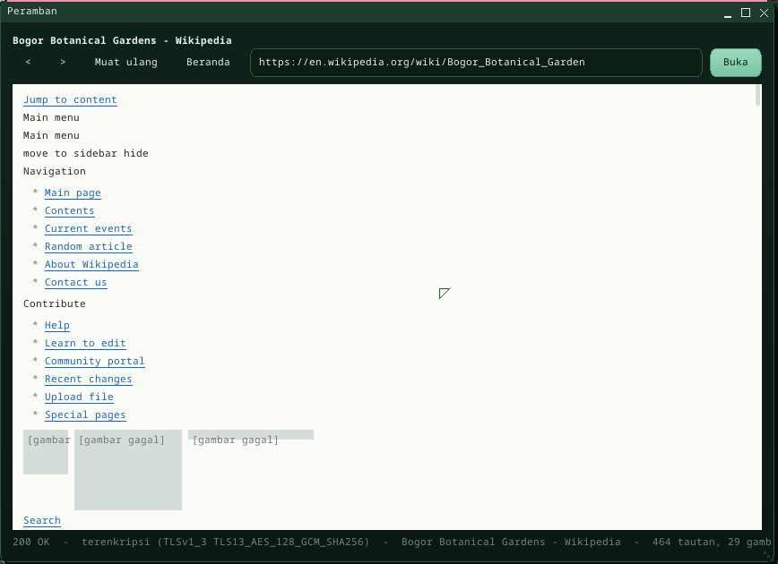

# Internet dan peramban web

Buitenzorg tersambung ke internet lewat tumpukan jaringannya sendiri: DHCP,
DNS, TCP, dan TLS untuk HTTPS. **Peramban** adalah peramban web bawaan;
program mendapat bagian yang sama lewat `Buitenzorg.Net`.

## Peramban

`run mweb [alamat]`, ikon **Peramban** di desktop, atau **Mulai > Kantor >
Peramban**. Ketik alamat lalu Enter (`example.com` saja berarti
`http://example.com`); `<` `>` mundur dan maju, **Muat ulang** (F5), **Beranda**
membuka halaman awal berisi beberapa situs untuk dicoba, Ctrl+L ke kolom
alamat. Gulir dengan roda tetikus, PageUp / PageDown, panah atau Spasi.
Tautan bergaris bawah; arahkan penunjuk ke tautan untuk melihat alamatnya di
baris status. Gambar di halaman (PNG, JPEG, GIF, BMP) dimuat setelah teksnya.
Berkas lokal juga bisa dibuka: `/disk/KEBUN.JPG`, atau halaman `.HTM` di
`/disk`.

Peramban menampilkan **struktur** halaman: judul, paragraf, daftar, tautan,
gambar, teks praformat, kutipan, garis, dan tabel (satu baris per baris).
**Tanpa CSS dan tanpa JavaScript**, jadi situs modern yang membangun isinya
dengan skrip hanya tampil sedikit; situs berbasis teks (`text.npr.org`,
`lite.duckduckgo.com`, Wikipedia versi seluler, dokumentasi) nyaman dibaca.

## Unduhan

`run munduh [alamat]`, atau **Mulai > Utilitas > Unduhan**. Tempel alamat
`http://` atau `https://` lalu Enter: berkas disimpan ke `/disk/UNDUHAN`
dengan nama 8.3 dari alamatnya (`laporan-akhir.pdf` menjadi `LAPORANA.PDF`;
nama yang sudah dipakai diberi angka). Tiap unduhan menampilkan bilah
kemajuan, jumlah dan kecepatan; **Jeda** menghentikan sementara,
**Lanjutkan** meneruskan dari titik berhenti (server diminta sisanya dengan
permintaan HTTP `Range`), **Hapus** mengeluarkannya dari daftar (berkas yang
belum selesai dihapus, yang sudah selesai tetap ada). Unduhan berjalan satu
per satu di latar, dan daftarnya -- termasuk yang dijeda -- tetap ada setelah
restart (`/disk/UNDUHAN/DAFTAR.TXT`).

Ukuran berkas tidak dibatasi memori: isi ditulis ke disk per 256 KiB begitu
datang, lewat syscall baru **`FS_APPEND`** (68). Untuk program:
`HttpClient.Download(url, path, progress, cancel)` (`r.Saved`, `r.Cancelled`,
`r.Resumed`), `Files.WriteAllBytes` dan `Files.AppendAllBytes`.

## Di Terminal

| Perintah | |
|---|---|
| `nslookup example.com` | menerjemahkan nama (tanpa argumen: server DNS dan cache) |
| `ping example.com` | ping kini menerima nama |
| `ipconfig`, `netstat` | alamat, router, sambungan |

## IPv6 dan kartu jaringan

Kartu Ethernet: virtio-net, Intel e1000 / e1000e (I217-I219), Realtek RTL8139
dan RTL8169/8168/8111/8101 (yang terakhir belum diuji di perangkat keras),
GENET di Pi 4. Wi-Fi belum didukung.

IPv6 berjalan di samping IPv4: setiap kartu mendapat alamat link-local
(fe80::, dari MAC-nya), dan iklan router menambah alamat global (SLAAC). Di
Terminal: `ipconfig` menampilkan alamatnya, `ping6 -r` meminta iklan router,
`ping6 ALAMAT [jumlah]` mengirim ping. Program belum bisa memakai IPv6: belum
ada UDP/TCP di atas IPv6 dan belum ada pencarian DNS AAAA.

## Untuk program: `Buitenzorg.Net`

`HttpClient.Get(url)` / `Post(url, tipe, isi)` (redirect, body chunked,
`r.Status`, `r.Text`, `r.Body`, `r.Header(...)`, `r.Tls`);
`TcpConnection.Connect(host, port)` + `Write` / `Read` / `Close`;
`TcpServer(port).Accept(waitMs)`; `TlsConnection.Connect(host, 443)` dan
`TlsConnection.AddRoot(der)` (CA privat); `Dns.Resolve(nama)`;
**WebSocket** (RFC 6455): `WebSocket.Connect("ws://..." / "wss://...")`,
`Send(teks)` / `Send(byte[])`, `Receive()` (null bila koneksi tertutup; ping
dijawab otomatis, pesan terfragmen disatukan), `Close()`, dan sisi server
`WebSocket.Accept(koneksi, kepalaRequest)` -- self-test Peramban menjalankan
server echo seperti itu. Pemanggilan
menahan thread pemanggil selama menunggu -- program UI mengambil data di
`Thread` latar dan menyerahkan hasilnya ke UI dengan `Dispatcher.Post`, seperti
Peramban. Di luar perangkat (`dotnet X.dll`) kelas yang sama memakai socket
.NET, jadi self-test bisa jalan di PC. Contoh kode lengkap ada di
[versi bahasa Inggris](internet.md).

Syscall: **`TCP_OP` (64)** -- connect, send, receive, state, close, listen,
accept; handle milik proses dan ditutup saat proses berakhir -- dan
**`DNS_RESOLVE` (65)**.

## Cara kerja

- **DNS** (`dns.rs`): record A lewat UDP port 53 ke server dari lease DHCP
  (jaringan user QEMU: 10.0.2.3), rantai CNAME diikuti, jawaban di-cache
  sesuai TTL (30 dtk .. 1 jam).
- **TCP untuk program** (`appnet.rs`): tabel handle per proses di atas
  `tcp.rs`; kernel tidak pernah menahan -- program yang memeriksa ulang.
- **TLS** berjalan di host runtime managed (`clrhost/src/netapi.rs`):
  **rustls** tanpa `std`, primitif RustCrypto, **akar sertifikat Mozilla**
  (webpki-roots) -- rantai sertifikat, nama, dan tanggalnya diperiksa terhadap
  jam waktu nyata -- dan bahan kunci dari syscall `RANDOM`. TLS 1.3 dan 1.2.
- **HTTP/1.1** (`Buitenzorg.App/Net.cs`): satu permintaan per sambungan,
  redirect (maks. 5), body chunked dan ber-Content-Length, maks. 8 MB.
- Mesin halaman (tokenizer HTML + layout) berjalan di host
  (`clrhost/src/htmlpage.rs`) di perangkat dan di C# (`Html.cs`) di luar
  perangkat: string RustCLR berformat UTF-8, sehingga mengindeks halaman
  panjang dari C# memindai ulang dari awal -- artikel Wikipedia 250 KB butuh
  lebih dari dua menit; di host ~80 ms. Diukur di QEMU (x86, TCG): DNS 27 ms,
  TCP + TLS 304 ms, 248 KB dalam 0,75 dtk, parse 78 ms, layout 173 ms.

Cek boot: `MILESTONE: DNS OK`; self-test **Peramban** di suite managed
menyajikan halaman dari thread-nya sendiri lewat TCP di alamat mesin itu
sendiri lalu menjelajahinya (redirect, body chunked, gambar, klik tautan,
mundur).

## Batasan

- Tanpa gambar SVG (logo di banyak situs tampil sebagai kotak abu-abu).
- CSS dan JavaScript berupa subset; tanpa cache HTTP.
- Formulir terkirim (GET di alamat, POST urlencoded; Enter mengikuti aturan
  implicit submission HTML; `onsubmit` bisa membatalkan); tanpa unggah berkas.
- Cookie (`CookieJar`, subset RFC 6265: host/domain, path, Max-Age/Expires,
  Secure); Peramban menyimpan yang persisten di `/disk/APPDATA/MWEB/KUKI.TXT`.
  Tanpa SameSite.
- Nama yang hanya punya alamat IPv6 tetap tersambung (`DNS_RESOLVE6` 77,
  DNS AAAA). Tanpa HTTP/2, body terkompresi, atau proxy.
- TCP belum punya window scaling atau SACK -- cukup untuk halaman, lambat
  untuk berkas besar.
- Satu sambungan per permintaan (tanpa keep-alive).

## CSS di Peramban

Peramban menerapkan sebagian CSS: blok `<style>`, sampai empat berkas `<link rel="stylesheet">` (diambil
sebelum halaman ditata) dan atribut `style="..."`. Selektor: `*`, `tag`, `.kelas`, `#id`, gabungan
seperti `p.catatan`, dan kombinator keturunan / anak; aturan dengan pseudo-class (`:hover`), selektor
atribut atau kombinator saudara diabaikan. Properti: `color`, `background(-color)`, `border` (bingkai di
sekeliling blok), `font-weight`, `font-size` / `font` (dipetakan ke tiga font sistem),
`display: none | block | inline`, `text-align`, dan `margin-left` / `padding-left`. Belum ada flexbox,
grid, float atau positioning, dan belum ada JavaScript.

---

← [Indeks dokumentasi](README.id.md) · *Buitenzorg OS — dibuat oleh Gravicode Studios, dipimpin oleh Kang Fadhil.*
