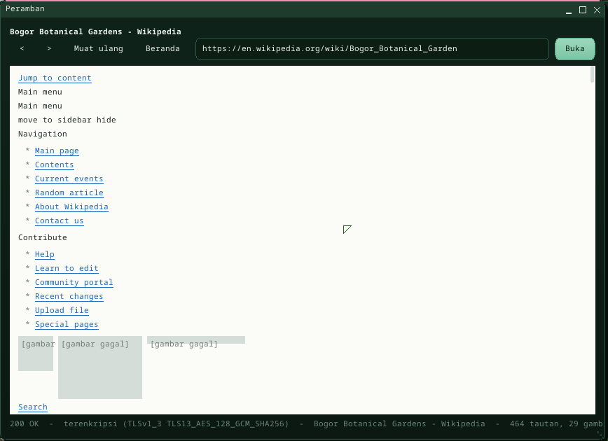

# Internet dan peramban web

Buitenzorg tersambung ke internet lewat tumpukan jaringannya sendiri: DHCP,
DNS, TCP, dan TLS untuk HTTPS. **Peramban** adalah peramban web bawaan;
program mendapat bagian yang sama lewat `Buitenzorg.Net`.

## Peramban

`run mweb [alamat]`, ikon **Peramban** di desktop, atau **Mulai > Kantor >
Peramban**. Ketik alamat lalu Enter (`example.com` saja berarti
`http://example.com`); `<` `>` mundur dan maju, **Muat ulang** (F5), **Beranda**
membuka halaman awal berisi beberapa situs untuk dicoba, Ctrl+L ke kolom
alamat. Gulir dengan roda tetikus, PageUp / PageDown, panah atau Spasi.
Tautan bergaris bawah; arahkan penunjuk ke tautan untuk melihat alamatnya di
baris status. Gambar di halaman (PNG, JPEG, GIF, BMP) dimuat setelah teksnya.
Berkas lokal juga bisa dibuka: `/disk/KEBUN.JPG`, atau halaman `.HTM` di
`/disk`.

Peramban menampilkan **struktur** halaman: judul, paragraf, daftar, tautan,
gambar, teks praformat, kutipan, garis, dan tabel (satu baris per baris).
**Tanpa CSS dan tanpa JavaScript**, jadi situs modern yang membangun isinya
dengan skrip hanya tampil sedikit; situs berbasis teks (`text.npr.org`,
`lite.duckduckgo.com`, Wikipedia versi seluler, dokumentasi) nyaman dibaca.

## Di Terminal

| Perintah | |
|---|---|
| `nslookup example.com` | menerjemahkan nama (tanpa argumen: server DNS dan cache) |
| `ping example.com` | ping kini menerima nama |
| `ipconfig`, `netstat` | alamat, router, sambungan |

## Untuk program: `Buitenzorg.Net`

`HttpClient.Get(url)` / `Post(url, tipe, isi)` (redirect, body chunked,
`r.Status`, `r.Text`, `r.Body`, `r.Header(...)`, `r.Tls`);
`TcpConnection.Connect(host, port)` + `Write` / `Read` / `Close`;
`TcpServer(port).Accept(waitMs)`; `TlsConnection.Connect(host, 443)` dan
`TlsConnection.AddRoot(der)` (CA privat); `Dns.Resolve(nama)`. Pemanggilan
menahan thread pemanggil selama menunggu -- program UI mengambil data di
`Thread` latar dan menyerahkan hasilnya ke UI dengan `Dispatcher.Post`, seperti
Peramban. Di luar perangkat (`dotnet X.dll`) kelas yang sama memakai socket
.NET, jadi self-test bisa jalan di PC. Contoh kode lengkap ada di
[versi bahasa Inggris](internet.md).

Syscall: **`TCP_OP` (64)** -- connect, send, receive, state, close, listen,
accept; handle milik proses dan ditutup saat proses berakhir -- dan
**`DNS_RESOLVE` (65)**.

## Cara kerja

- **DNS** (`dns.rs`): record A lewat UDP port 53 ke server dari lease DHCP
  (jaringan user QEMU: 10.0.2.3), rantai CNAME diikuti, jawaban di-cache
  sesuai TTL (30 dtk .. 1 jam).
- **TCP untuk program** (`appnet.rs`): tabel handle per proses di atas
  `tcp.rs`; kernel tidak pernah menahan -- program yang memeriksa ulang.
- **TLS** berjalan di host runtime managed (`clrhost/src/netapi.rs`):
  **rustls** tanpa `std`, primitif RustCrypto, **akar sertifikat Mozilla**
  (webpki-roots) -- rantai sertifikat, nama, dan tanggalnya diperiksa terhadap
  jam waktu nyata -- dan bahan kunci dari syscall `RANDOM`. TLS 1.3 dan 1.2.
- **HTTP/1.1** (`Buitenzorg.App/Net.cs`): satu permintaan per sambungan,
  redirect (maks. 5), body chunked dan ber-Content-Length, maks. 8 MB.
- Mesin halaman (tokenizer HTML + layout) berjalan di host
  (`clrhost/src/htmlpage.rs`) di perangkat dan di C# (`Html.cs`) di luar
  perangkat: string RustCLR berformat UTF-8, sehingga mengindeks halaman
  panjang dari C# memindai ulang dari awal -- artikel Wikipedia 250 KB butuh
  lebih dari dua menit; di host ~80 ms. Diukur di QEMU (x86, TCG): DNS 27 ms,
  TCP + TLS 304 ms, 248 KB dalam 0,75 dtk, parse 78 ms, layout 173 ms.

Cek boot: `MILESTONE: DNS OK`; self-test **Peramban** di suite managed
menyajikan halaman dari thread-nya sendiri lewat TCP di alamat mesin itu
sendiri lalu menjelajahinya (redirect, body chunked, gambar, klik tautan,
mundur).

## Batasan

- Tanpa gambar SVG (logo di banyak situs tampil sebagai kotak abu-abu).
- Tanpa CSS, JavaScript, formulir yang terkirim, cookie, atau cache; teks
  memakai font monospace sistem (karakter di luar ASCII didekati).
- Hanya IPv4; tanpa HTTP/2, body terkompresi, atau proxy.
- TCP belum punya window scaling atau SACK -- cukup untuk halaman, lambat
  untuk berkas besar.
- Satu sambungan per permintaan (tanpa keep-alive).

---

← [Indeks dokumentasi](README.id.md) · *Buitenzorg OS — dibuat oleh Gravicode Studios, dipimpin oleh Kang Fadhil.*
