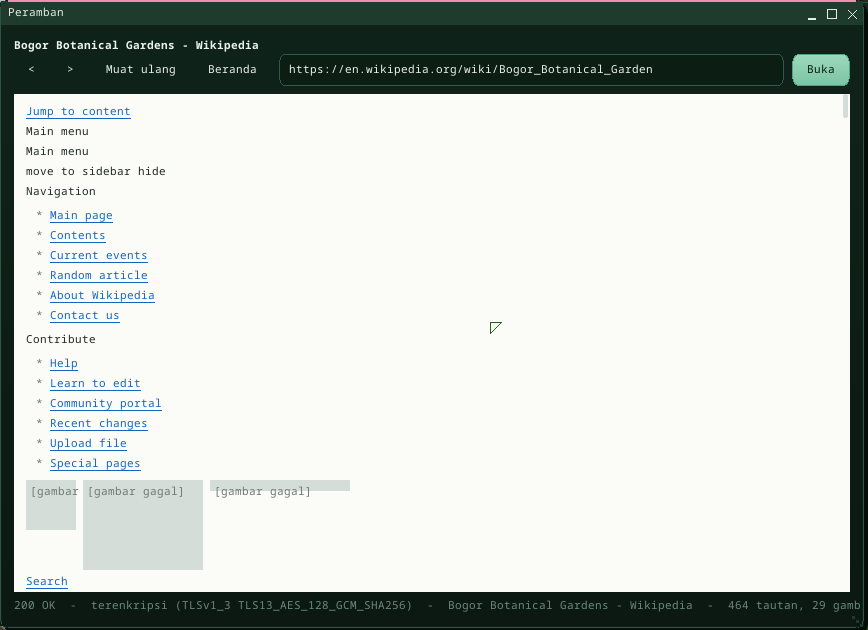

# Internet and the web browser

Buitenzorg reaches the internet through its own network stack: DHCP, DNS,
TCP, and TLS for HTTPS. **Peramban** is the built-in web browser; programs
get the same pieces through `Buitenzorg.Net`.



## Peramban

`run mweb [address]`, the **Peramban** icon on the desktop, or **Start >
Kantor > Peramban**. Type an address and press Enter (`example.com` alone
means `http://example.com`); `<` `>` go back and forward, **Muat ulang** (F5)
reloads, **Beranda** opens the start page with a few sites to try, Ctrl+L
jumps to the address bar. Scroll with the wheel, PageUp / PageDown, the arrow
keys or Space. Links are underlined; hovering one shows its address in the
status line. Pictures in pages (PNG, JPEG, GIF, BMP) load after the text.
Local files open too: `/disk/KEBUN.JPG`, or an `.HTM` page on `/disk`.

The browser shows a page's **structure**: headings, paragraphs, lists,
links, images, preformatted text, quotes, rules, and tables one row per line.
There is **no CSS and no JavaScript**, so modern sites that build their
content with scripts show little; text-oriented sites (`text.npr.org`,
`lite.duckduckgo.com`, Wikipedia's mobile pages, documentation) read well.

## In the Terminal

| Command | |
|---|---|
| `nslookup example.com` | resolve a name (no argument: the DNS server and the cache) |
| `ping example.com` | ping accepts names now |
| `ipconfig`, `netstat` | address, router, connections |

## For programs: `Buitenzorg.Net`

```csharp
using Buitenzorg.Net;

var http = new HttpClient();
var r = http.Get("https://example.com/");      // follows redirects, chunked bodies, Content-Length
Console.WriteLine(r.Status + " " + r.Tls);      // 200 TLSv1_3 TLS13_AES_256_GCM_SHA384
string html = r.Text;                           // r.Body (bytes), r.Header("Content-Type")

var c = TcpConnection.Connect("10.0.2.2", 8000);   // plain TCP (names are resolved)
c.Write("hello\n");
var buf = new byte[1024];
int n = c.Read(buf, 0, buf.Length);             // 0 = the other side closed
c.Close();

var server = new TcpServer(8080);               // accept connections
var client = server.Accept(waitMs: 1000);       // null when none came

long ip = Dns.Resolve("example.com");           // -1 when it does not resolve
```

`TlsConnection.Connect(host, 443)` gives a TLS stream directly;
`TlsConnection.AddRoot(der)` trusts one more root certificate (for a server
with a private CA). Calls block the calling thread while they wait -- a UI
program fetches on a background `Thread` and hands the result to the UI with
`Dispatcher.Post`, as Peramban does. Off the device (`dotnet X.dll`) the same
classes run on .NET's sockets, so self-tests work on a PC.

Syscalls: **`TCP_OP` (64)** -- connect, send, receive, state, close, listen,
accept; handles belong to the process and close when it ends -- and
**`DNS_RESOLVE` (65)**. See [abi.md](abi.md).

## How it works

- **DNS** (`kernel/bzkernel/src/dns.rs`): A records over UDP port 53 to the
  server from the DHCP lease (QEMU's user network: 10.0.2.3), CNAME chains
  followed, answers cached for their TTL (30 s .. 1 h).
- **TCP for programs** (`appnet.rs`): a per-process handle table over the
  kernel's `tcp.rs`; nothing blocks in the kernel -- programs poll, and every
  call runs the network stack first.
- **TLS** runs in the managed runtime's host (`userland/clrhost/src/netapi.rs`):
  **rustls** without `std`, the RustCrypto primitives, **Mozilla's root
  certificates** (webpki-roots) -- the server's certificate chain, name and
  dates are checked against the real-time clock -- and key material from the
  kernel's `RANDOM` syscall. TLS 1.3 and 1.2.
- **HTTP/1.1** (`Buitenzorg.App/Net.cs`): one request per connection,
  redirects (up to 5), chunked and length-delimited bodies, 8 MB at most.
- The browser (`userland/clr-apps/MWeb`): the page engine -- a tolerant
  HTML tokenizer and a flow layout for the system's three fonts -- runs in
  the host (`userland/clrhost/src/htmlpage.rs`) on the device and in C#
  (`Html.cs`, the same rules) off it: RustCLR keeps strings as UTF-8, so
  indexing into a long page from C# rescans it, and a 250 KB Wikipedia
  article took over two minutes to tokenize; in the host it takes ~80 ms.
  The page view draws only the visible part and crops images to it.
  Measured on QEMU (x86, TCG): that article -- DNS 27 ms, TCP + TLS 304 ms,
  248 KB in 0.75 s, parse 78 ms, layout 173 ms.

Boot check: `MILESTONE: DNS OK` (query building, a CNAME + A answer,
NXDOMAIN); the managed suite's **Peramban** self-test serves pages from a
thread of its own over TCP on the machine's address and browses them
(redirect, chunked body, image, link click, back).

## Limits

- No SVG images (logos on many sites show as a gray box).
- No CSS, no JavaScript, no forms that submit, no cookies, no cache; text in
  the system's monospaced fonts (characters outside ASCII are approximated).
- IPv4 only; no HTTP/2, no compressed bodies (the browser asks for
  `identity`), no proxy.
- TCP has no window scaling or SACK -- fine for pages, slow for large files.
- One connection per request (no keep-alive).

---

← [Documentation index](README.md) · *Buitenzorg OS — made by Gravicode Studios, led by Kang Fadhil.*
