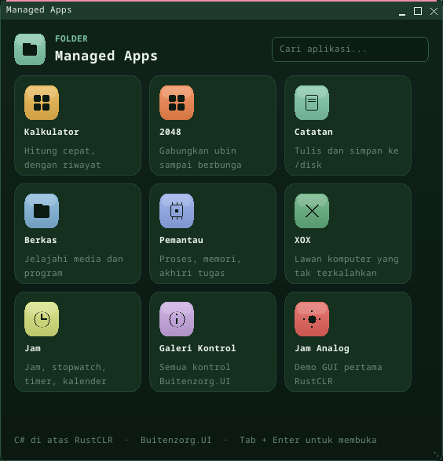
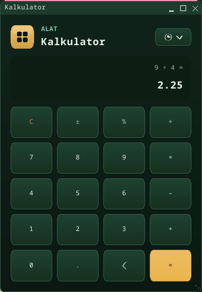
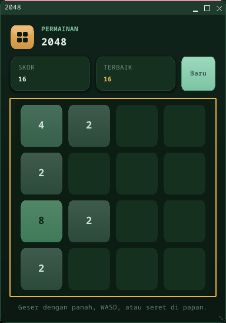
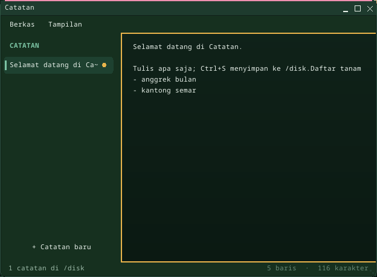
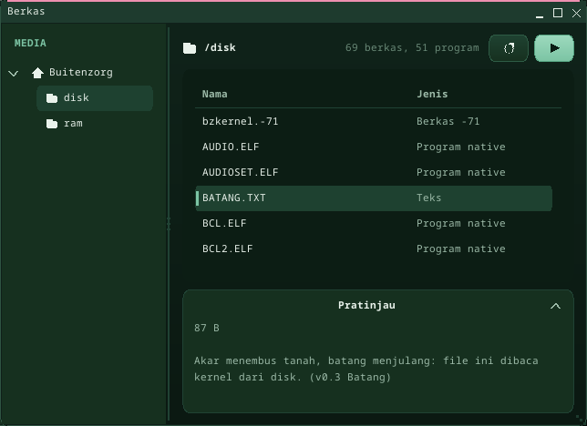
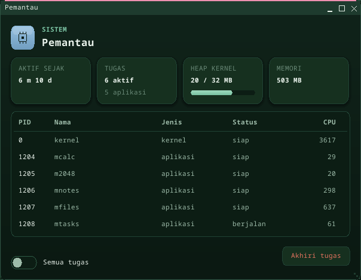
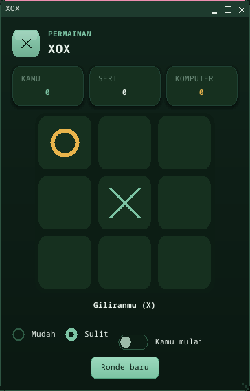
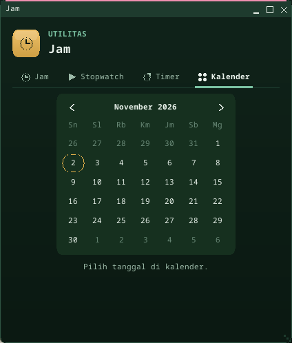
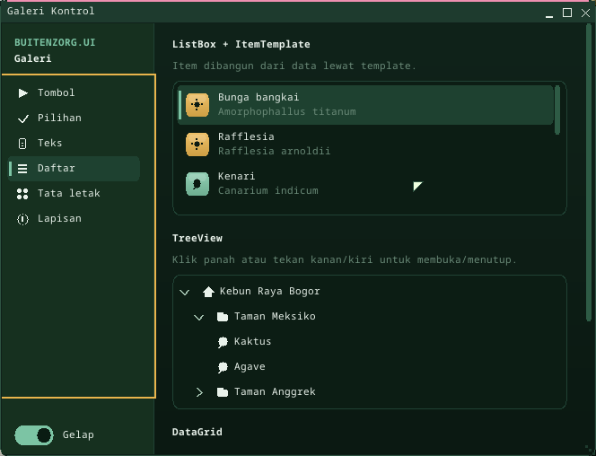

# Managed Apps and Buitenzorg.UI

Buitenzorg runs C# two ways (see [CLAUDE.md](../CLAUDE.md)): **native** (bflat /
NativeAOT, no garbage collector) and **managed** (RustCLR, an IL interpreter
with a garbage collector and a BCL). This page covers the managed side's UI
toolkit, **Buitenzorg.UI**, and the **Managed Apps** folder built with it.



## Opening the apps

- **Desktop:** double-click **Managed Apps** (top-left icon). A folder window
  opens with one tile per app. Click a tile, or move with Tab and press Enter.
  The search box filters the tiles.
- **Shell:** `run managed`, or start an app directly by its launch name:

| Launch name | App | What it shows off |
|---|---|---|
| `mcalc` | Kalkulator | MVVM bindings, a keypad `Grid`, a history flyout, keyboard input |
| `m2048` | 2048 | A custom-drawn control, swipe + arrow input, pop animation, a modal dialog |
| `mnotes` | Catatan | `Menu` with shortcuts (Ctrl+S/N/B/T), `SplitView`, multi-line `TextBox`, toasts |
| `mstudio` | Studio | The IDE ([studio.md](studio.md)): a custom `CodeEditor` control, `TabControl` panels, a `Dialog` with a `ComboBox` of 25 templates, `Shell.Run` |
| `mfiles` | Berkas | `TreeView`, `GridSplitter`, sortable `DataGrid`, `Expander` preview, context menu |
| `mtasks` | Pemantau | Live stat cards, `ProgressBar`, `DataGrid` of processes, `ToggleSwitch`, end-task dialog |
| `mxox` | XOX | `RadioButton` groups, a toggle, an alpha-beta opponent |
| `mclock` | Jam | `TabControl`: analog clock, stopwatch with laps, countdown timer, `Calendar` |
| `mgallery` | Galeri Kontrol | Every control of Buitenzorg.UI, plus the light/dark theme switch |
| `hellogui` | Jam Analog | The first managed GUI demo (Buitenzorg.App, no toolkit) |

| | |
|---|---|
|  |  |
|  |  |
|  |  |
|  |  |

The assemblies live on `/disk` as 8.3 names (`MCALC.DLL`, ..., `BZUI.DLL`).
`CLRHOST.ELF` loads an app and, first, the assemblies it references
(`Buitenzorg.UI` -> `BZUI.DLL`, which references `Buitenzorg.App` -> `BZAPP.DLL`).

## Buitenzorg.UI in one page

The toolkit (`userland/clr-apps/Buitenzorg.UI`) follows Avalonia's design so
that Avalonia code reads naturally, but builds the tree in C# (there is no XAML
loader):

```csharp
using Buitenzorg.UI;

var app = new Application();                       // theme + styles + event loop
var w = new Window("Halo", 360, 240);              // client size; the WM adds the title bar
var vm = new CounterViewModel();                   // an ObservableObject

var label = new TextBlock().WithClass("h1")
    .Bind(TextBlock.TextProperty, vm, () => vm.Count.ToString(), nameof(vm.Count));
var button = new Button("Tambah", _ => vm.Count++).WithClass("accent");

w.Content = new StackPanel { Margin = new Thickness(16), Spacing = 12, Children = { label, button } };
app.Run(w);
```

| Area | What there is |
|---|---|
| Property system | `StyledProperty<T>` with local / animated / style layers and defaults; inherited properties (`Foreground`, `FontSize`, `FontWeight`); `PropertyChanged` |
| Layout | Measure/Arrange with Margin, Padding, alignment, Width/Height/Min/Max; cached and invalidated upward like Avalonia |
| Panels | `StackPanel`, `Grid` (`"Auto,*,2*,120"`, spans, spacing), `DockPanel`, `WrapPanel`, `UniformGrid`, `Canvas`, `Border`, `ScrollViewer`, `SplitView`, `GridSplitter` |
| Controls | `TextBlock`, `Label`, `Button`, `RepeatButton`, `ToggleButton`, `HyperlinkButton`, `DropDownButton`, `SplitButton`, `CheckBox`, `RadioButton`, `ToggleSwitch`, `Slider`, `ProgressBar` (incl. indeterminate), `TextBox` (multi-line, watermark, password), `NumericUpDown`, `AutoCompleteBox`, `ComboBox`, `ListBox`, `ItemsControl`, `TabControl`, `TreeView`, `DataGrid`, `Expander`, `Calendar`, `CalendarDatePicker`, `Separator`, `Image`, `Icon` (vector glyphs) |
| Overlays | `Popup` (light dismiss), `Flyout`, `MenuFlyout`, `Menu` + `MenuItem` (submenus, gestures), context menus (press-and-hold), `ToolTip`, `WindowNotificationManager` toasts, modal `Dialog` |
| Styling | `Style("Button.accent:pointerover")` selectors with types, classes, pseudo-classes (`:pointerover`, `:pressed`, `:focus`, `:focus-visible`, `:disabled`, `:checked`, `:selected`, `:expanded`, `:open`) and descendants; `Transition`s for colors and numbers |
| Data | `ObservableObject` (`SetProperty`), `ObservableCollection<T>`, `ICommand` / `RelayCommand`, one-way / two-way / by-name bindings |
| Input | Pointer events per window (move, press with capture, release, leave), keyboard focus, Tab navigation, default/cancel buttons, navigation keys |
| Theme | "Kebun": dark (forest floor) and light (morning glasshouse) variants, switchable live with `Application.SetTheme` |

The look: deep greens, a leaf accent (`#7CC4A4`), and an amber focus ring --
light through the canopy marking where the keyboard is.

### How it draws

The toolkit never touches pixels in C#. Every primitive is one kernel draw op on
the window's canvas -- the interpreter is far too slow to fill pixels. The
window system gained six ops for this (ABI `draw_op` 8-13): filled and outlined
rounded rectangles, vertical gradients (plain and rounded), styled text (body,
bold, 24 px heading) and translucent rounded rectangles (shadows, overlays).
`WIN_CREATE` takes a `CLIENT_SIZE` flag so a window is sized by its content
area, `WIN_EVENT` (45) delivers pointer events to the window's owner, and
`TEXT_METRICS` (46) reports the font metrics layout needs. See
[abi.md](abi.md).

### Testing an app

Each app has a `--selftest` that builds its real UI headlessly and drives it
through the window's own input routing (`SimulateClick`, `SimulateKeys`,
`SimulatePointer`), then checks the view model and the rendered frame. The same
self-tests run three ways:

- on a development machine under .NET: `dotnet MCalc.dll --selftest` (CI runs
  `dotnet Managed.dll --selftest all`);
- under RustCLR on the host: `rustnet run MCalc.dll -- --selftest`;
- on Buitenzorg itself: at boot, `managed --selftest` draws a real window with
  the new draw ops and runs the apps that reach the device (files, processes,
  notes) -> `MILESTONE: MANAGED UI OK` and `MILESTONE: MANAGED APPS OK`;
  `run managed --selftest all` runs every app.

Off the device, `Buitenzorg.App` falls back to an in-memory `/ram` and sample
process data, so the same code runs on a laptop.

## Limits (honest)

- **Speed.** The managed code is interpreted. Under QEMU's software emulation a
  click takes a noticeable fraction of a second; on KVM or real hardware it is
  much faster. The toolkit caches layout and styles and draws with kernel ops
  for this reason.
- **No XAML**, no data templates by type, no virtualization of long lists, no
  pointer wheel (the PS/2 mouse driver reports no wheel), one pointer button
  (so context menus open on press-and-hold).
- **Files:** root directories with 8.3 names; the VFS has no delete, so
  Catatan "deletes" a note by emptying its file.
- Fonts are the kernel's monospaced bitmap fonts in three styles.
