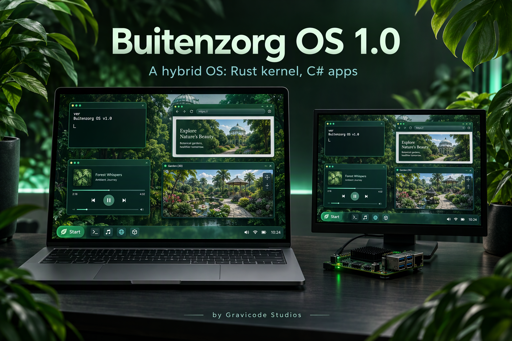
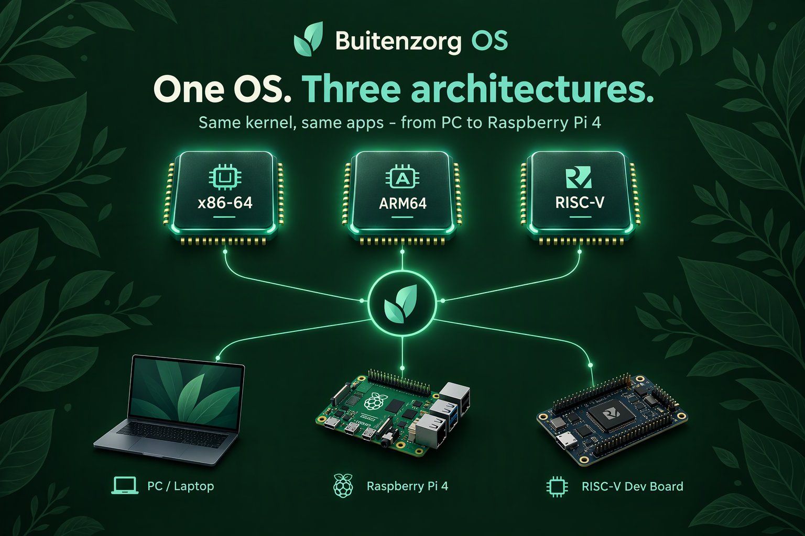
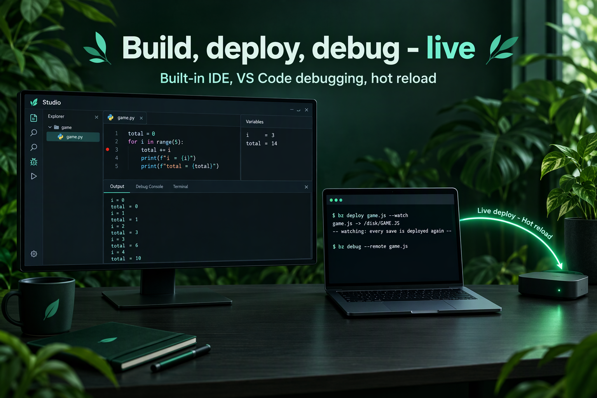
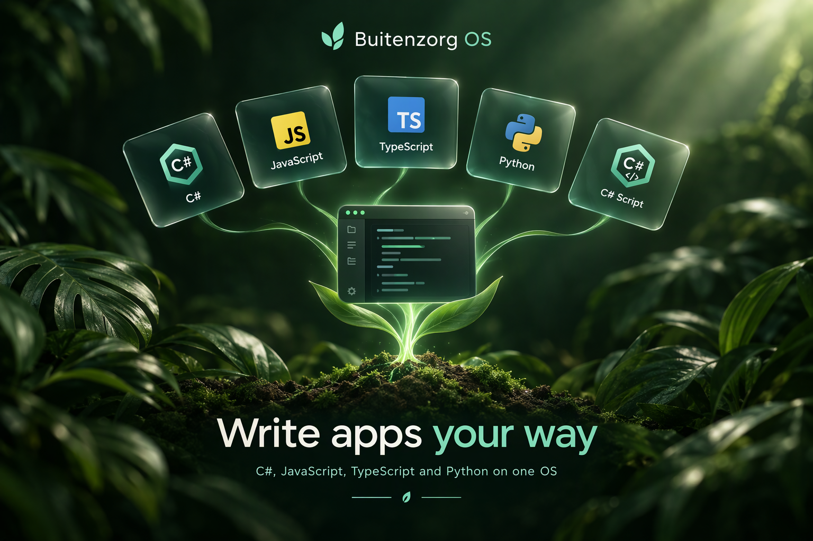
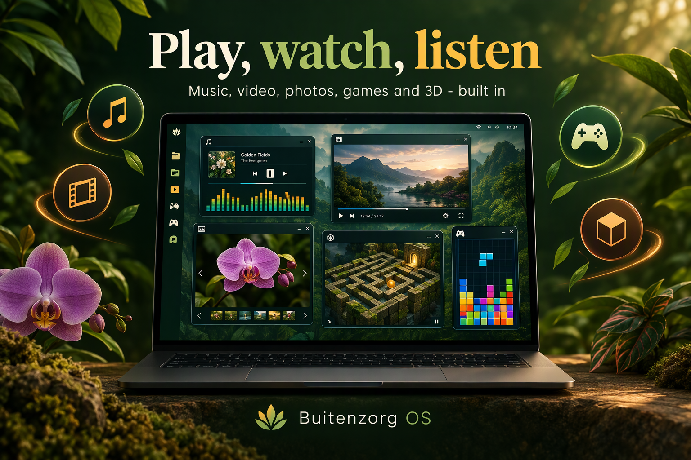
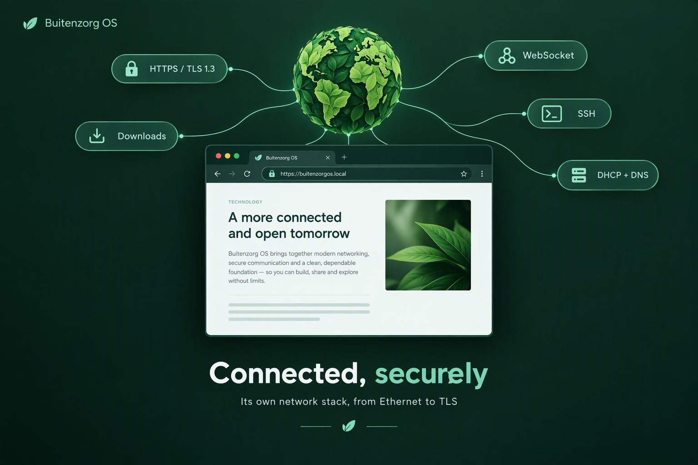
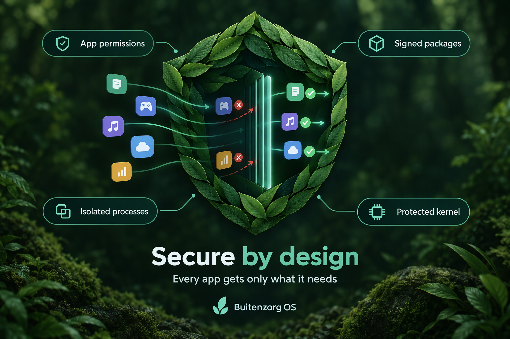
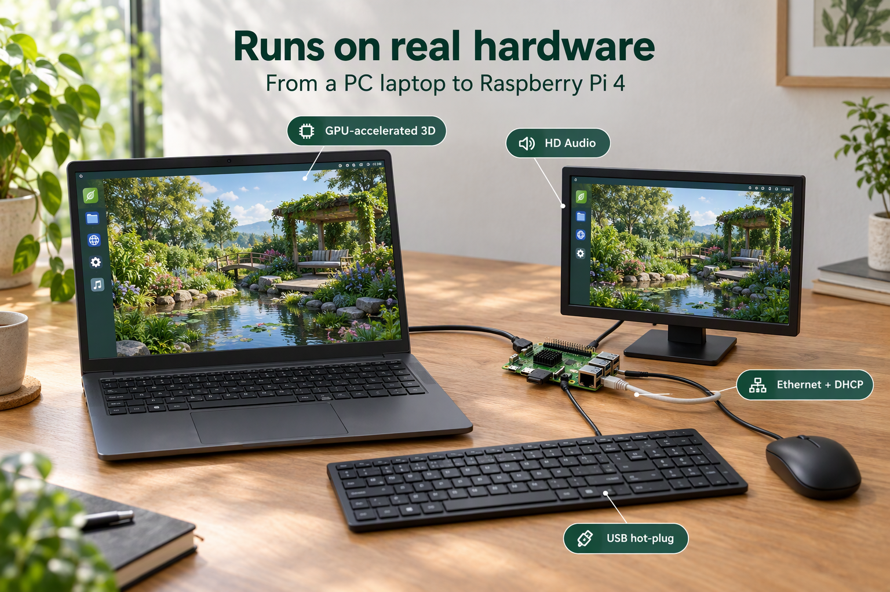

# Buitenzorg OS — marketing images

Eight visuals for posts, slides and the project page (1536×1024 PNG). They
were generated with GPT Image (Rodin MCP) from prompts that list only
features that are finished and verified. **They are illustrations, not
screenshots:** the window contents are artistic. For real screenshots of the
OS, use the images in [`docs/img`](../img).

| Image | Message | What backs it up |
|---|---|---|
|  `01-hero.png` | **Buitenzorg OS 1.0** — a hybrid OS: Rust kernel, C# apps | v1.0 released 2026-11-05; Rust `no_std` kernel, ring-3 C# (NativeAOT + RustCLR) |
|  `02-three-architectures.png` | **One OS. Three architectures.** | The same kernel and apps on x86-64, ARM64 and RISC-V; CI boots all three |
|  `03-developer-workflow.png` | **Build, deploy, debug — live** | Studio IDE, VS Code DAP, `bz deploy --watch`, `bz debug --remote`, hot reload |
|  `04-polyglot-apps.png` | **Write apps your way** | C#, JavaScript, TypeScript, Python and C# script (`.csx`), with UI apps in each |
|  `05-multimedia-games.png` | **Play, watch, listen** | Music (WAV/FLAC/MP3/MIDI), video (AVI), photos (PNG/JPEG/GIF), original games, 3D |
|  `06-connectivity.png` | **Connected, securely** | Its own network stack: Ethernet/DHCP/DNS, TCP, TLS 1.3, HTTP, WebSocket, downloads, SSH server |
|  `07-security.png` | **Secure by design** | Per-app permissions (broker at the syscall boundary), Ed25519-signed packages, isolated address spaces, validated syscall pointers |
|  `08-real-hardware.png` | **Runs on real hardware** | A physical laptop (Intel UHD 620 3D, HD Audio, I219 Ethernet) and a Raspberry Pi 4 (HDMI, USB, Ethernet) |

Suggested one-liners:

- *Buitenzorg OS — a hybrid, AI-native operating system grown like a garden: a Rust kernel underneath, C# and scripts on top.*
- *From a PC laptop to a Raspberry Pi 4 and RISC-V: one OS, one app model.*
- *Write it on your PC, save, and watch it reload on the device.*

---

*Buitenzorg OS — made by Gravicode Studios, led by Kang Fadhil.*
