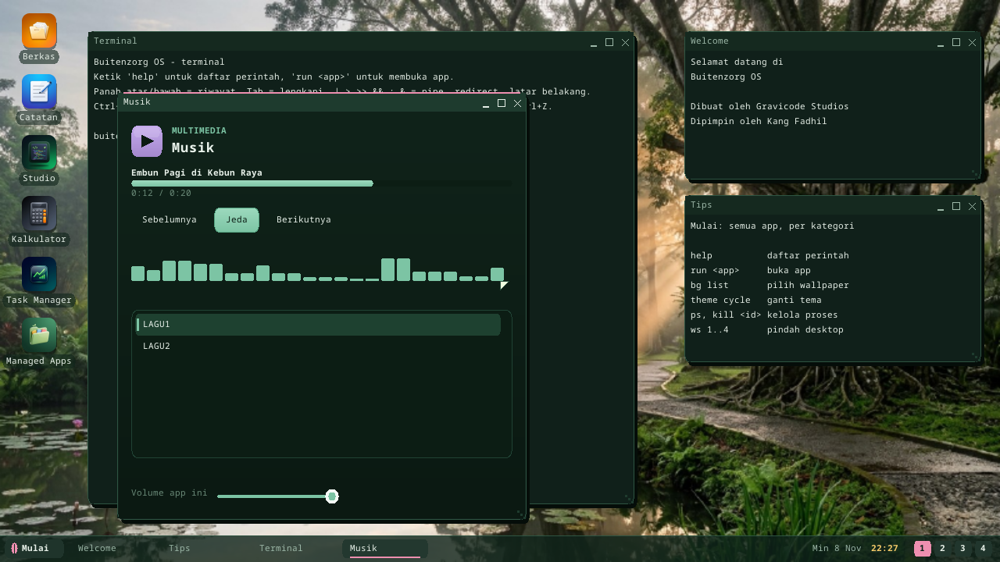
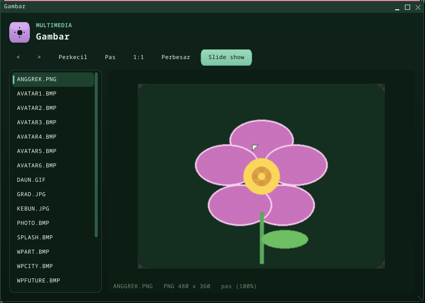

# Suara dan media

Setiap program bisa membunyikan suara bersamaan: kernel menyimpan satu stream
per program, mencampurnya, dan mengisi kartu suara dari ring yang terus
berputar selama ada yang diputar. **Musik** memutar berkas WAV di disk; dua
lagu orisinal ikut di setiap image.

## Musik

`run mmusik`, atau **Mulai > Multimedia > Musik**. Daftarnya berisi berkas WAV
di `/disk` dan folder scratch (`/ram`); klik satu, atau Spasi untuk putar /
jeda; Sebelumnya / Berikutnya; klik bilah progres untuk melompat; slider
mengatur volume *program ini* di mixer (volume master tetap di Pengaturan).
Dua lagu di setiap image -- *Embun Pagi di Kebun Raya* dan *Hujan Sore di
Bogor* (`LAGU1.WAV`, `LAGU2.WAV`) -- disintesis saat image dibangun
(`synth_song` di `kernel/bzimage/build.rs`: nada bel pada skala lima nada di
atas bass gong yang lambat).

## Gambar

`run mimage`, atau **Mulai > Multimedia > Gambar**. Daftarnya berisi gambar di
`/disk` dan folder scratch -- **BMP, PNG, JPEG (baseline dan progresif) dan
GIF** -- dan gambar terpilih ditampilkan pas di jendela. Zoom dengan Perkecil /
Pas / 1:1 / Perbesar, `+` `-` `0` `1` atau roda tetikus; seret (atau W A S D)
untuk menggeser gambar yang diperbesar; Kiri / Kanan atau `<` `>` untuk gambar
sebelumnya / berikutnya; **Slide show** (atau Spasi) berganti setiap 3 detik.
GIF animasi diputar. Tiga contoh ada di setiap image: `KEBUN.JPG`,
`ANGGREK.PNG` (transparan, tampil di atas papan catur) dan `DAUN.GIF` (12
bingkai).

## Untuk program

`Buitenzorg.Media.MediaPlayer`: `Load(path)` (WAV PCM 8/16-bit, mono/stereo,
laju apa pun), `Play`, `Pause`, `Stop`, `Seek`, `Position`, `Duration`,
`Title` (chunk LIST/INFO INAM), `Level`, `Ended`; panggil `Pump()` dari timer
UI (~100 ms) -- ia menjaga ~0,6 detik antre di mixer. Tingkat bawah:
`Audio.Write(data, offset, count, Audio.Format(laju, kanal, bit))`,
`Audio.QueuedMs`, `Audio.CanStream`, `Audio.AppVolume(pid, volume)`.

Gambar untuk program: `Buitenzorg.Media.Picture` -- `Picture.Load(path)`
(BMP, PNG, JPEG, GIF; null bila bukan gambar), `Width`, `Height`, `Format`,
`FrameCount`, lalu `Render(frame, piksel, dw, dh, sx, sy, sw, sh)` mengisi
array untuk satu `Blit` (mengembalikan jeda bingkai dalam ms). Dekode dan
penskalaan berjalan di host (`imgdecode.rs`, native `ImageInfo` /
`ImageDecodeScaled`, hasil dekode di-cache), jadi interpreter tidak pernah
mengulang per piksel. Di luar perangkat hanya BMP.

Syscall: **`AUDIO_WRITE` (62)** dan **`AUDIO_APP_VOLUME` (63)**. Di Terminal,
`mixer` mendaftar stream (`mixer PID VOLUME` mengaturnya).

## Cara kerja

`mixer.rs` mengubah setiap tulisan ke 48 kHz stereo 16-bit (interpolasi linear
untuk laju lain), menyimpan sampai dua detik per program, dan menjumlahkan
stream sesuai volumenya dengan saturasi. Pump driver mengisi ring: di AC'97 32
buffer DMA (680 ms) yang indeks valid terakhirnya bergerak di depan buffer yang
sedang diputar; di Intel HD Audio 16 halaman siklik (340 ms) di belakang posisi
link. Satu ring penuh hening menghentikan kartu; tulisan berikutnya
menyalakannya lagi. Cek boot: `MILESTONE: MIXER OK` (semua arsitektur) dan
`MILESTONE: AUDIO STREAM OK` (kartu PC).

## Batasan

- Streaming bekerja di kartu suara **PC** (AC'97, Intel HD Audio -- streaming
  diverifikasi di QEMU). Di ARM64 / RISC-V `virt` dan Raspberry Pi mixernya
  ada tetapi belum ada kartu yang streaming (`Audio.CanStream` = false; Pi
  tetap memutar bunyi sekali-putar di jack dan HDMI).
- Gambar: belum ada rotasi EXIF, thumbnail atau penyuntingan; bingkai GIF
  didekode di awal (cukup untuk animasi kecil).
- Hanya WAV: belum ada dekoder MP3, Ogg atau FLAC; belum ada mikrofon; meter
  menampilkan puncak, bukan spektrum.

---

← [Indeks dokumentasi](README.id.md) · *Buitenzorg OS — dibuat oleh Gravicode Studios, dipimpin oleh Kang Fadhil.*
