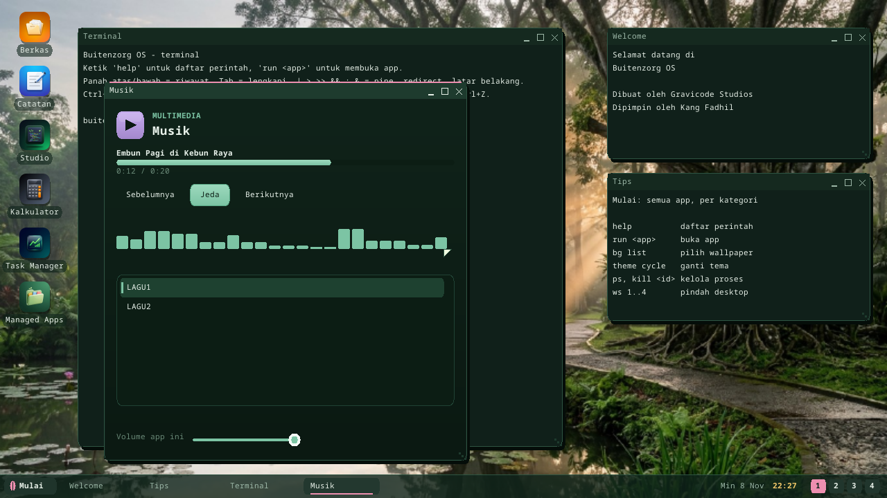
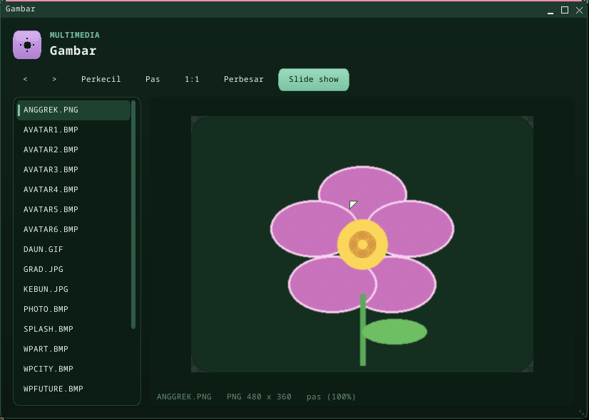

# Sound and media

Every program can play sound at the same time: the kernel keeps one stream
per program, mixes them, and feeds the sound card from a ring that never
stops while there is something to play. **Musik** plays the WAV files on the
disk; two original pieces come with every image.



## Musik

`run mmusik`, or **Start > Multimedia > Musik**. The list shows the WAV files
of `/disk` and the scratch folder (`/ram`); click one, or Space to play /
pause; Sebelumnya / Berikutnya; click the progress bar to jump; the slider
sets *this program's* volume in the mixer (the master volume stays in
Pengaturan). The two songs on every image -- *Embun Pagi di Kebun Raya* and
*Hujan Sore di Bogor* (`LAGU1.WAV`, `LAGU2.WAV`) -- are synthesized when the
image is built (`synth_song` in `kernel/bzimage/build.rs`: bell tones on a
five-note scale over a slow gong bass).

## Gambar (pictures)

`run mimage`, or **Start > Multimedia > Gambar**. It lists the pictures of
`/disk` and the scratch folder -- **BMP, PNG, JPEG (baseline and progressive)
and GIF** -- and shows the chosen one fitted to the window. Zoom with
Perkecil / Pas / 1:1 / Perbesar, `+` `-` `0` `1` or the wheel; drag (or
W A S D) to pan a zoomed picture; Left / Right or `<` `>` for the previous /
next one; **Slide show** (or Space) moves on every 3 s. Animated GIFs play.
Three samples come with every image: `KEBUN.JPG`, `ANGGREK.PNG` (with
transparency, shown over a checkerboard) and `DAUN.GIF` (12 frames).



## For programs

```csharp
using Buitenzorg.Media;

var player = new MediaPlayer();
player.Load("/disk/LAGU1.WAV");     // RIFF/WAVE PCM: 8-bit or 16-bit, mono or stereo, any rate
player.Play();
var timer = new DispatcherTimer(100);
timer.Tick += () => player.Pump();  // keeps ~0.6 s queued in the mixer
timer.Start();
// player.Pause() / Stop() / Seek(seconds), .Position, .Duration, .Title (LIST/INFO INAM), .Level, Ended
```

Lower level, `Buitenzorg.App.Audio`:

| | |
|---|---|
| `Audio.Write(data, offset, count, Audio.Format(rate, channels, bits))` | queue PCM in this program's stream; returns the bytes taken (fewer when ~2 s are queued) |
| `Audio.QueuedMs`, `Audio.CanStream` | what is waiting; whether the card streams |
| `Audio.AppVolume(pid, volume)` | a program's level in the mix (pid 0 = this one; -1 = read) |
| `Audio.Beep(hz, ms)`, `Audio.Volume` | a tone; the master volume |

Pictures, `Buitenzorg.Media.Picture`:

```csharp
var pic = Picture.Load("/disk/KEBUN.JPG");   // BMP, PNG, JPEG, GIF; null if not a picture
// pic.Width, pic.Height, pic.Format ("JPEG"), pic.FrameCount (> 1 for an animated GIF)
var px = new int[320 * 180];
int delay = pic.Render(frame: 0, px, 320, 180, sx: 0, sy: 0, sw: pic.Width, sh: pic.Height);
dc.Blit(x, y, 320, 180, px);                 // delay = the frame's time in ms (0 = still)
```

Decoding and scaling run in the host (`userland/clrhost/src/imgdecode.rs`,
natives `ImageInfo` / `ImageDecodeScaled`; the decoded picture is cached),
so the interpreter never loops over pixels. Off the device only BMP decodes.

Syscalls: **`AUDIO_WRITE` (62)** -- samples, length, format word `rate |
channels << 20 | bits << 24` (0 = 48 kHz stereo 16-bit) -- and
**`AUDIO_APP_VOLUME` (63)**. In the Terminal, `mixer` lists the streams
(`mixer PID VOLUME` sets one).

## How it works

`kernel/bzkernel/src/mixer.rs` converts each write to 48 kHz stereo 16-bit
(linear interpolation for other rates), keeps up to two seconds per program,
and sums the streams at their volumes with saturation. The driver's pump
(`audio::stream_pump`, called by `AUDIO_WRITE` and the desktop loop) fills
the ring: on AC'97 32 DMA buffers (680 ms) whose last-valid index moves ahead
of the playing one, on Intel HD Audio the 16 cyclic pages (340 ms) behind the
link position. A whole ring of silence stops the card; the next write starts
it again. One-shot sounds (`Audio.Beep`, the AUDIO_PLAY syscall) join the mix
as the system's stream while music plays. Boot checks: `MILESTONE: MIXER OK`
(conversion, volume, saturation -- every architecture) and `MILESTONE: AUDIO
STREAM OK` (a second of tone through the ring on the PC's card); Musik's
self-test plays through `AUDIO_WRITE` in the boot's managed suite.

## Limits

- Streaming works on **PC** sound cards (AC'97, Intel HD Audio -- tested on
  the Dell Latitude 7290's Realtek codec for one-shot sounds; streaming was
  verified under QEMU's HDA and AC'97). On ARM64 / RISC-V `virt` and the
  Raspberry Pi the mixer is there but no card streams yet (`Audio.CanStream`
  is false; the Pi still plays one-shot sounds on its jack and HDMI).
- Pictures: no EXIF rotation, thumbnails or editing; GIF frames are decoded
  up front (fine for small animations).
- WAV only: no MP3, Ogg or FLAC decoder yet; no microphone; the level meter
  shows peaks, not a spectrum.

---

← [Documentation index](README.md) · *Buitenzorg OS — made by Gravicode Studios, led by Kang Fadhil.*
