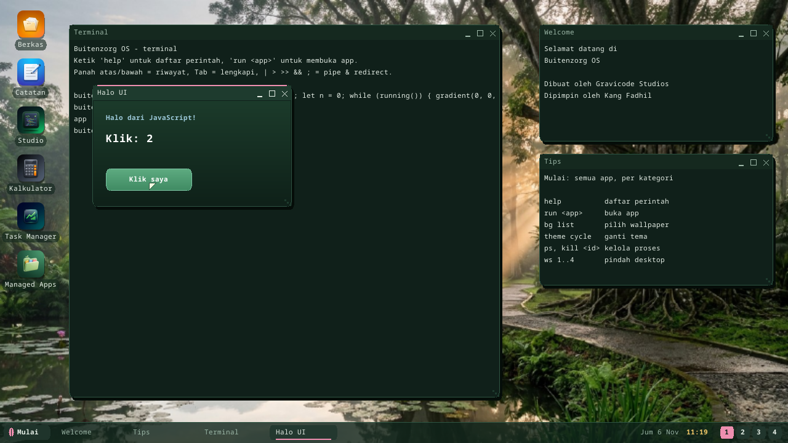
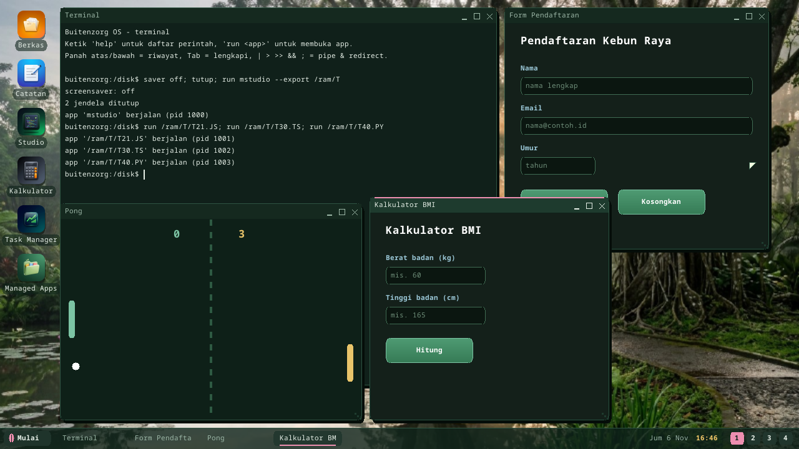

# Aplikasi ber-UI dengan JavaScript, TypeScript dan Python

Aplikasi berjendela tidak hanya untuk C#: berkas JavaScript, TypeScript atau
Python yang memanggil `window(...)` berjalan sebagai proses sendiri dengan
jendela di desktop.

```js
// MAIN.JS
window("Penghitung", 320, 220);
let n = 0;
while (running()) {
  gradient(0, 0, 320, 220, 0x1B3A2A, 0x0E2018);
  text(24, 24, "Penghitung", 0x9CC9D9, 1);
  text(24, 64, "" + n, 0xFFFFFF, 2);
  if (button(24, 140, 124, 40, "Tambah")) { n = n + 1; }
  if (button(164, 140, 124, 40, "Reset")) { n = 0; }
  present();
}
```



**Menjalankan:** F5 di [Buitenzorg Studio](studio.id.md), `run MAIN.JS` di
Terminal (path apa pun, `.js` / `.ts` / `.py`), atau kirim sebagai
[paket](packages.id.md) dengan entry skrip tersebut.

## Modelnya: immediate mode

Tidak ada objek widget. Setiap putaran loop menggambar ulang seluruh jendela
sambil menanyakan input: `button(...)` menggambar tombol dan bernilai true pada
frame setelah tombol itu diklik. `present()` menampilkan frame, menjaga sekitar
30 frame per detik, dan mengumpulkan event mouse dan keyboard untuk frame
berikutnya. `running()` bernilai false setelah program memanggil `quit()`.
Menutup jendela mengakhiri proses.

Fungsinya sama di ketiga bahasa; Python hanya tanpa kurung kurawal:

```python
window("Stopwatch", 300, 200)
jalan = False
while running():
    clear(0x14201A)
    if button(20, 120, 120, 40, "Mulai"):
        jalan = not jalan
    present()
```

## Fungsi

Warna `0xRRGGBB` (atau `rgb(r, g, b)`); koordinat dalam piksel di area klien
jendela, (0, 0) kiri atas.

| Fungsi | Kegunaan |
|---|---|
| `window(judul, w, h)` | membuka jendela (area klien w x h) |
| `width()`, `height()` | ukurannya |
| `clear(c)` | mengisi jendela |
| `rect(x, y, w, h, c [, radius])` | persegi penuh (membulat bila ada radius) |
| `frame(x, y, w, h, c [, radius])` | garis tepi 1 piksel |
| `gradient(x, y, w, h, atas, bawah)` | gradien vertikal |
| `line(x1, y1, x2, y2, c)` | garis |
| `circle(cx, cy, r, c)` / `ring(cx, cy, r, c)` | lingkaran penuh / garis lingkaran |
| `text(x, y, s, c [, gaya])` | teks; gaya 0 biasa, 1 tebal, 2 judul (24 px) |
| `textwidth(s [, gaya])`, `lineheight([gaya])` | ukuran teks (font monospace) |
| `button(x, y, w, h, label)` | tombol; true saat diklik |
| `input(x, y, w, id [, placeholder])` | kolom teks: klik untuk fokus, ketik, Backspace; Enter / Tab / Esc keluar (Enter juga sampai ke `key()`); mengembalikan teksnya |
| `setinput(id, teks)`, `focus(id)` | isi teks sebuah kolom / beri dia keyboard (`focus("")` = tidak ada) |
| `present()` | tampilkan frame, tunggu frame berikut, baca input |
| `running()`, `quit()` | syarat loop / keluar |
| `mousex()`, `mousey()`, `mousedown()` | penunjuk mouse |
| `clicked()`, `clickx()`, `clicky()` | ada klik di frame ini dan posisinya |
| `key()` | kode tombol berikutnya (0 = tidak ada): `chr(key)` karakternya; 27 Esc, 10 Enter, 8 Backspace, 32 spasi, 63232..63235 atas/bawah/kiri/kanan |
| `ticks()`, `wait(ms)` | milidetik sejak mulai / tidur |
| `random(n)` | 0 .. n-1 |
| `arg(i)`, `argcount()` | argumen program |
| `print(...)` / `console.log(...)` | satu baris di log sistem (serial) |

Ditambah yang dimiliki semua skrip: `str`, `len`, `abs`, `min`, `max`, `chr`,
`ord`, `substr(s, mulai, panjang)`, dan literal heksadesimal (`0x7CC4A4`);
untuk form `int(s)` (juga `parseInt`, `Number`), `indexOf(s, bagian)` (-1 =
tidak ada), `trim`, `upper`, `lower`.

## Subset bahasa

Interpreternya kecil: bilangan bulat dan string (tanpa pecahan: kalikan 100),
fungsi dan rekursi, `if/else` (`elif`), `while`, `for` (gaya C di JS/TS,
`range()` di Python), `&& || !` (`and or not`). Belum ada array, objek, class
atau import — simpan keadaan di variabel dan hitung daftar dengan fungsi
(lihat template kalkulator dan kuis). Di JS/TS `let`/`var`/`const` membuat
variabel milik fungsi saat ini; assignment biasa mengubah variabel terdekat
yang sudah ada (termasuk global, juga di Python).

## Template

**Proyek baru** di Studio punya enam belas template UI, sehingga setiap bahasa
punya form, utilitas, game dan gambar:

| | Form & utilitas | Game | Gambar & animasi |
|---|---|---|---|
| JavaScript | penghitung, form pendaftaran, timer Pomodoro | tangkap bola | papan gambar |
| TypeScript | kalkulator, konversi mata uang | Pong | bola memantul, spirograf |
| Python | stopwatch, kalkulator BMI, pencampur RGB | tebak angka, kuis | mandala |



## Cara kerjanya

`CLRHOST.ELF` (host runtime managed) menjalankan berkas `.js/.ts/.py` dengan
interpreter milik kernel sendiri (`kernel/bzkernel/src/script.rs`, ikut
dikompilasi ke host) dan menyediakan fungsi di atas lewat hook `Host`
interpreter (`userland/clrhost/src/scriptui.rs`) di atas syscall jendela
(WIN_CREATE / WIN_CMD / WIN_PRESENT / WIN_EVENT / KEY_READ). Ia berjalan di
ring 3 seperti app lain, tanpa batas langkah kernel, sehingga loop UI tidak
pernah membekukan desktop. Pada boot self-test (headless) tidak ada jendela
yang dibuka dan `running()` berhenti setelah tiga frame (setiap template UI
dijalankan begitu saat boot oleh self-test Studio).

Belum ada: kotak isian teks, gambar, suara, lebih dari satu jendela per
program.

---

← [Indeks dokumentasi](README.id.md) · *Buitenzorg OS — dibuat oleh Gravicode Studios, dipimpin Kang Fadhil.*
