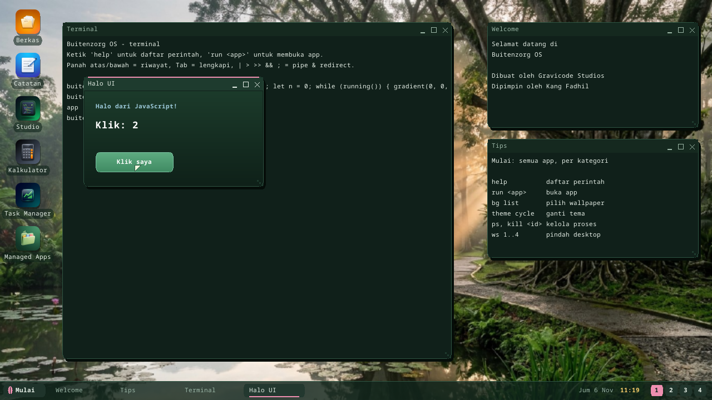
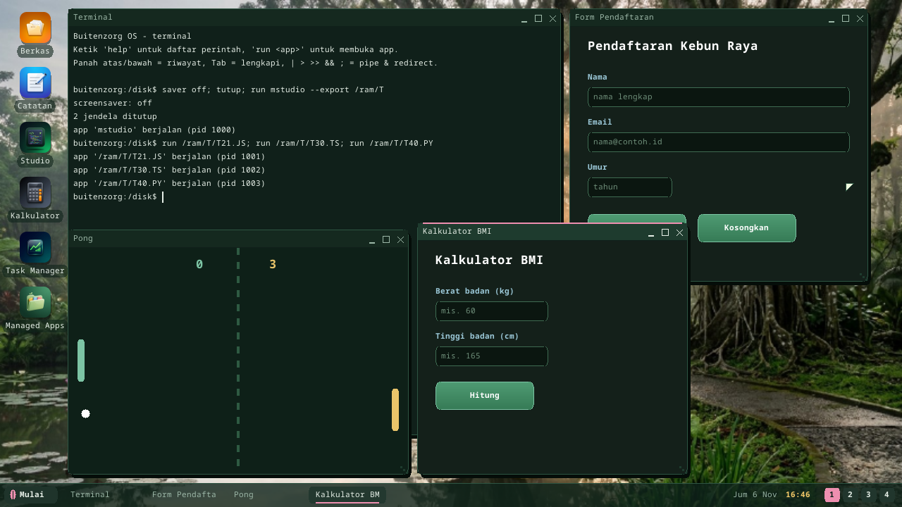

# UI apps in JavaScript, TypeScript and Python

Apps with a window are not only for C#: a JavaScript, TypeScript or Python
file that calls `window(...)` runs as its own process with a window on the
desktop.

```js
// MAIN.JS
window("Penghitung", 320, 220);
let n = 0;
while (running()) {
  gradient(0, 0, 320, 220, 0x1B3A2A, 0x0E2018);
  text(24, 24, "Penghitung", 0x9CC9D9, 1);
  text(24, 64, "" + n, 0xFFFFFF, 2);
  if (button(24, 140, 124, 40, "Tambah")) { n = n + 1; }
  if (button(164, 140, 124, 40, "Reset")) { n = 0; }
  present();
}
```



**Run it:** F5 in [Buitenzorg Studio](studio.md), `run MAIN.JS` in the
Terminal (any path, `.js` / `.ts` / `.py`), or ship it as a [package](packages.md)
whose entry is the script.

## The model: immediate mode

There are no widget objects. Each turn of the loop draws the whole window
again, and asks for input while drawing: `button(...)` draws a button and is
true in the frame after it was clicked. `present()` shows the frame, keeps
about 30 frames a second, and collects the mouse and keyboard events for the
next frame. `running()` is false once the program called `quit()`. Closing the
window ends the process.

The same functions exist in all three languages; Python just has no braces:

```python
window("Stopwatch", 300, 200)
jalan = False
while running():
    clear(0x14201A)
    if button(20, 120, 120, 40, "Mulai"):
        jalan = not jalan
    present()
```

## Functions

Colors are `0xRRGGBB` (or `rgb(r, g, b)`); coordinates are pixels in the
window's client area, (0, 0) top-left.

| Function | Does |
|---|---|
| `window(title, w, h)` | opens the window (client area w x h) |
| `width()`, `height()` | its size |
| `clear(c)` | fills the window |
| `rect(x, y, w, h, c [, radius])` | filled rectangle (rounded with a radius) |
| `frame(x, y, w, h, c [, radius])` | 1-pixel outline |
| `gradient(x, y, w, h, top, bottom)` | vertical gradient |
| `line(x1, y1, x2, y2, c)` | line |
| `circle(cx, cy, r, c)` / `ring(cx, cy, r, c)` | filled circle / outline |
| `text(x, y, s, c [, style])` | text; style 0 normal, 1 bold, 2 heading (24 px) |
| `textwidth(s [, style])`, `lineheight([style])` | text metrics (the font is monospaced) |
| `button(x, y, w, h, label)` | a button; true when it was clicked |
| `input(x, y, w, id [, placeholder])` | a text field: click to focus, type, Backspace; Enter / Tab / Esc leave it (Enter also reaches `key()`); returns its text |
| `setinput(id, text)`, `focus(id)` | set a field's text / give it the keyboard (`focus("")` = none) |
| `present()` | show the frame, wait for the next, read input |
| `running()`, `quit()` | the loop condition / leave it |
| `mousex()`, `mousey()`, `mousedown()` | the pointer |
| `clicked()`, `clickx()`, `clicky()` | a click this frame and where it was released |
| `key()` | next key code (0 = none): `chr(key)` the character; 27 Esc, 10 Enter, 8 Backspace, 32 space, 63232..63235 up/down/left/right |
| `ticks()`, `wait(ms)` | milliseconds since start / sleep |
| `random(n)` | 0 .. n-1 |
| `arg(i)`, `argcount()` | the program's arguments |
| `print(...)` / `console.log(...)` | a line in the system log (serial) |

Plus what every script has: `str`, `len`, `abs`, `min`, `max`, `chr`, `ord`,
`substr(s, start, len)`, and hexadecimal literals (`0x7CC4A4`); for forms
`int(s)` (also `parseInt`, `Number`), `indexOf(s, part)` (-1 = none), `trim`,
`upper`, `lower`.

## Language subset

The interpreter is small: integers and strings (no floats: scale by 100 for
fractions), functions and recursion, `if/else` (`elif`), `while`, `for`
(C-style in JS/TS, `range()` in Python), `&& || !` (`and or not`). No arrays,
objects, classes or imports yet — keep state in variables and compute lists
with functions (see the calculator and quiz templates). In JS/TS `let`/`var`/
`const` make a variable of the current function; a plain assignment changes
the nearest existing one (globals too, also in Python).

## Templates

Studio's **Proyek baru** has sixteen UI templates, so every language has a
form, a utility, a game and a drawing:

| | Forms & utilities | Games | Drawing & animation |
|---|---|---|---|
| JavaScript | counter, sign-up form, Pomodoro timer | catch the ball | drawing board |
| TypeScript | calculator, currency converter | Pong | bouncing ball, spirograph |
| Python | stopwatch, BMI calculator, RGB mixer | number guessing, quiz | mandala |



## How it works

`CLRHOST.ELF` (the managed-runtime host) runs `.js/.ts/.py` files with the
kernel's own interpreter (`kernel/bzkernel/src/script.rs`, compiled into the
host as well) and supplies the functions above through the interpreter's
`Host` hook (`userland/clrhost/src/scriptui.rs`) on top of the window
syscalls (WIN_CREATE / WIN_CMD / WIN_PRESENT / WIN_EVENT / KEY_READ). It runs
in ring 3 like any app, without the kernel's step budget, so a UI loop never
blocks the desktop. In the headless self-test boot no window is opened and
`running()` stops after three frames (every UI template is run that way at
boot by Studio's self-test).

Not yet: text input boxes, images, sound, more than one window per program.

---

← [Documentation index](README.md) · *Buitenzorg OS — made by Gravicode Studios, led by Kang Fadhil.*
