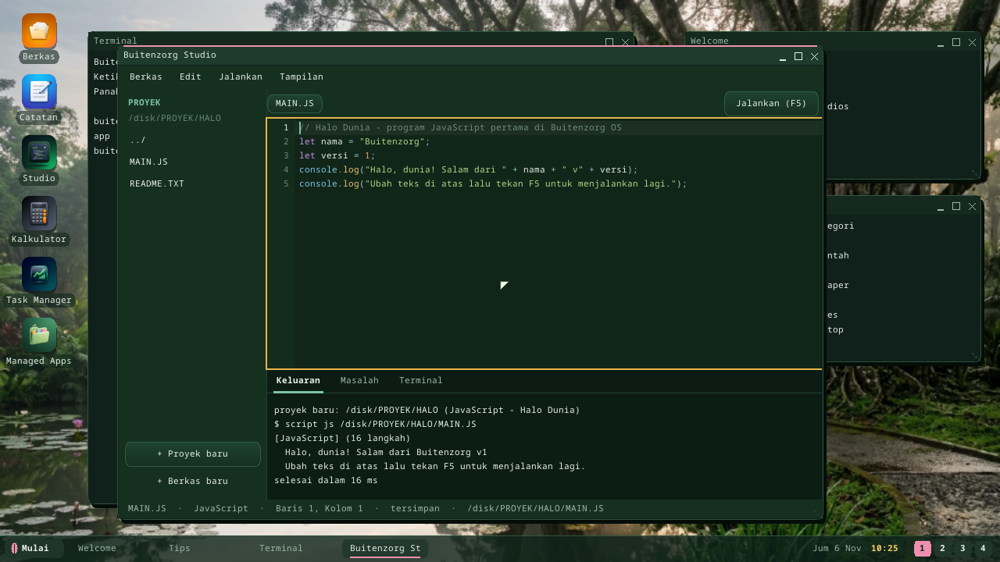
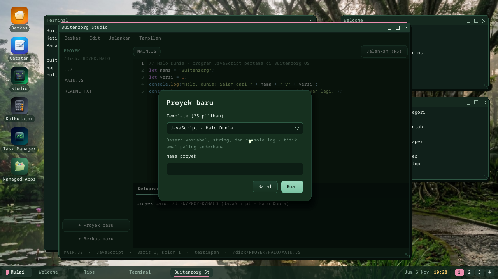

# Buitenzorg Studio

**Studio** adalah IDE di dalam Buitenzorg OS: tulis program, jalankan dengan
F5, baca keluaran dan galatnya — tanpa meninggalkan desktop. Buka dari ikon
desktop **Studio**, menu Mulai → Kantor → Studio, atau `run mstudio`.

## Jendela

| Bagian | Fungsi |
|---|---|
| Panel **Proyek** (kiri, Ctrl+B) | Berkas folder proyek; klik folder untuk masuk, `../` untuk naik, berkas untuk membuka. **+ Proyek baru** / **+ Berkas baru**. |
| Tab + editor | Satu tab per berkas (`*` = belum disimpan). Nomor baris, pewarnaan sintaks (C#, JavaScript, TypeScript, Python, shell, JSON), baris aktif, tanda merah di baris yang bergalat. |
| **Jalankan (F5)** | Menyimpan semua berkas lalu menjalankan berkas aktif: `.JS`/`.TS`/`.PY` lewat interpreter skrip kernel, `.SH` lewat shell. |
| **Keluaran** | Keluaran program dan lama eksekusinya. |
| **Masalah** | Galat beserta berkas dan barisnya (`parse: baris 2: ...`); klik untuk melompat. |
| **Terminal** | Shell yang sama dengan Terminal desktop (pipe, skrip, `bz`, ...). |
| Bar status | Berkas, bahasa, baris dan kolom, status simpan, path. |

## Tombol

| Tombol | Fungsi |
|---|---|
| F5 | jalankan berkas aktif |
| Ctrl+S / Ctrl+W | simpan / tutup tab |
| Ctrl+N | proyek baru (pilih template) |
| Ctrl+Z / Ctrl+Y | urungkan / ulangi (ketikan dikelompokkan per kata) |
| Ctrl+D / Ctrl+K | duplikat / hapus baris |
| Ctrl+F / Ctrl+R | cari / ganti (bar di atas editor; Enter = berikutnya) |
| Ctrl+G | ke baris |
| Tab, Enter | indentasi; baris baru mengikuti indentasi (satu tingkat lebih setelah `{`, `(`, `[`, `:` Python, atau `then`/`do` shell); `}` sendirian mundur satu tingkat |
| Home | karakter pertama yang bukan spasi, lalu kolom 0 |
| Ctrl+B / Ctrl+T | panel proyek / tema terang-gelap |

## Template proyek (25)

**Ctrl+N** membuka pemilih template; tiap template adalah proyek kecil yang
langsung bisa dijalankan (template C# dibangun di PC dan membawa `BUILD.TXT`).

| Bahasa | Kasus penggunaan |
|---|---|
| JavaScript | Halo dunia · rekursi (Fibonacci, faktorial) · prima, FPB, KPK · FizzBuzz · tabel konversi satuan · simulasi tabungan |
| TypeScript | Halo bertipe/interface · statistik nilai siswa · permainan dadu dua pemain (acak LCG) · struk kasir |
| Python | Halo · tabel perkalian · tebak angka (pencarian biner) · kalender (kabisat, Zeller) · barisan Collatz |
| Skrip shell | argumen/perulangan/kondisi · cadangan berkas teks · laporan sistem · pembersih berkas sementara · profil Terminal dengan alias |
| C# | konsol native (bflat) · desktop native (Buitenzorg.UI) · app managed (RustCLR) |
| Paket | proyek `.bzpkg` (manifest + skrip) |
| JSON | berkas data |

Proyek disimpan di `/disk/PROYEK/<NAMA>` (nama folder maks 8 huruf;
`/ram/PROYEK` bila tidak ada `/disk`). Saat pertama dibuka, Studio membuat
`HALO` dari template "Halo Dunia".

## Kemampuan bahasa skrip

Interpreter kernel (`script.rs`) adalah subset kecil: bilangan bulat dan
string, `+ - * / %`, perbandingan, `&& || !`, fungsi dan rekursi, `if/else`
(`elif` di Python), `while`, `for` (gaya C di JS/TS, `range()` di Python),
`print` / `console.log`, `str`, `len`, `abs`. Belum ada array, objek, pecahan
atau import; setiap run punya batas langkah. Galat parse membawa nomor baris
yang tampil di **Masalah**.

## Batasan (jujur)

- C# belum dikompilasi di dalam OS: template C# menjelaskan build di PC
  (bflat / `dotnet build`, `bz pack`, deploy).
- Belum ada breakpoint/debugger; belum ada seleksi mouse atau clipboard di
  editor.
- Galat runtime skrip belum punya nomor baris (hanya galat parse).
- Berkas besar: editor hanya menggambar baris yang terlihat, tetapi berjalan di
  interpreter RustCLR — berkas beberapa ribu baris masih nyaman.

Implementasi: `userland/clr-apps/MStudio` (`Studio.cs`, `CodeEditor.cs`,
`Syntax.cs`, `Templates.cs`); menjalankan lewat syscall **`SHELL_RUN` (58)** —
`Buitenzorg.App.Shell.Run(line)`. Self-test: 23 pemeriksaan, bagian dari
`Managed --selftest` saat boot.

---

← [Indeks dokumentasi](README.id.md) · *Buitenzorg OS — dibuat oleh Gravicode Studios, dipimpin Kang Fadhil.*
