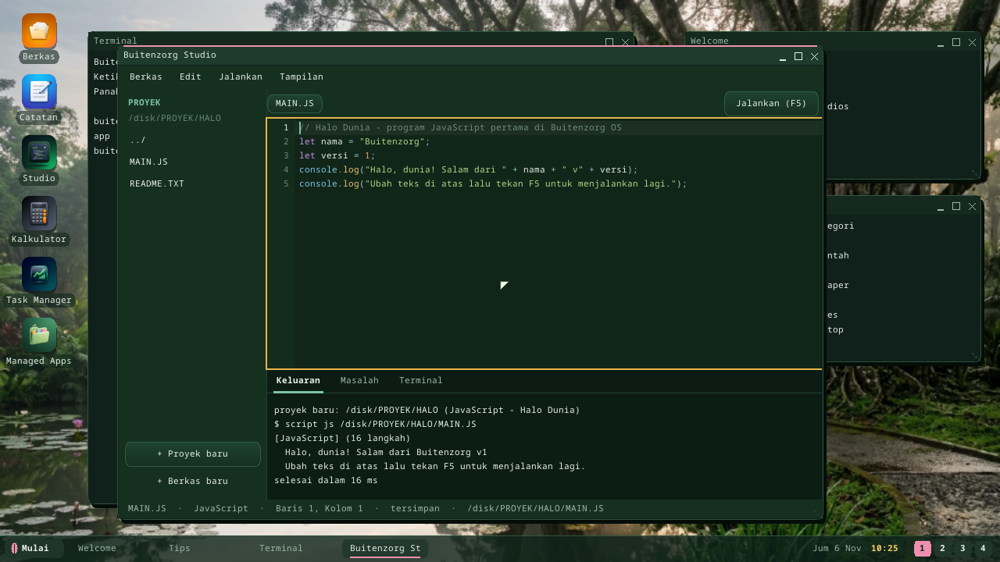
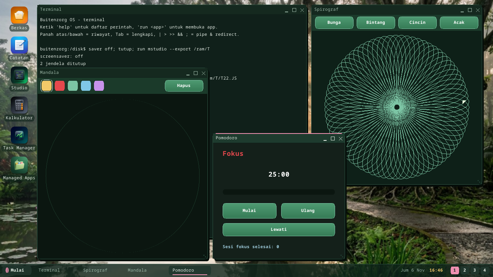
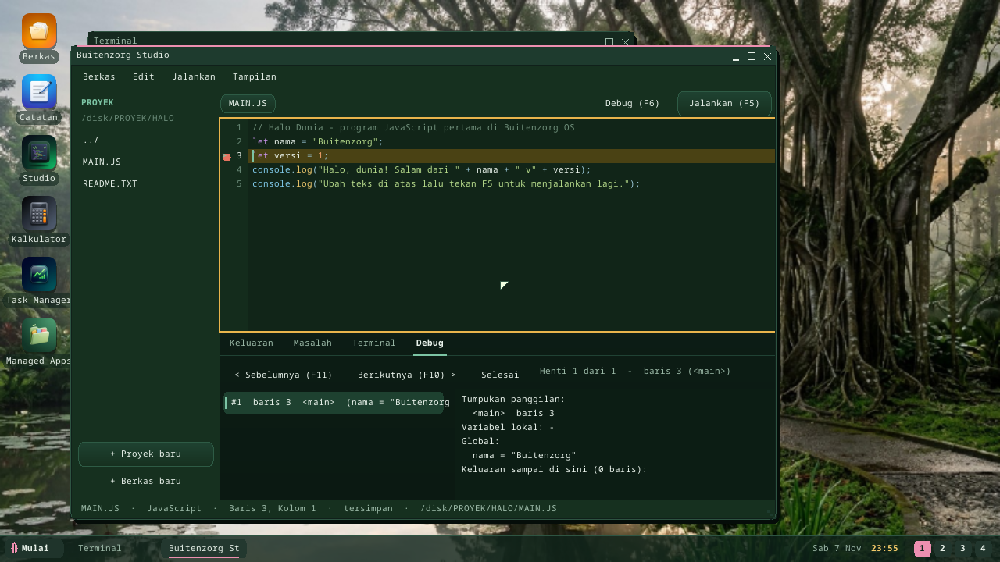

# Buitenzorg Studio

**Studio** is the IDE inside Buitenzorg OS: write a program, run it with F5,
read its output and its errors — without leaving the desktop. Open it from the
**Studio** desktop icon, Start menu → Kantor → Studio, or `run mstudio`.

## The window

| Part | What it does |
|---|---|
| **Project** pane (left, Ctrl+B) | The files of the current project folder; click a folder to enter it, `../` to go up, a file to open it. **+ Proyek baru** / **+ Berkas baru**. |
| Tabs + editor | One tab per open file (`*` = unsaved). Line numbers, syntax colors (C#, C# script, JavaScript, TypeScript, Python, shell, JSON), the current line, a red mark on lines with errors. |
| **Jalankan (F5)** | Saves every file and runs the current one: `.CSX` through the [C# script](csharp-script.md) bytecode engine, `.JS`/`.TS`/`.PY` through the kernel's script interpreter, `.SH` through the shell; a script that calls `window(...)` opens as its own app with a window ([UI apps](script-ui.md)). |
| **Debug (F6)** | Runs the script under the debugger (see below). |
| **Keluaran** | The program's output and how long it took. |
| **Masalah** | Errors with file and line (`parse: baris 2: ...`); click one to jump there. |
| **Terminal** | The same shell as the desktop Terminal (pipes, scripts, `bz`, ...). |
| **Debug** | The debugger's stops, call stack, variables and output so far. |
| Status bar | File, language, line and column, saved or not, path. |

## Keys

| Key | Does |
|---|---|
| F5 | run the current file |
| F6 | debug the current file |
| F9 | breakpoint on / off on the caret's line (or click a line number) |
| F10 / F11 | next / previous debugger stop |
| Ctrl+S / Ctrl+W | save / close the tab |
| Ctrl+N | new project (template picker) |
| Ctrl+Z / Ctrl+Y | undo / redo (typing is grouped per word) |
| Ctrl+D / Ctrl+K | duplicate / delete the line |
| Ctrl+F / Ctrl+R | find / replace (bar above the editor; Enter = next) |
| Ctrl+G | go to line |
| Tab, Enter | indent; a new line keeps the indentation (one level more after `{`, `(`, `[`, a Python `:` or a shell `then`/`do`); `}` on its own line steps back |
| Home | first non-blank character, then column 0 |
| Ctrl+B / Ctrl+T | project pane / light-dark theme |

## Project templates (52)

**Ctrl+N** opens the template picker; each template is a small project that
runs as it is (C# ones are built on a PC and carry `BUILD.TXT`).

| Language | Use cases |
|---|---|
| C# script | hello · List & Dictionary · text analysis · sorting algorithms · exceptions · statistics & math |
| C# script UI | counter · Snake game · function plotter · address book · to-do list |
| JavaScript | Hello world · recursion (Fibonacci, factorial) · primes, GCD and LCM · FizzBuzz · unit conversion table · savings simulation |
| JavaScript UI | counter · drawing board · catch-the-ball game · sign-up form · Pomodoro timer |
| TypeScript | Hello with types/interfaces · student grade statistics · two-player dice game (LCG random) · cashier receipt |
| TypeScript UI | calculator · bouncing-ball animation · currency converter · Pong · spirograph |
| Python | Hello · multiplication table · binary-search guessing · calendar (leap years, Zeller) · Collatz sequence |
| Python UI | stopwatch · multiple-choice quiz · RGB color mixer · BMI calculator · number guessing · mandala |
| Shell script | arguments/loops/conditions · text-file backup · system report · temporary-file cleaner · Terminal profile with aliases |
| C# | native console (bflat) · native desktop (Buitenzorg.UI) · managed app (RustCLR) |
| Package | a `.bzpkg` project (manifest + script) |
| JSON | a data file |

Projects live in `/disk/PROYEK/<NAME>` (8-letter folder names; `/ram/PROYEK`
where there is no `/disk`). The first start creates `HALO` from the "Hello
world" template.

`run mstudio --list` prints the catalog; `run mstudio --export /ram/T` writes
every template's main file as `/ram/T/T01.CSX` ... `T52.JSON`, so one can be
tried straight from the Terminal (`run /ram/T/T21.JS`).

## What the script languages can do

The kernel's interpreter (`script.rs`) is a small subset: integers and
strings, `+ - * / %`, comparisons, `&& || !`, functions and recursion,
`if/else` (`elif` in Python), `while`, `for` (C-style in JS/TS, `range()` in
Python), `print` / `console.log`, `str`, `len`, `abs`. No arrays, objects,
floats or imports yet; every run has a step budget. Parse errors carry the
line number shown in **Masalah**.

## Debugger (F6)

Scripts in **JavaScript, TypeScript, Python and C# script** can be debugged:

1. Set breakpoints: **F9** on the caret's line, or click a line number (a red
   dot). No breakpoint = stop on every line.
2. **F6** (or **Debug (F6)**): the file runs once in the kernel's interpreter
   with the debugger on, which records the program's state at every stop.
3. The **Debug** tab lists the stops (`#3  baris 7  fib  (n=2)`); **F10** /
   **F11** walk forward / back through them. The editor marks the line, the
   panel shows the **call stack**, the **local variables**, the **globals**
   (lists and dictionaries with their items) and the output printed up to that
   point.

It is a *record, then replay* debugger: you can move backwards in time, but
not change a value and continue. Up to 400 stops are recorded per run.
Native programs are debugged with `dbg` in the Terminal
([Debugging](debugging.md)). The same records come from the shell:
`script debug js MAIN.JS 4,9` (or `all`).

**UI scripts** (the ones that open a window) are debugged too: F6 starts the
app in its own window *while it records* -- click its buttons, type into it --
and when you close the window its stops arrive in the Debug tab. Put the
breakpoints where your event handling is (the line that reacts to a click),
not only on every line: with no breakpoint the 400 stops are used up in the
first frames. Under the hood: `script debug` answers `@dbgui PID FILE` and
starts `CLRHOST.ELF FILE --bzdebug LINES REPORT`; Studio polls
`script debug status PID FILE` every half second until the report is there.

## Limits (honest)

- C# is not compiled inside the OS: the C# templates explain the build on a PC
  (bflat / `dotnet build`, `bz pack`, deploy).
- The debugger replays a recorded run (no changing values mid-run); a UI
  script's stops are shown after its window closes. No mouse selection or
  clipboard in the editor.
- Large files: the editor keeps lines in memory and draws only the visible
  ones, but it runs in the RustCLR interpreter — files of a few thousand lines
  stay usable.

Implementation: `userland/clr-apps/MStudio` (`Studio.cs`, `CodeEditor.cs`,
`Syntax.cs`, `Templates.cs`, `Debugger.cs`); runs through syscall **`SHELL_RUN` (58)** —
`Buitenzorg.App.Shell.Run(line)`. Self-test: 31 checks on the device (it runs every runnable template, the UI ones as headless processes, and debugs a UI script), part of
`Managed --selftest` at boot.

---

← [Documentation index](README.md) · *Buitenzorg OS — made by Gravicode Studios, led by Kang Fadhil.*
