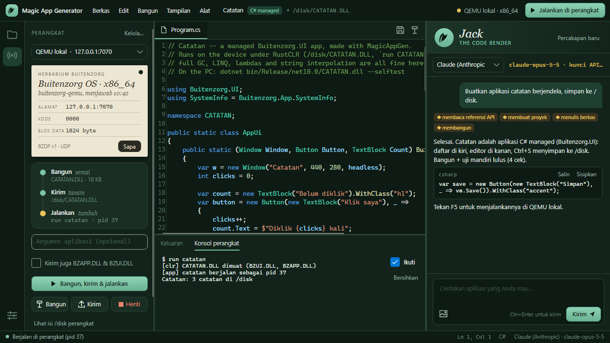
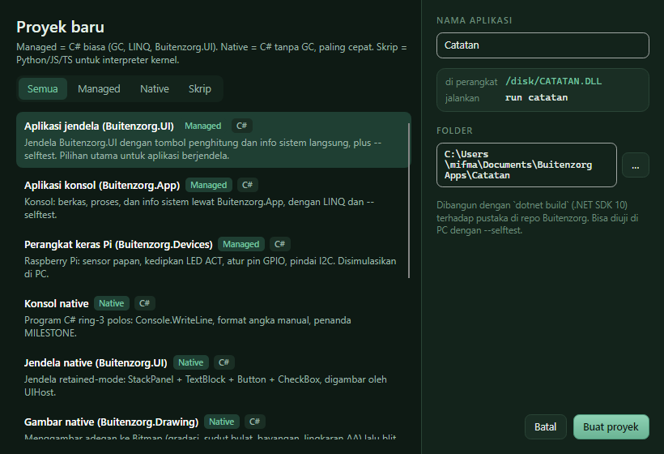
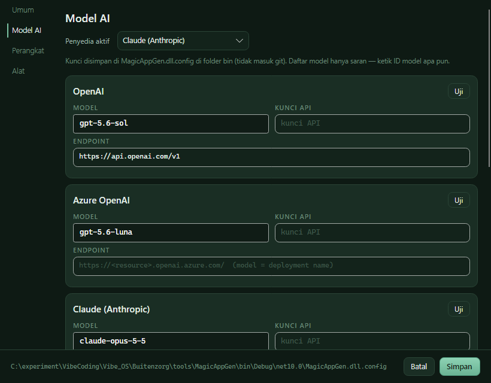
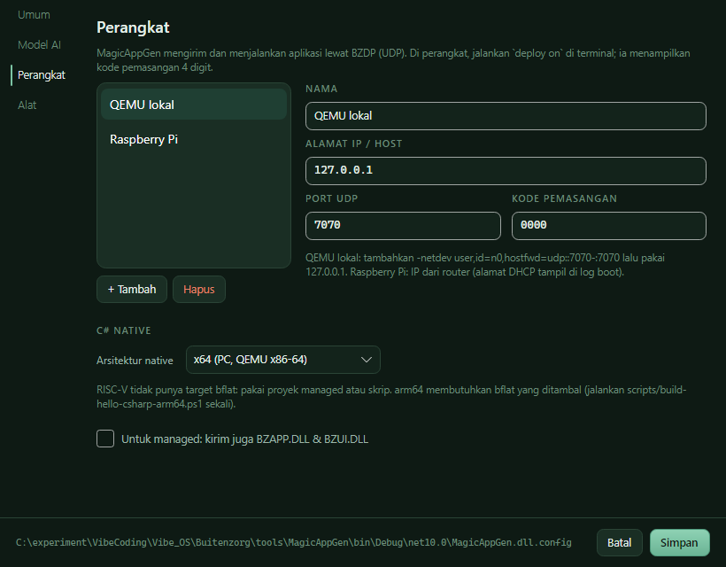

# Magic App Generator (MagicAppGen)

An **Avalonia UI** code editor with an AI assistant — **"Jack - The Code Bender"** —
that writes, builds and **deploys apps for Buitenzorg OS straight to a device over
the network**, using **Microsoft Semantic Kernel**.

Buitenzorg OS is made by **Gravicode Studios**, led by **Kang Fadhil**.

This is a *host-side* developer tool (desktop .NET 10), not a ring-3 Buitenzorg app.



> **Design — "Kebun malam".** The Bogor Botanical Garden after dark, matching the
> OS's own *kebun* theme: canopy greens for the chrome, the OS leaf `#7CC4A4` for
> primary actions and focus, pollen `#E8C35A` for anything live (a connected
> device, a running app, Jack calling a tool) and hibiscus `#E8836B` for errors.
> Inter for the UI, Cascadia/Consolas for code and device data. The one
> signature element is the device **specimen tag** in the Perangkat panel — a
> herbarium label carrying the device's address, pairing code and what it
> answered — above the real *build → deploy → run* sequence drawn as a vine
> (*semai · tanam · tumbuh*). Tokens live in `Styles/AppStyles.axaml`.

## Run

```powershell
cd tools\MagicAppGen
dotnet build
dotnet run
```

## Three kinds of app

| Kind | Built with | On the device | Started by |
| --- | --- | --- | --- |
| **Managed C#** (recommended for UI) | `dotnet build` against `userland/clr-apps/Buitenzorg.App` / `Buitenzorg.UI` | `/disk/NAME.DLL` (RustCLR: GC, LINQ, lambdas…) | `run name` |
| **Native C#** | bflat `--stdlib:zero` + the `bzstart.rs` shim + rust-lld (x64, or arm64 with the patched bflat) | `/disk/NAME.ELF` (no GC, zerolib rules) | `run name` |
| **Script** (Python / TypeScript / JavaScript) | a subset check + copy | `/disk/NAME.PY` / `.TS` / `.JS` | `script py /disk/NAME.PY` |

`NAME` is the 8.3 upper-case device name (a managed project's `<AssemblyName>`).
Builds go to `<project>/out/` and never touch the Buitenzorg checkout. Managed
apps can be tested on the PC first (`Bangun → Uji mandiri di PC`, i.e.
`dotnet NAME.dll --selftest`), because Buitenzorg.App falls back to simulated
files, processes and a simulated Raspberry Pi off the device.

The script check knows the in-kernel interpreter's limits (`kernel/bzkernel/src/script.rs`:
integers, strings, functions, loops — no lists/objects/classes/imports/floats,
braces required after `if`/`while`/`for` in JS/TS, and no apostrophes/colons in
TypeScript comments because annotations are stripped before comments).

## Deploy & run on a device (BZDP)

The **Perangkat** panel (antenna icon on the rail, or the device pill in the top
bar) talks to a Buitenzorg device with the **Buitenzorg Deploy Protocol v1**
over UDP (port 7070): *Sapa* (HELLO), **Bangun, kirim & jalankan** (F5),
separate *Bangun* / *Kirim* / *Henti* (KILL), the live **Konsol perangkat**
(polls LOG), and *Lihat isi /disk* (LIST). On the device run `deploy on` in the
terminal; it shows the pairing code. For QEMU forward the port:
`-netdev user,id=n0,hostfwd=udp::7070-:7070`.

Device profiles (name, host, UDP port, pairing code), the native architecture
(x64 / arm64) and "also send BZAPP.DLL & BZUI.DLL" are in **Alat → Pengaturan →
Perangkat** and in `app.config` (`Device.Profiles`, `Device.Active`,
`Native.Arch`, `Deploy.RuntimeLibraries`).

Protocol client: `Services/BzdpClient.cs` (stop-and-wait, 500 ms × 6 tries,
resend from the device's `next_offset`, CRC-32 on END). A loopback stand-in for
the device side is `Services/FakeBzdpDevice.cs`.

## Headless modes

```powershell
dotnet run -- --list-templates
dotnet run -- --scaffold managed-ui C:\path\to\Catatan Catatan
dotnet run -- --build C:\path\to\Catatan --selftest           # build to out/, run --selftest (managed)
dotnet run -- --deploy C:\path\to\Catatan --host 192.168.1.50 [--port 7070] [--code 1234] [--run] [--args "..."] [--watch 5] [--with-libs]
dotnet run -- --fake-device [--port 7070] [--code 1234] [--drop 0.1]   # a loopback device for testing
dotnet run -- --bzdp-selftest                                 # client vs. fake device (clean, lossy, errors, full flow)
dotnet run -- --llm-test [--keys <file>] [--provider Claude] [--model id]   # one real round trip + tool call per provider
dotnet run -- --generate [--provider P] [--model id] [--keys <file>] <outDir> <prompt...>
dotnet run -- --screenshot docs\shot.png [--scene main|templates|settings|devices] [--size 1280x720]
```

`--keys` reads a loose "Section / key: value" text file **in memory only**
(nothing is saved or printed); environment variables (`ANTHROPIC_API_KEY`,
`ANTHROPIC_WORKSPACE_ID`, `OPENAI_API_KEY`, `AZURE_OPENAI_API_KEY` +
`AZURE_OPENAI_ENDPOINT`, `GEMINI_API_KEY`, `DEEPSEEK_API_KEY`) work too.

## LLM providers (reviewed 2026-11)

| Provider | Default model | Notes |
| --- | --- | --- |
| Claude (Anthropic) | `claude-opus-5-5` | Official `Anthropic` C# SDK → `IChatClient` → SK with kernel-function invocation. Also `claude-sonnet-5-5`, `claude-haiku-5-5`, `claude-fable-5-1`. No `temperature` is sent (these models reject it). Optional *workspace id* for keys not scoped to a workspace. |
| OpenAI | `gpt-5.6-sol` | gpt-5.x reasoning models get no custom temperature. |
| Azure OpenAI | `gpt-5.6-luna` | model = deployment name, endpoint = `https://<resource>.openai.azure.com/`. |
| Gemini | `gemini-3.5-flash` | Google AI key. |
| DeepSeek | `deepseek-v4-flash` | OpenAI-compatible endpoint `https://api.deepseek.com`. |
| Ollama | `qwen3` | local, no key. |

Each provider row in Settings has an **Uji** button for a live round trip.

## Kernel functions (what Jack can actually do)

`Ai/BuitenzorgPlugin.cs`:

| Function | Purpose |
| --- | --- |
| `GetApiReference(library)` | Exact API: native `drawing`/`ui`/`audio`/`bcl`/`syscalls`/`gotchas`, managed `managed`/`managed-ui`/`devices`, `scripts`, `deploy` (`Ai/ManagedApiReference.cs`) |
| `ListTemplates()` / `GetTemplateSource(id)` / `ScaffoldProject(...)` | The starter catalog |
| `WriteFile` / `ReadFile` | Project file I/O |
| `BuildProject(dir)` | Build any kind; managed also runs `--selftest` on the host |
| `CompileCheck(cs)` / `DeployApp(cs)` | Native-only bflat check / embed as `USERAPP.ELF` |
| `DeployToDevice(dir, run, args)` / `ReadDeviceLog()` / `StopDeviceApp(pid)` / `ListDeviceFiles(path)` | BZDP to the active device |
| `BuildApp()` / `RunApp()` | `scripts/build.ps1` / `scripts/smoke-test.ps1` |

`Ai/CommonPlugin.cs`: `SearchInternet` (Tavily), `ScrapeWebPage`, `MathCalculation`, `CheckDateTime`.

## Templates

| Id | Kind | What you get |
| --- | --- | --- |
| `managed-ui` | Managed | Buitenzorg.UI window: counter button + live system info, `--selftest` |
| `managed-console` | Managed | Files, processes, system info via Buitenzorg.App + LINQ, `--selftest` |
| `managed-gpio` | Managed | Raspberry Pi: board sensors, ACT LED, GPIO 17, I2C scan (simulated on the PC) |
| `console`, `desktop-ui`, `drawing`, `game`, `audio` | Native | The bflat `--stdlib:zero` starters |
| `python`, `ts`, `js` | Script | Programs inside the interpreter subset (verified against `script.rs`) |

## Configuration

Everything lives in **`app.config`** and is editable from **Alat → Pengaturan**
(tabs Umum, Model AI, Perangkat, Alat), which writes the deployed
`bin/<config>/net10.0/MagicAppGen.dll.config`. API keys are never committed;
`Buitenzorg.Root` empty means "find the checkout from MagicAppGen's folder".

## Screenshots

| | |
| --- | --- |
| Main window (1280×720) |  |
| New project |  |
| Settings → Model AI |  |
| Settings → Perangkat |  |

All rendered with `--screenshot` (Avalonia headless + Skia).
